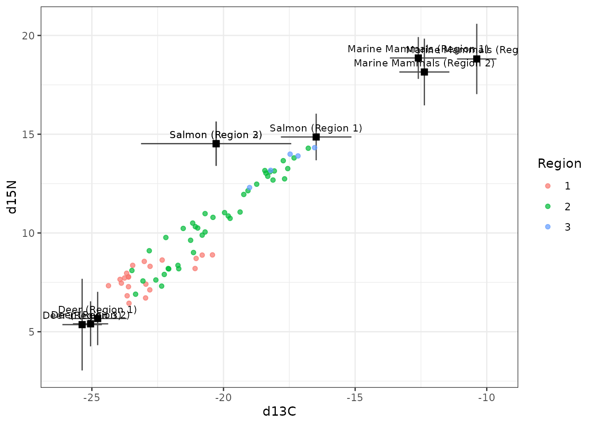

# Get started: fitting your own data

MixSIARPFN fits MixSIAR’s stable isotope mixing models from three CSV
files, with the same function calls as MixSIAR. This page shows how to
install it, what happens the first time you use it, what the three files
look like, and how to fit your own data.

## Installing

``` r
# install.packages("remotes")
remotes::install_github("andrewcparnell/MixSIARPFN")
```

## The first time you fit a model

MixSIARPFN’s networks run in Python, but you do not need to install or
know any Python. **The first fit in a new installation sets everything
up, once:**

1.  **A small private Python environment.** The `reticulate` package
    downloads numpy, pandas and ONNX Runtime (about 180 MB; and Python
    itself, if your computer has no suitable version) into its own
    cache. Your other Python installations are not touched.
2.  **The network for your model’s error structure** (about 70 MB each;
    there are three: Residual \* Process, Residual only and Process
    only), downloaded from Zenodo
    ([doi:10.5281/zenodo.24002247](https://doi.org/10.5281/zenodo.24002247))
    and checked by its checksum.

On a fast connection this takes about half a minute; on a slow one, a
few minutes. You will see messages while it happens. Both are kept, so
later fits take about a second, and the first fit in each new R session
a few seconds (to start Python). You can download all three networks in
advance, and see where they are kept:

``` r
pfn_networks(download = TRUE)
```

## The three input files

MixSIARPFN reads exactly the same files as MixSIAR. The package includes
MixSIAR’s example data, and looking at those is the quickest way to see
the format. They are in the package’s `extdata` folder:

``` r
x <- system.file("extdata", package = "MixSIARPFN")
list.files(x, pattern = "csv$")
#>  [1] "alligator_1_mixsiar_summary.csv"     "alligator_2_mixsiar_summary.csv"    
#>  [3] "alligator_3_mixsiar_summary.csv"     "alligator_4_mixsiar_summary.csv"    
#>  [5] "alligator_5_mixsiar_summary.csv"     "alligator_6_mixsiar_summary.csv"    
#>  [7] "alligator_7_mixsiar_summary.csv"     "alligator_8_mixsiar_summary.csv"    
#>  [9] "alligator_consumer.csv"              "alligator_sources_simplemean.csv"   
#> [11] "alligator_TEF.csv"                   "geese_consumer.csv"                 
#> [13] "geese_discrimination.csv"            "geese_mixsiar_summary.csv"          
#> [15] "geese_sources.csv"                   "killerwhale_consumer.csv"           
#> [17] "killerwhale_discrimination.csv"      "killerwhale_mixsiar_summary.csv"    
#> [19] "killerwhale_sources.csv"             "lake_consumer.csv"                  
#> [21] "lake_discrimination.csv"             "lake_mixsiar_summary.csv"           
#> [23] "lake_raw_mixsiar_summary.csv"        "lake_sources.csv"                   
#> [25] "mantis_consumer.csv"                 "mantis_discrimination.csv"          
#> [27] "mantis_mixsiar_summary.csv"          "mantis_source.csv"                  
#> [29] "palmyra_consumer.csv"                "palmyra_discrimination.csv"         
#> [31] "palmyra_mixsiar_summary.csv"         "palmyra_raw_mixsiar_summary.csv"    
#> [33] "palmyra_sources.csv"                 "snail_consumer.csv"                 
#> [35] "snail_discrimination.csv"            "snail_mixsiar_summary.csv"          
#> [37] "snail_raw_mixsiar_summary.csv"       "snail_sources.csv"                  
#> [39] "stormpetrel_consumer.csv"            "stormpetrel_discrimination.csv"     
#> [41] "stormpetrel_mixsiar_summary.csv"     "stormpetrel_raw_mixsiar_summary.csv"
#> [43] "stormpetrel_sources.csv"             "wolves_consumer.csv"                
#> [45] "wolves_discrimination.csv"           "wolves_mixsiar_summary.csv"         
#> [47] "wolves_sources.csv"
```

### 1. Consumers (the mixture)

One row per consumer: one column per tracer, plus a column for each
grouping factor or continuous covariate you want in the model. Column
names are up to you; you tell the loader which are which. The wolves
data, with two factors:

``` r
head(read.csv(file.path(x, "wolves_consumer.csv")))
#>     d13C d15N Region Pack
#> 1 -23.68 7.96      1    1
#> 2 -23.61 7.78      1    1
#> 3 -23.76 7.72      1    1
#> 4 -23.61 7.77      1    1
#> 5 -24.37 7.33      1    1
#> 6 -23.93 7.65      1    1
```

A continuous covariate is just a numeric column (lake example). R turns
characters such as `:` in column names into `.`, so `Secchi:Mixed` is
used as `Secchi.Mixed`:

``` r
head(read.csv(file.path(x, "lake_consumer.csv")))
#>        d13C     d15N Secchi.Mixed
#> 1 -31.05700 5.849985    1.4889850
#> 2 -31.35207 4.797388    0.2809651
#> 3 -30.92511 4.544643    1.1443028
#> 4 -31.96164 1.459529    0.9223282
#> 5 -29.43504 3.224154    3.3465906
#> 6 -30.46537 4.288768    3.5301051
```

### 2. Sources

Either **summary statistics** or **raw samples**.

*Summary statistics* (`data_type = "means"`): one row per source, with
the source names in the first column, then `Mean<tracer>` and
`SD<tracer>` for every tracer and the sample size `n`. The tracer names
must match the consumer file’s (`Meand13C` for `d13C`):

``` r
read.csv(file.path(x, "killerwhale_sources.csv"))
#>           X  Meand13C    SDd13C Meand15N SDd15N   n
#> 1      Chum -19.24000 0.4600000    12.19  0.295   5
#> 2   Sockeye -20.84000 0.1650000    10.41  0.247   5
#> 3 Steelhead -20.57000 0.3930000    11.81  0.381  45
#> 4      Coho -17.66000 0.3510000    13.94  0.410   7
#> 5   Chinook -17.06311 0.3461539    14.95  0.220 115
```

With concentration dependence, add `Conc<tracer>` columns (geese
example):

``` r
read.csv(file.path(x, "geese_sources.csv"))
#>        Sources  Meand15N    SDd15N  Meand13C    SDd13C Concd15N Concd13C  n
#> 1      Zostera  6.488984 1.4594632 -11.17023 1.2149562   0.0297   0.3593 14
#> 2        Grass  4.432160 2.2680709 -30.87984 0.6413182   0.0355   0.4026 14
#> 3    U.lactuca 11.192613 1.1124385 -11.17090 1.9593306   0.0192   0.2098 14
#> 4 Enteromorpha  9.816280 0.8271039 -14.05701 1.1724677   0.0139   0.1844 14
```

If the sources were measured separately in each level of a factor (say
each region), add that factor’s column, with one row per source and
level (wolves example; the factor must also be in the consumer file):

``` r
read.csv(file.path(x, "wolves_sources.csv"))
#>                X Region Meand13C SDd13C Meand15N SDd15N  n
#> 1           Deer      1   -26.88   1.10     3.07   1.35 24
#> 2           Deer      2   -27.15   0.67     2.80   1.14 37
#> 3           Deer      3   -27.47   0.75     2.76   2.32  9
#> 4         Salmon      1   -18.58   1.34    12.26   1.18  6
#> 5         Salmon      2   -22.38   2.85    11.92   1.12  5
#> 6         Salmon      3   -22.38   2.85    11.92   1.12  5
#> 7 Marine Mammals      1   -14.70   1.08    16.26   1.06  7
#> 8 Marine Mammals      2   -14.47   0.95    15.55   1.69  6
#> 9 Marine Mammals      3   -12.48   0.75    16.21   1.78  6
```

*Raw samples* (`data_type = "raw"`): one row per sample, with the source
name in the first column and one column per tracer (Palmyra example).
MixSIARPFN summarises them to each source’s mean, SD and sample size:

``` r
head(read.csv(file.path(x, "palmyra_sources.csv")))
#>      X      d13C     d15N
#> 1 Reef -15.08397 15.47462
#> 2 Reef -15.02601 14.95905
#> 3 Reef -11.03147 13.70018
#> 4 Reef -15.17098 15.18441
#> 5 Reef -15.22725 15.33783
#> 6 Reef -15.34722 15.67877
```

### 3. Discrimination (trophic enrichment)

One row per source, with the same source names: `Mean<tracer>` and
`SD<tracer>` for every tracer.

``` r
read.csv(file.path(x, "killerwhale_discrimination.csv"))
#>      Source Meand13C SDd13C Meand15N SDd15N
#> 1      Chum     2.35   0.35     2.58   0.26
#> 2   Sockeye     2.35   0.35     2.58   0.26
#> 3 Steelhead     2.35   0.35     2.58   0.26
#> 4      Coho     2.35   0.35     2.58   0.26
#> 5   Chinook     2.35   0.35     2.58   0.26
```

### Starting your own files from an example

The simplest way to get the format right is to copy an example and
replace the numbers:

``` r
file.copy(file.path(x, c("wolves_consumer.csv", "wolves_sources.csv",
                         "wolves_discrimination.csv")), ".")
```

## Fitting your own data

Load the three files, fit, and summarise. With your own files, give
their paths, for example `filename = "my_consumers.csv"`. Here, the
wolves example: two random effects, pack nested in region, and sources
measured in each region.

``` r
mix <- load_mix_data(filename = file.path(x, "wolves_consumer.csv"),
                     iso_names = c("d13C", "d15N"),     # the tracer columns
                     factors = c("Region", "Pack"),     # grouping factors (or NULL)
                     fac_random = c(TRUE, TRUE),        # random (TRUE) or fixed (FALSE)
                     fac_nested = c(FALSE, TRUE),       # Pack is nested in Region
                     cont_effects = NULL)               # a continuous covariate (or NULL)
source <- load_source_data(filename = file.path(x, "wolves_sources.csv"),
                           source_factors = "Region",   # sources given by region (or NULL)
                           conc_dep = FALSE,            # concentration dependence?
                           data_type = "means",         # "means" or "raw"
                           mix)
discr <- load_discr_data(filename = file.path(x, "wolves_discrimination.csv"), mix)
```

Look at the data before fitting:

``` r
plot_data(mix = mix, source = source, discr = discr)
```



Then fit, in place of MixSIAR’s `write_JAGS_model()` and `run_model()`:

``` r
fit <- run_pfn(mix, source, discr,
               alpha.prior = 1,                       # MixSIAR's uninformative prior
               resid_err = TRUE, process_err = TRUE)  # Residual * Process error
fit
#> MixSIARPFN fit (Residual * Process error), 3 sources, in 0.5 s
#> Marginal posteriors (no joint draws). Global diet:
#>          source  mean    sd  2.5% 97.5%
#>            Deer 0.463 0.197 0.089 0.829
#>  Marine Mammals 0.193 0.151 0.012 0.585
#>          Salmon 0.332 0.197 0.035 0.770
#> Use output_pfn() for every proportion and parameter.
```

[`output_pfn()`](https://andrewcparnell.github.io/MixSIARPFN/reference/output_pfn.md)
replaces MixSIAR’s `output_JAGS()`: it writes the summary statistics and
plots the posteriors.
[`summary_table()`](https://andrewcparnell.github.io/MixSIARPFN/reference/summary_table.md)
gives the summary as a data frame:

``` r
knitr::kable(head(round(summary_table(fit), 3), 8))
```

|                         |  Mean |    SD |  2.5% |    5% |   25% |   50% |   75% |   95% | 97.5% |
|:------------------------|------:|------:|------:|------:|------:|------:|------:|------:|------:|
| Epsilon.1               | 0.910 | 0.494 | 0.291 | 0.347 | 0.582 | 0.815 | 1.128 | 1.776 | 2.067 |
| Epsilon.2               | 0.536 | 0.285 | 0.218 | 0.249 | 0.367 | 0.483 | 0.642 | 0.986 | 1.143 |
| Region.SD               | 1.981 | 2.181 | 0.116 | 0.213 | 0.771 | 1.380 | 2.357 | 5.775 | 8.104 |
| Pack.SD                 | 0.950 | 0.738 | 0.349 | 0.397 | 0.588 | 0.788 | 1.095 | 1.939 | 2.442 |
| p.global.Deer           | 0.463 | 0.197 | 0.089 | 0.132 | 0.317 | 0.467 | 0.610 | 0.782 | 0.829 |
| p.global.Marine Mammals | 0.193 | 0.151 | 0.012 | 0.021 | 0.080 | 0.156 | 0.267 | 0.497 | 0.585 |
| p.global.Salmon         | 0.332 | 0.197 | 0.035 | 0.057 | 0.178 | 0.305 | 0.461 | 0.700 | 0.770 |
| p.Region 1.Deer         | 0.756 | 0.154 | 0.321 | 0.447 | 0.699 | 0.789 | 0.856 | 0.934 | 0.955 |

Your files are checked as MixSIAR checks them. If something is wrong,
the loaders (for example a misspelt column name) or
[`run_pfn()`](https://andrewcparnell.github.io/MixSIARPFN/reference/run_pfn.md)
(for example a source missing from the discrimination file: “No
discrimination values for sources: Sockeye”) stop with a message saying
what to fix.
[`run_pfn()`](https://andrewcparnell.github.io/MixSIARPFN/reference/run_pfn.md)
also refuses data outside what the networks were trained for (for
example more than 8 sources or 4 tracers), saying why.

## Where next

- The **Examples** menu goes through each of MixSIAR’s nine isotope
  examples, each compared with MixSIAR’s own fit.
- The **Accuracy** menu has *How MixSIARPFN works and how well it does*,
  which explains the method and tests it, and *MixSIARPFN on every
  simulated dataset*, which gives every comparison with MixSIAR.
- Each function’s help page (Reference) lists all its arguments.
