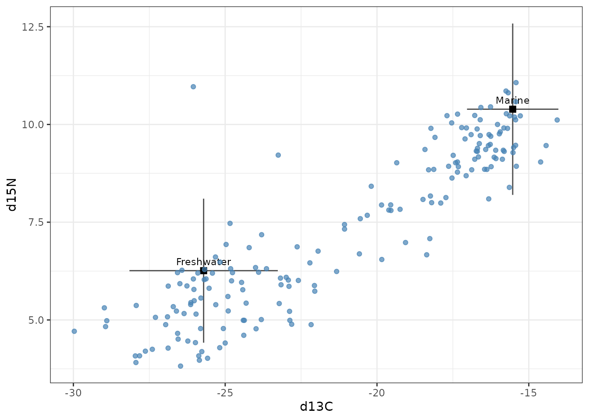
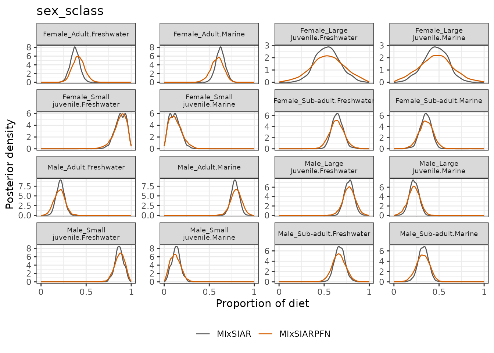
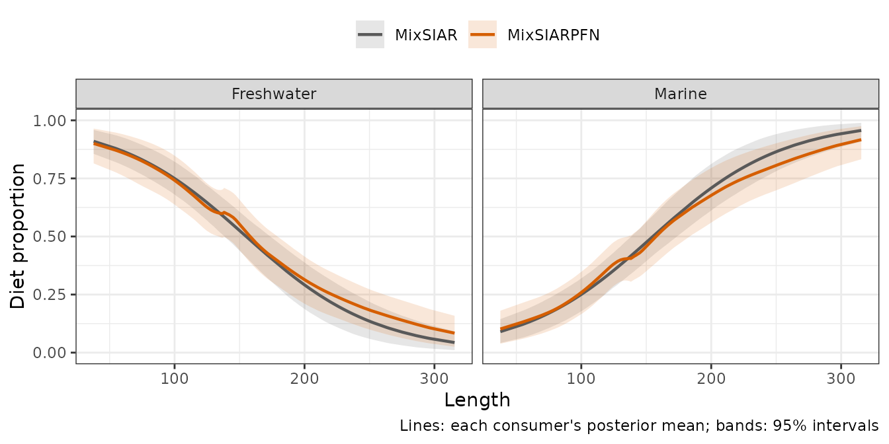
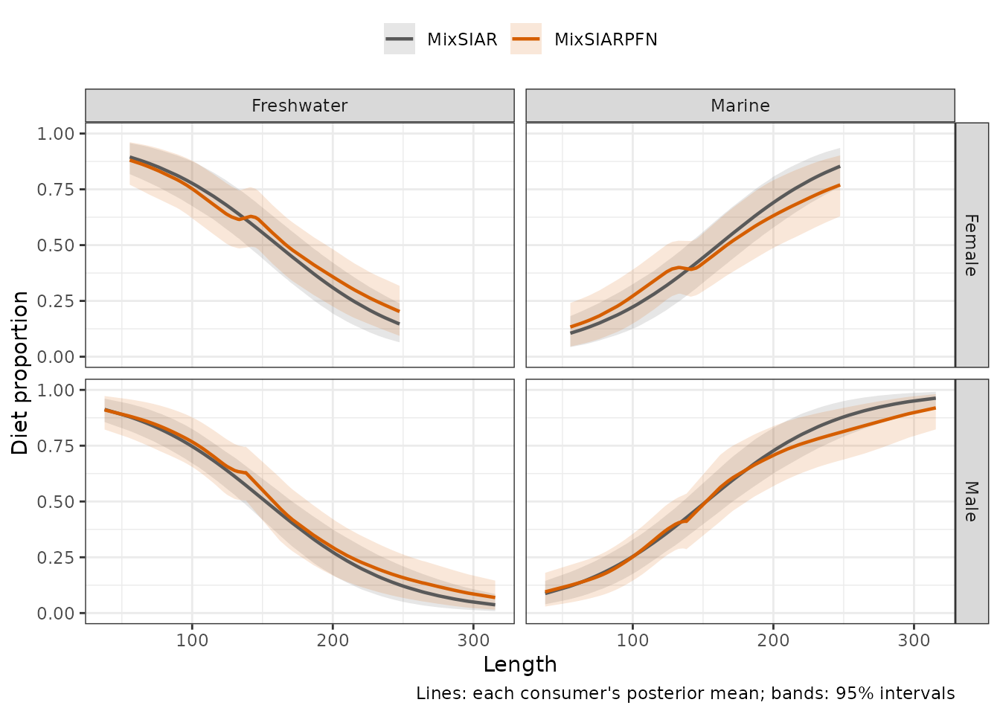

# Alligator: eight models in a few seconds

This follows MixSIAR’s alligator example script
(`mixsiar_script_alligator.R`), based on Nifong et al. (2015, *Journal
of Animal Ecology*, <doi:10.1111/1365-2656.12306>): American alligators,
two tracers (δ¹³C and δ¹⁵N) and two sources, marine and freshwater prey.
MixSIAR’s script fits **eight** models, to ask which of habitat, sex,
size class and body length explain how much each alligator relies on
marine prey. With MixSIAR each model is a separate MCMC run; with
MixSIARPFN all eight take a few seconds, which is what this example
shows.

## The data and the eight models

``` r
models <- list(
  "1: null"                   = list(factors = NULL, cont = NULL),
  "2: habitat"                = list(factors = "habitat", cont = NULL),
  "3: sex"                    = list(factors = "sex", cont = NULL),
  "4: size class"             = list(factors = "sclass", cont = NULL),
  "5: length"                 = list(factors = NULL, cont = "Length"),
  "6: sex + size class"       = list(factors = c("sex", "sclass"), cont = NULL),
  "7: sex + length"           = list(factors = "sex", cont = "Length"),
  "8: sex x size class"       = list(factors = "sex_sclass", cont = NULL))
x <- system.file("extdata", package = "MixSIARPFN")
load_model <- function(m) {
  nf <- length(m$factors)
  mix <- load_mix_data(file.path(x, "alligator_consumer.csv"), iso_names = c("d13C", "d15N"),
                       factors = m$factors, fac_random = rep(FALSE, nf),
                       fac_nested = rep(FALSE, nf), cont_effects = m$cont)
  source <- load_source_data(file.path(x, "alligator_sources_simplemean.csv"),
                             source_factors = NULL, conc_dep = FALSE, data_type = "means", mix)
  discr <- load_discr_data(file.path(x, "alligator_TEF.csv"), mix)
  list(mix = mix, source = source, discr = discr)
}
data <- lapply(models, load_model)
```

There are 181 alligators. All models use Residual \* Process error and
MixSIAR’s uninformative prior, as in MixSIAR’s script; the effects are
fixed.

``` r
plot_data(mix = data[[1]]$mix, source = data[[1]]$source, discr = data[[1]]$discr)
```



## Fitting all eight models

``` r
time <- system.time(
  fits <- lapply(data, function(d) run_pfn(d$mix, d$source, d$discr, alpha.prior = 1,
                                           resid_err = TRUE, process_err = TRUE))
)
```

All eight models took 5.2 seconds together (the first includes starting
Python and loading the network).

MixSIAR’s script compares the models by leave-one-out cross-validation
(LOO), which needs the likelihood at each posterior draw. MixSIARPFN
gives marginal posteriors only, so it cannot compute LOO; what it makes
quick is looking at every model’s posteriors.

## How each model compares with MixSIAR

``` r
refs <- lapply(seq_along(models), function(i) mixsiar_reference(paste0("alligator_", i)))
rows <- lapply(seq_along(models), function(i) {
  cmp <- compare_mixsiar(fits[[i]], refs[[i]]$draws, refs[[i]]$summary)
  diet <- cmp[!is.na(cmp$w1), ]
  data.frame(model = names(models)[i], diets = nrow(diet),
             mean_gap = mean(abs(diet$pfn_mean - diet$mixsiar_mean)),
             w1 = mean(diet$w1), sd_ratio = median(diet$sd_ratio),
             pfn_seconds = fits[[i]]$seconds, mixsiar_minutes = refs[[i]]$info$minutes,
             psrf = refs[[i]]$info$max_psrf)
})
tab <- do.call(rbind, rows)
knitr::kable(tab, digits = c(0, 0, 3, 3, 2, 2, 0, 3), row.names = FALSE,
             col.names = c("Model", "Diet proportions compared", "Mean difference in means",
                           "Mean W1", "Median SD ratio", "MixSIARPFN seconds",
                           "MixSIAR minutes", "MixSIAR largest PSRF"))
```

| Model | Diet proportions compared | Mean difference in means | Mean W1 | Median SD ratio | MixSIARPFN seconds | MixSIAR minutes | MixSIAR largest PSRF |
|:---|---:|---:|---:|---:|---:|---:|---:|
| 1: null | 2 | 0.003 | 0.008 | 1.25 | 0.33 | 68 | 1.002 |
| 2: habitat | 8 | 0.011 | 0.013 | 1.23 | 0.55 | 76 | 1.002 |
| 3: sex | 6 | 0.006 | 0.011 | 1.24 | 0.49 | 73 | 1.004 |
| 4: size class | 10 | 0.009 | 0.014 | 1.28 | 0.55 | 71 | 1.003 |
| 5: length | 2 | 0.018 | 0.019 | 1.29 | 0.26 | 86 | 1.004 |
| 6: sex + size class | 2 | 0.045 | 0.046 | 1.35 | 0.57 | 84 | 1.004 |
| 7: sex + length | 6 | 0.021 | 0.023 | 1.18 | 1.87 | 91 | 1.002 |
| 8: sex x size class | 18 | 0.014 | 0.022 | 1.32 | 0.51 | 77 | 1.002 |

Each row compares MixSIARPFN’s diet posteriors with MixSIAR’s for one
model (MixSIAR’s “long” run, three chains). For models with a continuous
effect, the diets compared are the global diet at the average length;
the curves along length are compared below. In total, MixSIAR took 628
minutes of computing for the eight models; MixSIARPFN took 5.1 seconds.

## A closer look

The model with the interaction of sex and size class (model 8):

``` r
plot_compare(fits[[8]], refs[[8]]$draws, block = "sex_sclass")
```



Diet along body length (model 5), each alligator’s posterior from both
methods:

``` r
plot_compare_covariate(fits[[5]], refs[[5]]$pind)
```



And along length separately for each sex (model 7):

``` r
plot_compare_covariate(fits[[7]], refs[[7]]$pind, by = "sex")
```



**What this shows.** Across all eight models, MixSIARPFN’s posterior
means differ from MixSIAR’s by 0.016 on average, and along body length
each alligator’s posterior mean diet differs by 0.018 (model 5) and
0.026 (model 7). MixSIARPFN’s posteriors are wider here than in the
other examples (median SD ratio 1.18 to 1.35): with only two sources and
a lot of data, MixSIAR’s posteriors are tight, and the network stays a
little more cautious. For model 6, MixSIAR saved only the global diet
(it does not report per-level diets for two fixed effects), so only that
is compared.
