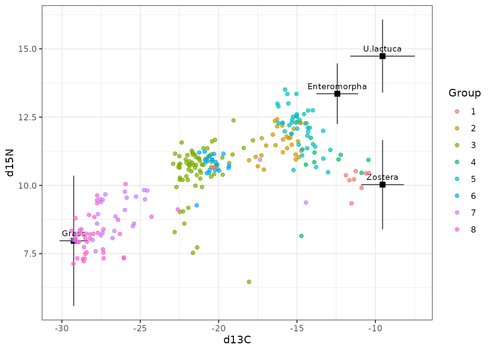
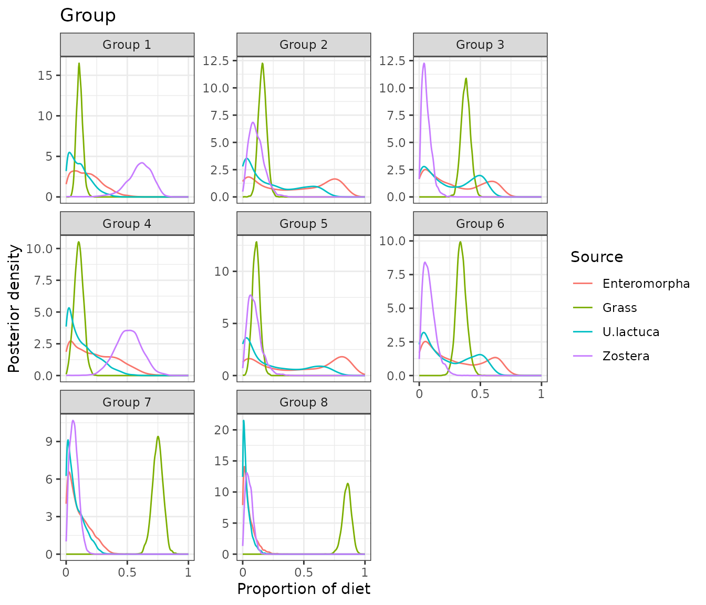
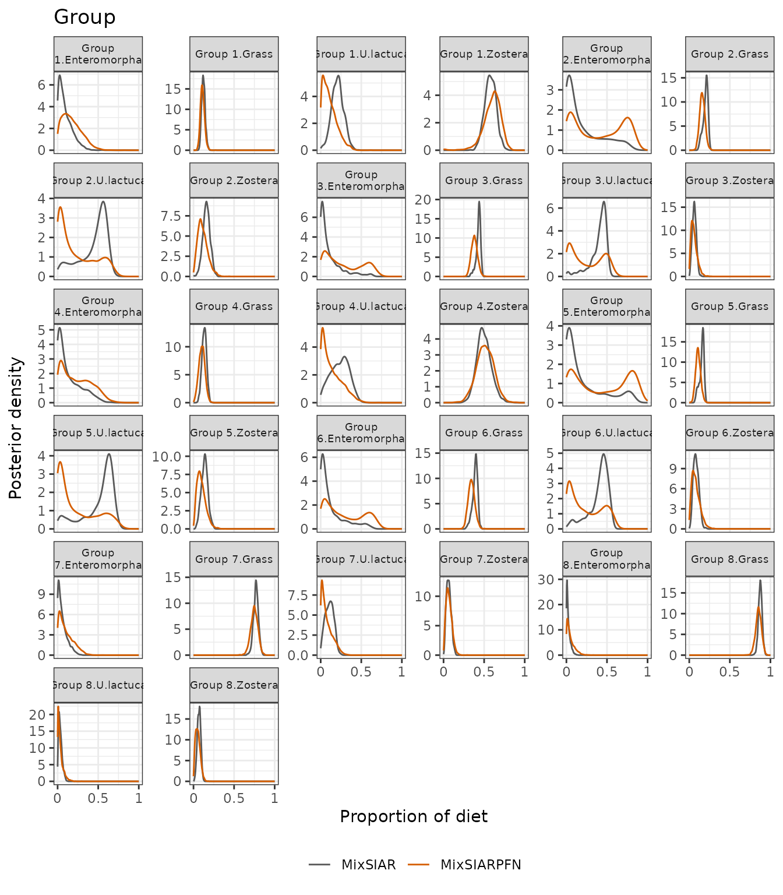
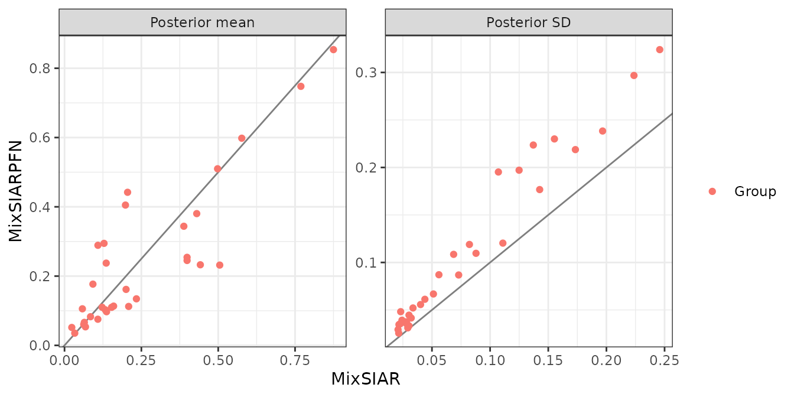
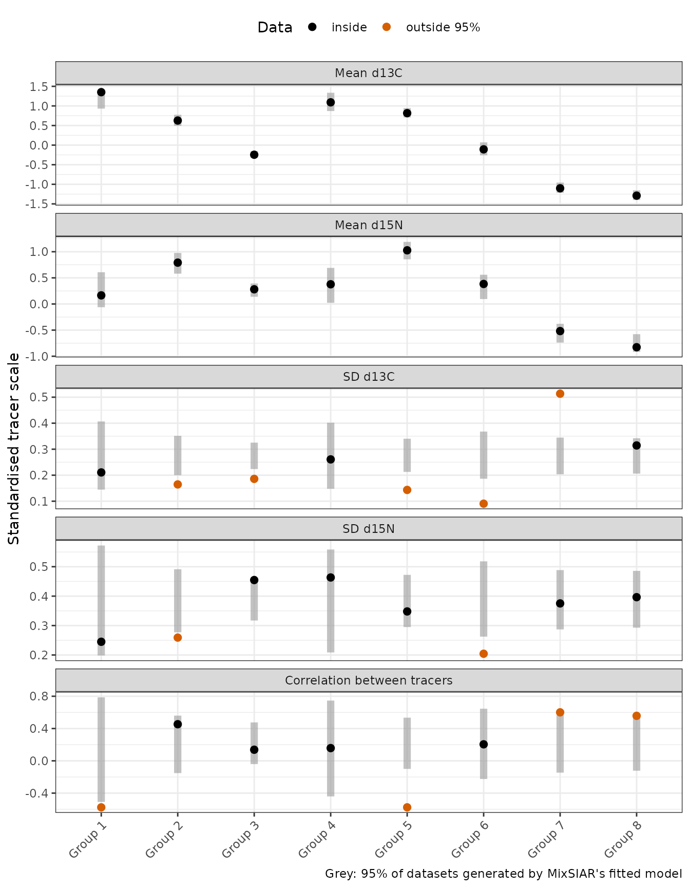

# Geese: a fixed effect and concentration dependence

This follows MixSIAR’s geese example (Inger et al. 2006 data, as
analysed in Stock et al. 2018): 251 geese in 8 groups, two tracers (δ¹³C
and δ¹⁵N) and four food sources (grass and three algae: Enteromorpha,
*Ulva lactuca* and *Zostera*). Group is a fixed effect, the sources’
elemental concentrations differ (concentration dependence), and the
error structure is Residual only. Only the fitting call differs from
MixSIAR’s vignette:
[`run_pfn()`](https://andrewcparnell.github.io/MixSIARPFN/reference/run_pfn.md)
in place of `write_JAGS_model()` and `run_model()`.

## The data

``` r
mix <- load_mix_data(
  filename = system.file("extdata", "geese_consumer.csv", package = "MixSIARPFN"),
  iso_names = c("d13C", "d15N"), factors = "Group", fac_random = FALSE,
  fac_nested = FALSE, cont_effects = NULL)
source <- load_source_data(
  filename = system.file("extdata", "geese_sources.csv", package = "MixSIARPFN"),
  source_factors = NULL, conc_dep = TRUE, data_type = "means", mix)
discr <- load_discr_data(
  filename = system.file("extdata", "geese_discrimination.csv", package = "MixSIARPFN"),
  mix)
mix
#> Consumer data: 251 consumers, 2 tracer(s): d13C, d15N 
#>    Fixed effect Group with 8 levels
source
#> Source data: 4 sources: Enteromorpha, Grass, U.lactuca, Zostera 
#>   With concentration dependence
```

The isospace plot shows the geese, coloured by group, and the source
means after discrimination, with ±1 SD. With four sources and two
tracers the data cannot pin down every proportion (that needs at most
one more source than tracers), so some of the diet is set by the prior
and the sources’ spread:

``` r
plot_data(mix = mix, source = source, discr = discr)
```



## Fitting the model

As in MixSIAR’s vignette, Residual only error (`process_err = FALSE`)
and the uninformative prior:

``` r
time <- system.time(
  fit <- run_pfn(mix, source, discr, alpha.prior = 1,
                 resid_err = TRUE, process_err = FALSE)
)
fit
#> MixSIARPFN fit (Residual only error), 4 sources, in 0.7 s
#> Marginal posteriors (no joint draws). Global diet:
#>        source  mean    sd  2.5% 97.5%
#>  Enteromorpha 0.176 0.119 0.008 0.440
#>         Grass 0.112 0.026 0.066 0.166
#>     U.lactuca 0.111 0.086 0.004 0.316
#>       Zostera 0.595 0.106 0.356 0.763
#> Use output_pfn() for every proportion and parameter.
```

The fit took 0.8 seconds.

## Results

``` r
out <- output_pfn(fit, mix, source,
                  output_options = list(summary_save = FALSE, plot_post_save_pdf = FALSE))
```

``` r
knitr::kable(round(summary_table(fit), 3))
```

|                        |  Mean |    SD |  2.5% |    5% |   25% |   50% |   75% |   95% | 97.5% |
|:-----------------------|------:|------:|------:|------:|------:|------:|------:|------:|------:|
| p.global.Enteromorpha  | 0.176 | 0.119 | 0.008 | 0.016 | 0.079 | 0.159 | 0.254 | 0.396 | 0.440 |
| p.global.Grass         | 0.112 | 0.026 | 0.066 | 0.072 | 0.094 | 0.110 | 0.128 | 0.156 | 0.166 |
| p.global.U.lactuca     | 0.111 | 0.086 | 0.004 | 0.007 | 0.041 | 0.093 | 0.162 | 0.277 | 0.316 |
| p.global.Zostera       | 0.595 | 0.106 | 0.356 | 0.412 | 0.537 | 0.606 | 0.668 | 0.742 | 0.763 |
| p.Group 1.Enteromorpha | 0.177 | 0.119 | 0.008 | 0.016 | 0.081 | 0.160 | 0.255 | 0.396 | 0.441 |
| p.Group 1.Grass        | 0.110 | 0.026 | 0.064 | 0.071 | 0.092 | 0.109 | 0.126 | 0.154 | 0.164 |
| p.Group 1.U.lactuca    | 0.112 | 0.087 | 0.004 | 0.008 | 0.042 | 0.094 | 0.164 | 0.279 | 0.318 |
| p.Group 1.Zostera      | 0.598 | 0.109 | 0.353 | 0.412 | 0.540 | 0.610 | 0.673 | 0.746 | 0.768 |
| p.Group 2.Enteromorpha | 0.405 | 0.297 | 0.004 | 0.010 | 0.099 | 0.405 | 0.705 | 0.819 | 0.839 |
| p.Group 2.Grass        | 0.162 | 0.033 | 0.098 | 0.109 | 0.139 | 0.161 | 0.184 | 0.217 | 0.229 |
| p.Group 2.U.lactuca    | 0.233 | 0.219 | 0.002 | 0.005 | 0.040 | 0.151 | 0.411 | 0.639 | 0.673 |
| p.Group 2.Zostera      | 0.113 | 0.061 | 0.022 | 0.030 | 0.068 | 0.105 | 0.149 | 0.227 | 0.255 |
| p.Group 3.Enteromorpha | 0.289 | 0.224 | 0.007 | 0.014 | 0.083 | 0.232 | 0.512 | 0.652 | 0.676 |
| p.Group 3.Grass        | 0.380 | 0.037 | 0.310 | 0.321 | 0.355 | 0.380 | 0.405 | 0.443 | 0.456 |
| p.Group 3.U.lactuca    | 0.254 | 0.195 | 0.004 | 0.008 | 0.064 | 0.218 | 0.450 | 0.551 | 0.573 |
| p.Group 3.Zostera      | 0.060 | 0.039 | 0.009 | 0.013 | 0.031 | 0.052 | 0.081 | 0.136 | 0.157 |
| p.Group 4.Enteromorpha | 0.238 | 0.177 | 0.005 | 0.011 | 0.077 | 0.213 | 0.374 | 0.550 | 0.596 |
| p.Group 4.Grass        | 0.103 | 0.037 | 0.030 | 0.041 | 0.077 | 0.103 | 0.128 | 0.164 | 0.177 |
| p.Group 4.U.lactuca    | 0.134 | 0.120 | 0.002 | 0.004 | 0.033 | 0.100 | 0.211 | 0.371 | 0.418 |
| p.Group 4.Zostera      | 0.510 | 0.110 | 0.295 | 0.331 | 0.437 | 0.510 | 0.584 | 0.688 | 0.722 |
| p.Group 5.Enteromorpha | 0.442 | 0.324 | 0.004 | 0.009 | 0.104 | 0.453 | 0.773 | 0.875 | 0.893 |
| p.Group 5.Grass        | 0.110 | 0.031 | 0.052 | 0.061 | 0.089 | 0.109 | 0.130 | 0.163 | 0.174 |
| p.Group 5.U.lactuca    | 0.232 | 0.238 | 0.001 | 0.003 | 0.030 | 0.125 | 0.414 | 0.691 | 0.728 |
| p.Group 5.Zostera      | 0.097 | 0.056 | 0.017 | 0.024 | 0.055 | 0.088 | 0.129 | 0.202 | 0.228 |
| p.Group 6.Enteromorpha | 0.295 | 0.230 | 0.007 | 0.013 | 0.080 | 0.240 | 0.518 | 0.671 | 0.698 |
| p.Group 6.Grass        | 0.344 | 0.042 | 0.266 | 0.278 | 0.316 | 0.342 | 0.371 | 0.414 | 0.429 |
| p.Group 6.U.lactuca    | 0.245 | 0.197 | 0.004 | 0.008 | 0.058 | 0.196 | 0.438 | 0.564 | 0.589 |
| p.Group 6.Zostera      | 0.083 | 0.052 | 0.012 | 0.017 | 0.044 | 0.073 | 0.112 | 0.183 | 0.208 |
| p.Group 7.Enteromorpha | 0.106 | 0.087 | 0.003 | 0.006 | 0.033 | 0.083 | 0.162 | 0.275 | 0.307 |
| p.Group 7.Grass        | 0.748 | 0.045 | 0.657 | 0.673 | 0.719 | 0.749 | 0.778 | 0.819 | 0.833 |
| p.Group 7.U.lactuca    | 0.075 | 0.067 | 0.002 | 0.003 | 0.021 | 0.056 | 0.116 | 0.209 | 0.236 |
| p.Group 7.Zostera      | 0.066 | 0.036 | 0.011 | 0.016 | 0.039 | 0.062 | 0.089 | 0.131 | 0.146 |
| p.Group 8.Enteromorpha | 0.052 | 0.048 | 0.002 | 0.003 | 0.016 | 0.037 | 0.073 | 0.151 | 0.179 |
| p.Group 8.Grass        | 0.854 | 0.035 | 0.780 | 0.794 | 0.831 | 0.855 | 0.878 | 0.909 | 0.919 |
| p.Group 8.U.lactuca    | 0.035 | 0.035 | 0.001 | 0.002 | 0.010 | 0.024 | 0.050 | 0.106 | 0.128 |
| p.Group 8.Zostera      | 0.054 | 0.029 | 0.009 | 0.012 | 0.031 | 0.050 | 0.072 | 0.107 | 0.118 |

With a fixed effect, MixSIAR’s global diet is the diet of the first
group, so the plots below show the eight groups:

``` r
out$plots$Group
```



Each is a **marginal** posterior: the network does not give joint draws,
so the marginal means of one group’s diet need not sum to exactly 1, and
sums or ratios of proportions cannot be computed from the output.

## Comparison with MixSIAR

``` r
ref <- mixsiar_reference("geese")
cmp <- compare_mixsiar(fit, ref$draws, ref$summary)
```

MixSIAR 3.1.12 fitted the same model with 3 chains of 1,000,000
iterations (burn-in 500,000), which took about 2.9 hours (largest
Gelman-Rubin diagnostic 1.004). MixSIARPFN took 0.8 seconds.

Means, SDs, 95% intervals and the Wasserstein-1 distance (W1: how far,
on average, one posterior’s mass has to move to match the other, on the
proportion scale):

``` r
knitr::kable(data.frame(
  quantity = cmp$name,
  `MixSIARPFN mean` = round(cmp$pfn_mean, 3), `MixSIAR mean` = round(cmp$mixsiar_mean, 3),
  `MixSIARPFN SD` = round(cmp$pfn_sd, 3), `MixSIAR SD` = round(cmp$mixsiar_sd, 3),
  `MixSIARPFN 95% CI` = sprintf("%.2f to %.2f", cmp$pfn_q2.5, cmp$pfn_q97.5),
  `MixSIAR 95% CI` = sprintf("%.2f to %.2f", cmp$mixsiar_q2.5, cmp$mixsiar_q97.5),
  W1 = round(cmp$w1, 3), check.names = FALSE))
```

| quantity | MixSIARPFN mean | MixSIAR mean | MixSIARPFN SD | MixSIAR SD | MixSIARPFN 95% CI | MixSIAR 95% CI | W1 |
|:---|---:|---:|---:|---:|:---|:---|---:|
| p.Group 1.Enteromorpha | 0.177 | 0.092 | 0.119 | 0.082 | 0.01 to 0.44 | 0.00 to 0.29 | 0.084 |
| p.Group 1.Grass | 0.110 | 0.122 | 0.026 | 0.021 | 0.06 to 0.16 | 0.08 to 0.17 | 0.012 |
| p.Group 1.U.lactuca | 0.112 | 0.209 | 0.087 | 0.073 | 0.00 to 0.32 | 0.07 to 0.35 | 0.096 |
| p.Group 1.Zostera | 0.598 | 0.577 | 0.109 | 0.069 | 0.35 to 0.77 | 0.44 to 0.71 | 0.038 |
| p.Group 2.Enteromorpha | 0.405 | 0.198 | 0.297 | 0.224 | 0.00 to 0.84 | 0.00 to 0.74 | 0.207 |
| p.Group 2.Grass | 0.162 | 0.200 | 0.033 | 0.030 | 0.10 to 0.23 | 0.13 to 0.24 | 0.039 |
| p.Group 2.U.lactuca | 0.233 | 0.442 | 0.219 | 0.173 | 0.00 to 0.67 | 0.04 to 0.64 | 0.213 |
| p.Group 2.Zostera | 0.113 | 0.160 | 0.061 | 0.044 | 0.02 to 0.25 | 0.07 to 0.24 | 0.048 |
| p.Group 3.Enteromorpha | 0.289 | 0.109 | 0.224 | 0.137 | 0.01 to 0.68 | 0.00 to 0.53 | 0.180 |
| p.Group 3.Grass | 0.380 | 0.430 | 0.037 | 0.027 | 0.31 to 0.46 | 0.36 to 0.47 | 0.050 |
| p.Group 3.U.lactuca | 0.254 | 0.399 | 0.195 | 0.107 | 0.00 to 0.57 | 0.08 to 0.52 | 0.157 |
| p.Group 3.Zostera | 0.060 | 0.063 | 0.039 | 0.024 | 0.01 to 0.16 | 0.02 to 0.11 | 0.013 |
| p.Group 4.Enteromorpha | 0.238 | 0.136 | 0.177 | 0.143 | 0.01 to 0.60 | 0.00 to 0.48 | 0.102 |
| p.Group 4.Grass | 0.103 | 0.133 | 0.037 | 0.028 | 0.03 to 0.18 | 0.08 to 0.19 | 0.030 |
| p.Group 4.U.lactuca | 0.134 | 0.234 | 0.120 | 0.111 | 0.00 to 0.42 | 0.02 to 0.43 | 0.100 |
| p.Group 4.Zostera | 0.510 | 0.498 | 0.110 | 0.088 | 0.30 to 0.72 | 0.34 to 0.68 | 0.023 |
| p.Group 5.Enteromorpha | 0.442 | 0.205 | 0.324 | 0.246 | 0.00 to 0.89 | 0.00 to 0.80 | 0.237 |
| p.Group 5.Grass | 0.110 | 0.153 | 0.031 | 0.029 | 0.05 to 0.17 | 0.09 to 0.19 | 0.043 |
| p.Group 5.U.lactuca | 0.232 | 0.505 | 0.238 | 0.197 | 0.00 to 0.73 | 0.03 to 0.71 | 0.275 |
| p.Group 5.Zostera | 0.097 | 0.137 | 0.056 | 0.040 | 0.02 to 0.23 | 0.06 to 0.22 | 0.041 |
| p.Group 6.Enteromorpha | 0.295 | 0.129 | 0.230 | 0.155 | 0.01 to 0.70 | 0.00 to 0.56 | 0.166 |
| p.Group 6.Grass | 0.344 | 0.388 | 0.042 | 0.032 | 0.27 to 0.43 | 0.31 to 0.44 | 0.044 |
| p.Group 6.U.lactuca | 0.245 | 0.399 | 0.197 | 0.125 | 0.00 to 0.59 | 0.06 to 0.55 | 0.160 |
| p.Group 6.Zostera | 0.083 | 0.085 | 0.052 | 0.034 | 0.01 to 0.21 | 0.03 to 0.15 | 0.015 |
| p.Group 7.Enteromorpha | 0.106 | 0.058 | 0.087 | 0.056 | 0.00 to 0.31 | 0.00 to 0.20 | 0.047 |
| p.Group 7.Grass | 0.748 | 0.769 | 0.045 | 0.030 | 0.66 to 0.83 | 0.71 to 0.83 | 0.022 |
| p.Group 7.U.lactuca | 0.075 | 0.108 | 0.067 | 0.051 | 0.00 to 0.24 | 0.02 to 0.20 | 0.037 |
| p.Group 7.Zostera | 0.066 | 0.064 | 0.036 | 0.028 | 0.01 to 0.15 | 0.02 to 0.13 | 0.006 |
| p.Group 8.Enteromorpha | 0.052 | 0.024 | 0.048 | 0.023 | 0.00 to 0.18 | 0.00 to 0.08 | 0.028 |
| p.Group 8.Grass | 0.854 | 0.875 | 0.035 | 0.023 | 0.78 to 0.92 | 0.83 to 0.92 | 0.021 |
| p.Group 8.U.lactuca | 0.035 | 0.033 | 0.035 | 0.022 | 0.00 to 0.13 | 0.00 to 0.09 | 0.008 |
| p.Group 8.Zostera | 0.054 | 0.068 | 0.029 | 0.021 | 0.01 to 0.12 | 0.03 to 0.11 | 0.016 |

``` r
plot_compare(fit, ref$draws, block = "Group")
```



``` r
plot_compare(fit, ref$draws, type = "means")
```



**What this shows.** Grass, the source the data pin down best, is close
in every group: MixSIARPFN’s means differ from MixSIAR’s by 0.03 on
average, though its posteriors are wider (median SD ratio 1.31). The
three algae trade off against each other, since four sources cannot all
be determined from two tracers, and there the two fits differ more: mean
difference 0.09, median SD ratio 1.40, and the largest difference is
Group 5.U.lactuca (0.23 against 0.50). MixSIARPFN also puts more
probability near 0 on the algae: for group 2’s *U. lactuca* proportion,
the probability that it is below 0.02 is 0.16 against MixSIAR’s 0.01, a
tendency of the network for sources the data identify poorly. For data
like these, where sources overlap, MixSIARPFN gives a quick first answer
and a MixSIAR run the more precise one.

## Does MixSIAR’s model fit these data?

The comparison above takes MixSIAR as the reference. That is fair only
where MixSIAR’s model describes the data, which a posterior predictive
check can test: MixSIAR’s fitted model generates new datasets, one per
posterior draw, and the real data are compared with them group by group.
MixSIARPFN gives marginal posteriors only, so it cannot run this check
itself; the results come from a separate MixSIAR run with the same model
and data, shipped with the package (`mixsiar_reference("geese")$ppc`).
For each group, the plot shows each tracer’s mean and SD and the
correlation between the tracers, on the standardised scale MixSIAR’s
model uses:



11 of the 40 group statistics fall outside the 95% range of the model’s
datasets (7 outside 99%). For six datasets simulated from MixSIAR’s own
model with the same design the count is 0 to 2 (about 2 are expected by
chance). With Residual only error, MixSIAR’s model has one residual
covariance for all eight groups, but the groups differ: groups 2, 3, 5,
6 are much tighter than the model allows, group 7 much wider, and the
correlation between δ¹³C and δ¹⁵N runs from -0.58 to 0.60 across groups,
where the model’s datasets give about 0.23 in every group. The checks on
the whole dataset (each tracer’s mean, SD and range, and the total
log-likelihood) pass, so MixSIAR’s usual output would not show this.

Where the model does not fit, MixSIAR’s posterior is not a correct
answer for MixSIARPFN to match, and the two can differ more. The
difference between the two fits by group:

| Group   | Statistics outside 95% (of 5) | Mean W1, MixSIARPFN against MixSIAR |
|:--------|------------------------------:|------------------------------------:|
| Group 1 |                             1 |                               0.058 |
| Group 2 |                             2 |                               0.127 |
| Group 3 |                             1 |                               0.100 |
| Group 4 |                             0 |                               0.064 |
| Group 5 |                             2 |                               0.149 |
| Group 6 |                             2 |                               0.096 |
| Group 7 |                             2 |                               0.028 |
| Group 8 |                             1 |                               0.019 |

The groups that are tighter than the model allows are where the fits
differ most (mean W1 0.118, against 0.042 for the other groups). On data
like these, the differences between MixSIARPFN and MixSIAR say as much
about the model as about either method: both are fitting a model that
leaves out structure the data show.
