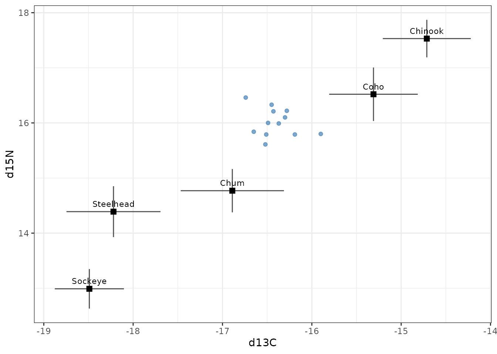
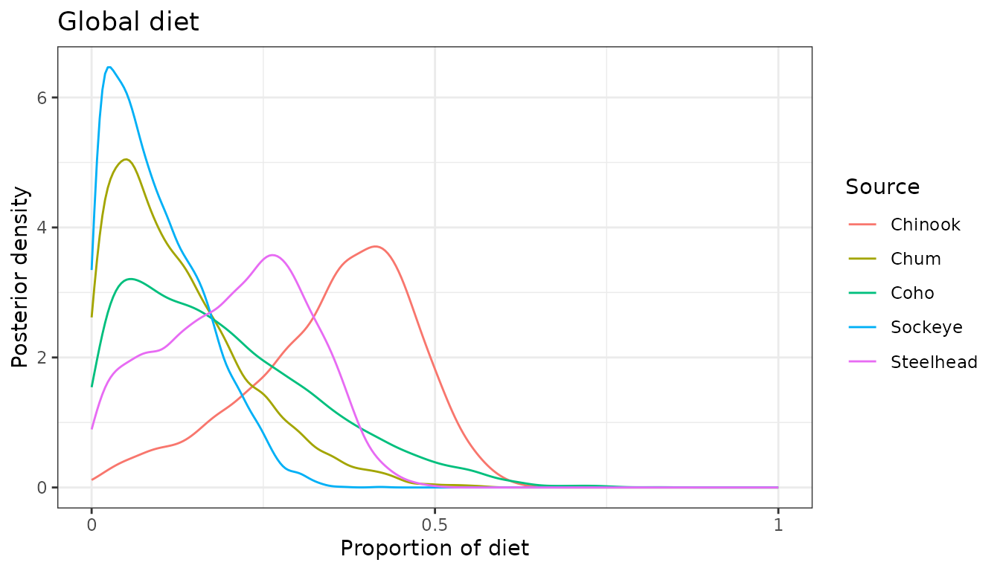
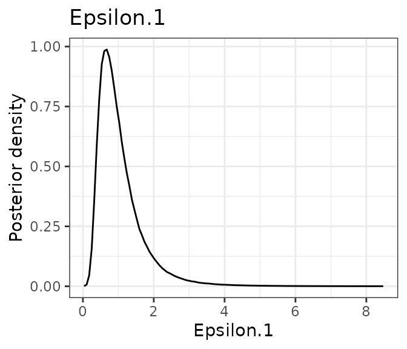
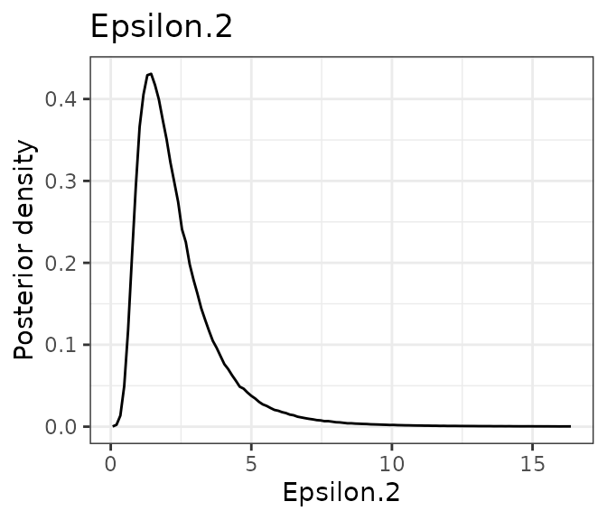
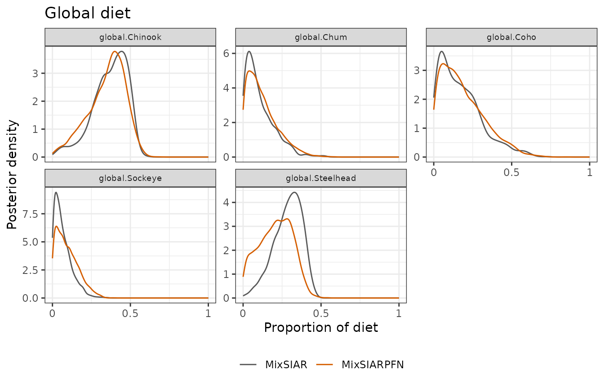
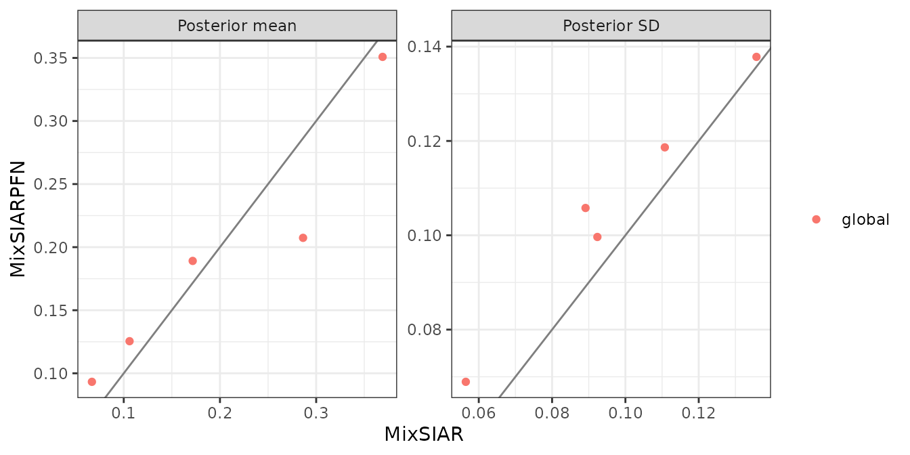
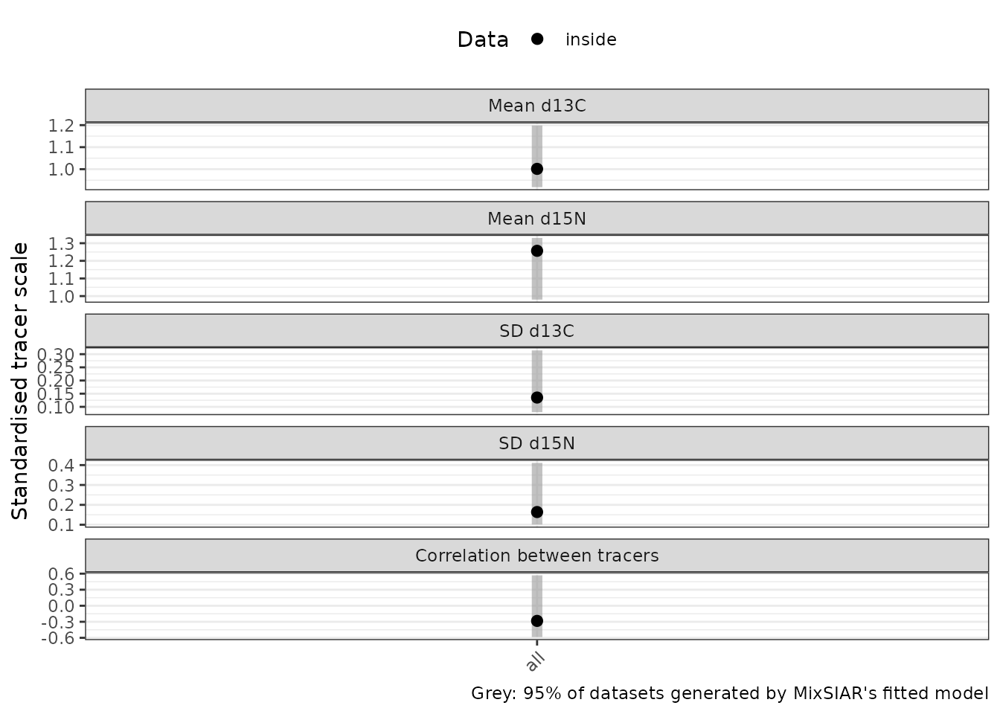

# Killer whale: no effects

This follows MixSIAR’s killer whale example (Semmens et al. 2013 data,
as analysed in Stock et al. 2018): 12 killer whales, two tracers (δ¹³C
and δ¹⁵N) and five salmon prey sources, with no random, fixed or
continuous effects. It is the simplest MixSIAR model, and a good first
check. Only the fitting call differs from MixSIAR’s vignette:
[`run_pfn()`](../reference/run_pfn.md) in place of `write_JAGS_model()`
and `run_model()`.

## The data

``` r
mix <- load_mix_data(
  filename = system.file("extdata", "killerwhale_consumer.csv", package = "MixSIARPFN"),
  iso_names = c("d13C", "d15N"), factors = NULL, fac_random = NULL,
  fac_nested = NULL, cont_effects = NULL)
source <- load_source_data(
  filename = system.file("extdata", "killerwhale_sources.csv", package = "MixSIARPFN"),
  source_factors = NULL, conc_dep = FALSE, data_type = "means", mix)
discr <- load_discr_data(
  filename = system.file("extdata", "killerwhale_discrimination.csv", package = "MixSIARPFN"),
  mix)
mix
#> Consumer data: 12 consumers, 2 tracer(s): d13C, d15N
source
#> Source data: 5 sources: Chinook, Chum, Coho, Sockeye, Steelhead
```

``` r
plot_data(mix = mix, source = source, discr = discr)
```



## Fitting the model

Residual \* Process error and MixSIAR’s uninformative Dirichlet prior
(all `alpha.prior` equal to 1), as in MixSIAR’s vignette. The network
for this error structure is downloaded the first time it is needed
(about 36 MB) and cached.

``` r
time <- system.time(
  fit <- run_pfn(mix, source, discr, alpha.prior = 1,
                 resid_err = TRUE, process_err = TRUE)
)
fit
#> MixSIARPFN fit (Residual * Process error), 5 sources, in 0.3 s
#> Marginal posteriors (no joint draws). Global diet:
#>     source  mean    sd  2.5% 97.5%
#>    Chinook 0.358 0.124 0.073 0.542
#>       Chum 0.128 0.101 0.004 0.371
#>       Coho 0.173 0.138 0.006 0.517
#>    Sockeye 0.086 0.068 0.003 0.247
#>  Steelhead 0.231 0.105 0.022 0.407
#> Use output_pfn() for every proportion and parameter.
```

The fit took 0.3 seconds.

## Results

``` r
out <- output_pfn(fit, mix, source,
                  output_options = list(summary_save = FALSE, plot_post_save_pdf = FALSE))
```

``` r
knitr::kable(round(summary_table(fit), 3))
```

|                    |  Mean |    SD |  2.5% |    5% |   25% |   50% |   75% |   95% | 97.5% |
|:-------------------|------:|------:|------:|------:|------:|------:|------:|------:|------:|
| Epsilon.1          | 1.062 | 0.764 | 0.317 | 0.374 | 0.616 | 0.882 | 1.282 | 2.296 | 2.840 |
| Epsilon.2          | 2.418 | 1.687 | 0.675 | 0.801 | 1.356 | 1.982 | 2.935 | 5.490 | 6.842 |
| p.global.Chinook   | 0.358 | 0.124 | 0.073 | 0.117 | 0.278 | 0.383 | 0.453 | 0.523 | 0.542 |
| p.global.Chum      | 0.128 | 0.101 | 0.004 | 0.009 | 0.048 | 0.106 | 0.186 | 0.325 | 0.371 |
| p.global.Coho      | 0.173 | 0.138 | 0.006 | 0.013 | 0.065 | 0.137 | 0.247 | 0.457 | 0.517 |
| p.global.Sockeye   | 0.086 | 0.068 | 0.003 | 0.005 | 0.031 | 0.071 | 0.127 | 0.219 | 0.247 |
| p.global.Steelhead | 0.231 | 0.105 | 0.022 | 0.042 | 0.154 | 0.242 | 0.312 | 0.386 | 0.407 |

``` r
out$plots$global
```



``` r
out$plots$Epsilon.1
out$plots$Epsilon.2
```



Each is a **marginal** posterior: the network does not give joint draws,
so the marginal means need not sum to exactly 1, and sums or ratios of
proportions cannot be computed from the output.

## Comparison with MixSIAR

``` r
ref <- mixsiar_reference("killerwhale")
cmp <- compare_mixsiar(fit, ref$draws, ref$summary)
```

MixSIAR 3.1.12 fitted the same model with 3 chains of 1,000,000
iterations (burn-in 500,000), which took about 23 minutes (largest
Gelman-Rubin diagnostic 1.005). MixSIARPFN took 0.3 seconds.

Means, SDs, 95% intervals and the Wasserstein-1 distance (W1: how far,
on average, one posterior’s mass has to move to match the other, on the
proportion scale; the residual multipliers’ draws were not saved, so
they have no W1):

``` r
knitr::kable(data.frame(
  quantity = cmp$name,
  `MixSIARPFN mean` = round(cmp$pfn_mean, 3), `MixSIAR mean` = round(cmp$mixsiar_mean, 3),
  `MixSIARPFN SD` = round(cmp$pfn_sd, 3), `MixSIAR SD` = round(cmp$mixsiar_sd, 3),
  `MixSIARPFN 95% CI` = sprintf("%.2f to %.2f", cmp$pfn_q2.5, cmp$pfn_q97.5),
  `MixSIAR 95% CI` = sprintf("%.2f to %.2f", cmp$mixsiar_q2.5, cmp$mixsiar_q97.5),
  W1 = round(cmp$w1, 3), check.names = FALSE))
```

| quantity | MixSIARPFN mean | MixSIAR mean | MixSIARPFN SD | MixSIAR SD | MixSIARPFN 95% CI | MixSIAR 95% CI | W1 |
|:---|---:|---:|---:|---:|:---|:---|---:|
| Epsilon.1 | 1.062 | 1.082 | 0.764 | 0.802 | 0.32 to 2.84 | 0.33 to 3.10 | NA |
| Epsilon.2 | 2.418 | 2.585 | 1.687 | 1.997 | 0.67 to 6.84 | 0.72 to 8.28 | NA |
| p.global.Chinook | 0.358 | 0.369 | 0.124 | 0.111 | 0.07 to 0.54 | 0.09 to 0.52 | 0.014 |
| p.global.Chum | 0.128 | 0.106 | 0.101 | 0.092 | 0.00 to 0.37 | 0.00 to 0.32 | 0.022 |
| p.global.Coho | 0.173 | 0.172 | 0.138 | 0.136 | 0.01 to 0.52 | 0.01 to 0.51 | 0.007 |
| p.global.Sockeye | 0.086 | 0.067 | 0.068 | 0.056 | 0.00 to 0.25 | 0.00 to 0.20 | 0.019 |
| p.global.Steelhead | 0.231 | 0.286 | 0.105 | 0.089 | 0.02 to 0.41 | 0.08 to 0.43 | 0.056 |

``` r
plot_compare(fit, ref$draws, block = "global")
```



``` r
plot_compare(fit, ref$draws, type = "means")
```



**What this shows.** The two posteriors are close. MixSIARPFN’s means
differ from MixSIAR’s by 0.02 on average (MixSIAR’s posterior SDs are
about 0.10), and its SDs are about the same (median SD ratio 1.12). The
largest difference is for Steelhead (0.23 against 0.29).

## Does MixSIAR’s model fit these data?

The comparison takes MixSIAR as the reference, which is fair where
MixSIAR’s model describes the data. A posterior predictive check tests
that: MixSIAR’s fitted model generates new datasets, one per posterior
draw, and the real data are compared with them. MixSIARPFN gives
marginal posteriors only, so it cannot run this check itself; the
results come from a separate MixSIAR run with the same model and data,
shipped with the package (`mixsiar_reference("killerwhale")$ppc`). Each
tracer’s mean and SD and the correlation between the tracers, on the
standardised scale MixSIAR’s model uses:



0 of the 5 statistics fall outside the 95% range of the model’s
datasets: the twelve killer whales look like data MixSIAR’s model
generates, so its posterior is a fair reference here, and MixSIARPFN
agrees with it closely. The geese and wolves vignettes show what happens
when the check fails.
