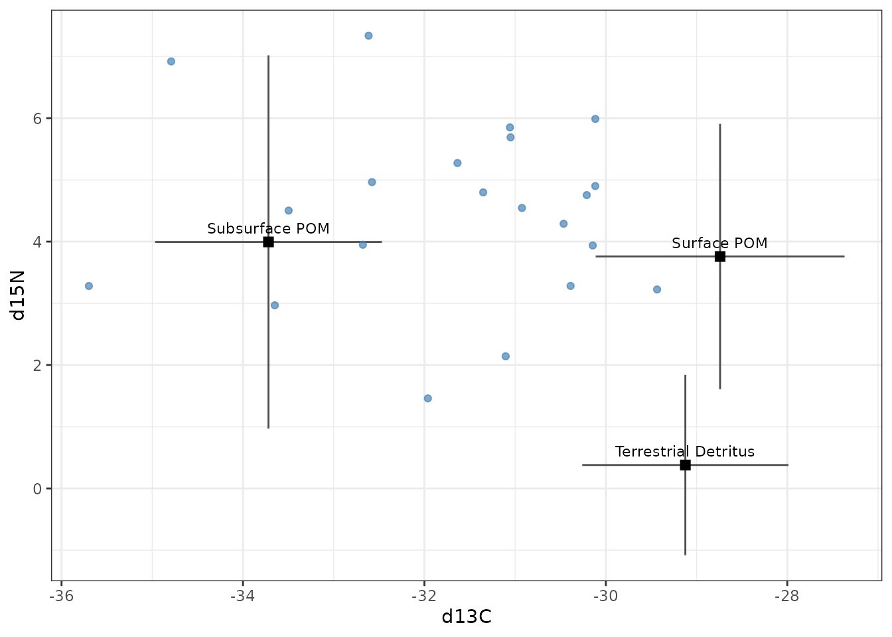
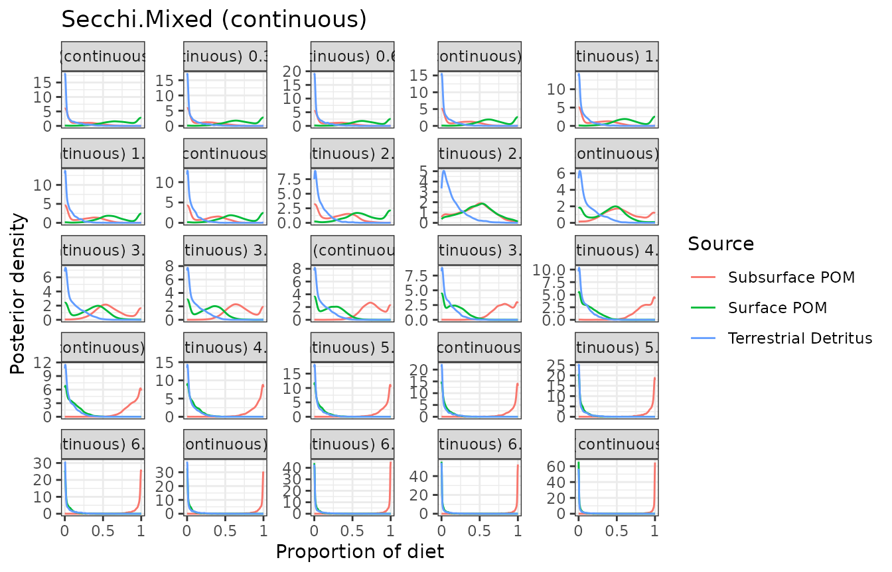
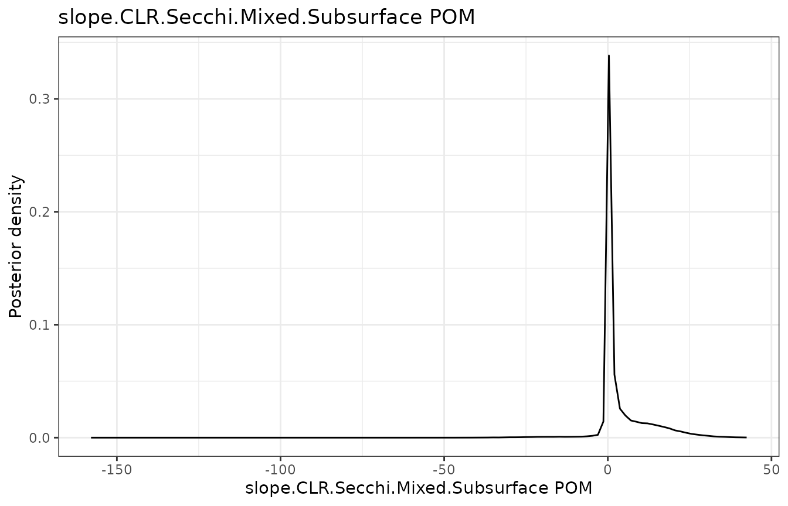
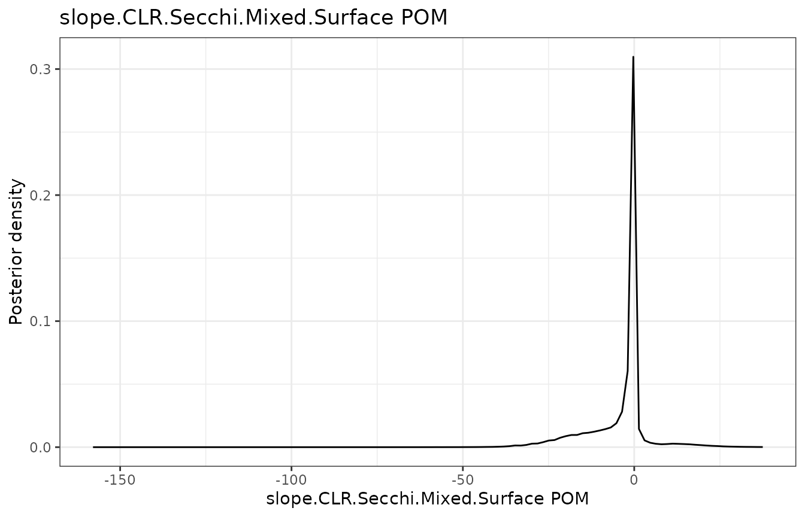
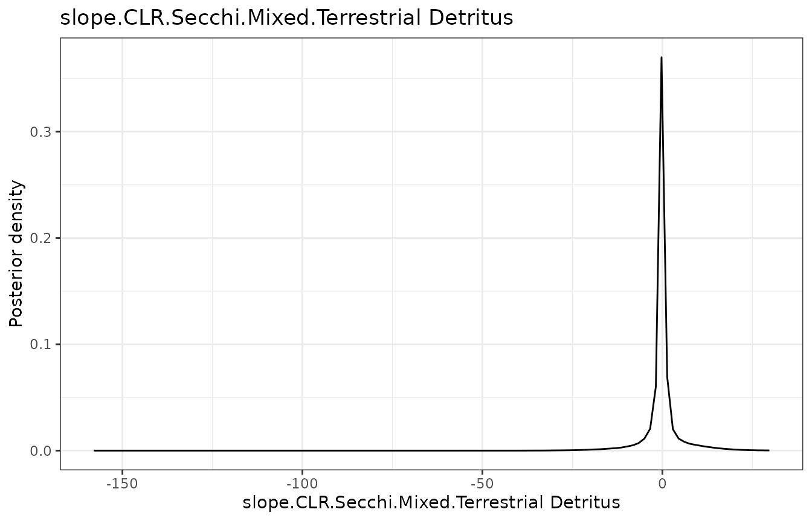
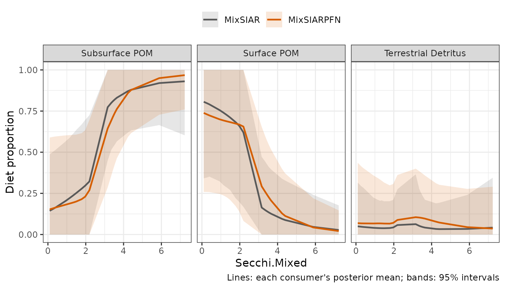
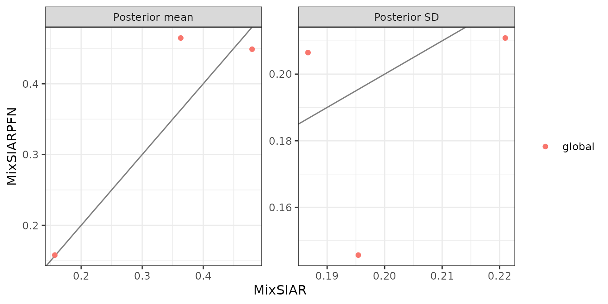

# Lake: a continuous effect, raw source data

This follows MixSIAR’s lake example (its `lake_ex` vignette), whose data
are simulated based on Francis et al. (2011, *Ecology Letters*,
<doi:10.1111/j.1461-0248.2011.01597.x>): zooplankton in 21 lakes, two
tracers (δ¹³C and δ¹⁵N) and three sources (terrestrial detritus, surface
particulate organic matter (POM) and subsurface POM). The diet changes
along a continuous effect, each lake’s ratio of Secchi depth to mixing
depth (`Secchi.Mixed`), a measure of how far light reaches into the
mixed layer. The source data are raw samples, and the error structure is
Residual only. Only the fitting call differs from MixSIAR’s:
[`run_pfn()`](https://andrewcparnell.github.io/MixSIARPFN/reference/run_pfn.md)
in place of `write_JAGS_model()` and `run_model()`.

## The data

``` r
mix <- load_mix_data(
  filename = system.file("extdata", "lake_consumer.csv", package = "MixSIARPFN"),
  iso_names = c("d13C", "d15N"), factors = NULL, fac_random = NULL,
  fac_nested = NULL, cont_effects = "Secchi.Mixed")
source <- load_source_data(
  filename = system.file("extdata", "lake_sources.csv", package = "MixSIARPFN"),
  source_factors = NULL, conc_dep = FALSE, data_type = "raw", mix)
#> Raw source data summarised to means, SDs and sample sizes (Subsurface POM: n = 21; Surface POM: n = 21; Terrestrial Detritus: n = 21).
discr <- load_discr_data(
  filename = system.file("extdata", "lake_discrimination.csv", package = "MixSIARPFN"),
  mix)
```

[`load_source_data()`](https://andrewcparnell.github.io/MixSIARPFN/reference/load_source_data.md)
summarises the raw source samples to each source’s mean, SD and sample
size, which is what MixSIARPFN’s networks use:

``` r
source$data
#>                 Source  Meand13C   SDd13C   Meand15N   SDd15N  n
#> 1       Subsurface POM -34.10900 1.145290  0.5945238 2.981343 21
#> 2          Surface POM -29.13057 1.277247  0.3585714 2.090102 21
#> 3 Terrestrial Detritus -29.51352 1.020728 -3.0205238 1.373461 21
```

There are 21 lakes (one consumer row each), with `Secchi.Mixed` from
0.09 to 7.23.

``` r
plot_data(mix = mix, source = source, discr = discr)
```



## Fitting the model

Residual only error and MixSIAR’s uninformative Dirichlet prior, as in
MixSIAR’s vignette.

``` r
time <- system.time(
  fit <- run_pfn(mix, source, discr, alpha.prior = 1,
                 resid_err = TRUE, process_err = FALSE)
)
fit
#> MixSIARPFN fit (Residual only error), 3 sources, in 0.3 s
#> Marginal posteriors (no joint draws). Global diet:
#>                source  mean    sd  2.5% 97.5%
#>        Subsurface POM 0.449 0.211 0.045 0.843
#>           Surface POM 0.465 0.206 0.055 0.849
#>  Terrestrial Detritus 0.158 0.146 0.003 0.537
#> Use output_pfn() for every proportion and parameter.
```

## Results

``` r
out <- output_pfn(fit, mix, source,
                  output_options = list(summary_save = FALSE, plot_post_save_pdf = FALSE))
```

The diet along `Secchi.Mixed`, as in MixSIAR’s vignette:

``` r
for (p in out$plots[grepl("Secchi", names(out$plots))]) print(p)
```



From the lowest to the highest `Secchi.Mixed`, the share of Subsurface
POM rises from 0.15 to 0.97 and the share of Surface POM falls from 0.74
to 0.02.

## Comparison with MixSIAR

``` r
ref <- mixsiar_reference("lake")
ref_raw <- mixsiar_reference("lake_raw")
blocks <- character(0)
```

With a continuous effect, each consumer has its own diet. Each lake’s
diet from MixSIARPFN against MixSIAR’s (MixSIAR’s `p.ind`), along
`Secchi.Mixed`:

``` r
plot_compare_covariate(fit, ref$pind)
```



The two curves follow each other closely: the consumers’ posterior mean
diets differ by 0.044 on average.

The global diet (at the average `Secchi.Mixed`) and the residual
multipliers:

MixSIAR 3.1.12 fitted the same model to the same data with 3 chains of
300,000 iterations (burn-in 200,000, MixSIAR’s “long” run), which took 6
minutes (largest Gelman-Rubin diagnostic 1.048). MixSIARPFN took 0.3
seconds, about 1,300 times faster.

Means, SDs, 95% intervals and the Wasserstein-1 distance between the two
posteriors (W1: how far, on average, one posterior’s mass has to move to
match the other, on the proportion scale):

``` r
knitr::kable(data.frame(
  quantity = cmp$name,
  `MixSIARPFN mean` = round(cmp$pfn_mean, 3), `MixSIAR mean` = round(cmp$mixsiar_mean, 3),
  `MixSIARPFN SD` = round(cmp$pfn_sd, 3), `MixSIAR SD` = round(cmp$mixsiar_sd, 3),
  `MixSIARPFN 95% CI` = sprintf("%.2f to %.2f", cmp$pfn_q2.5, cmp$pfn_q97.5),
  `MixSIAR 95% CI` = sprintf("%.2f to %.2f", cmp$mixsiar_q2.5, cmp$mixsiar_q97.5),
  W1 = round(cmp$w1, 3), check.names = FALSE))
```

| quantity | MixSIARPFN mean | MixSIAR mean | MixSIARPFN SD | MixSIAR SD | MixSIARPFN 95% CI | MixSIAR 95% CI | W1 |
|:---|---:|---:|---:|---:|:---|:---|---:|
| p.global.Subsurface POM | 0.449 | 0.480 | 0.211 | 0.221 | 0.04 to 0.84 | 0.04 to 0.81 | 0.046 |
| p.global.Surface POM | 0.465 | 0.363 | 0.206 | 0.187 | 0.05 to 0.85 | 0.04 to 0.83 | 0.101 |
| p.global.Terrestrial Detritus | 0.158 | 0.157 | 0.146 | 0.195 | 0.00 to 0.54 | 0.00 to 0.71 | 0.042 |

``` r
for (b in blocks) print(plot_compare(fit, ref$draws, block = b))
```

``` r
plot_compare(fit, ref$draws, type = "means")
```



**What this shows.** MixSIARPFN’s diet proportions differ from MixSIAR’s
by 0.045 on average (MixSIAR’s posterior SDs are about 0.20), the mean
W1 between the two posteriors is 0.063, and the median ratio of their
SDs is 0.95. The largest difference in a posterior mean is for
p.global.Surface POM (0.465 against 0.363).

The source data here are raw samples, which MixSIARPFN summarises to
each source’s mean, SD and sample size. MixSIAR’s own example fits the
raw samples instead, estimating each source’s mean and variance in the
model. That MixSIAR fit (16 minutes, largest Gelman-Rubin diagnostic
1.135, so not fully converged) and MixSIAR’s fit to the summaries differ
by 0.024 in posterior means on average. The comparison above is like for
like: both methods fitted the same summaries.
