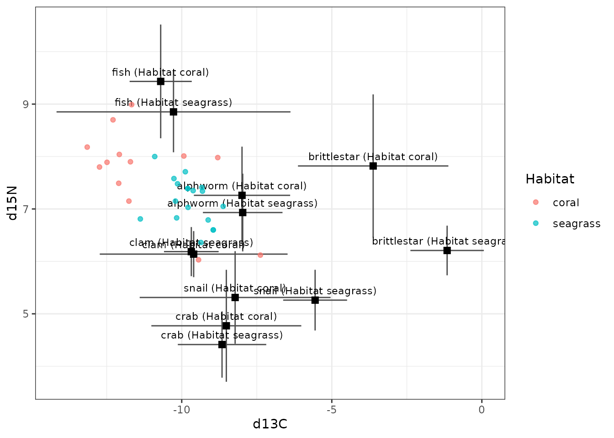
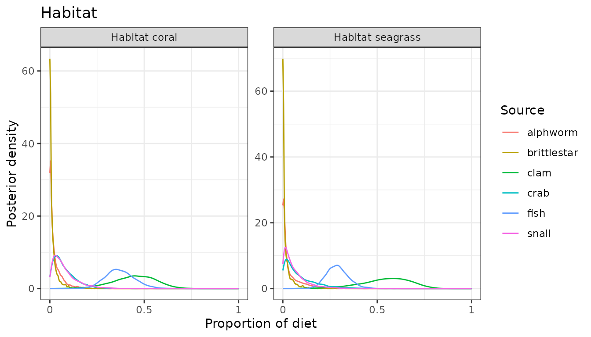
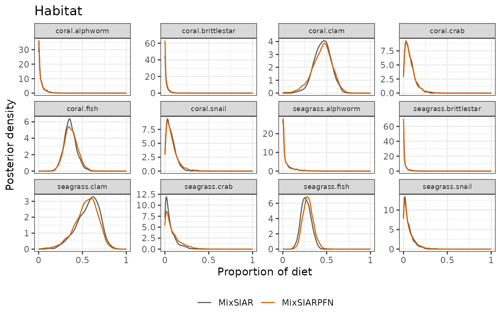
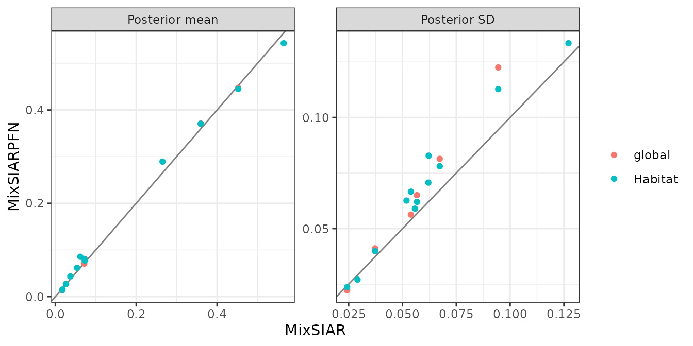

# Mantis shrimp: sources by habitat, concentrations and an informative prior

This follows MixSIAR’s mantis shrimp example script
(`mixsiar_script_mantis.R`): mantis shrimp from several habitats, two
tracers (δ¹³C and δ¹⁵N) and six prey sources. It uses three options
together: habitat is a fixed effect, the sources were measured
separately in each habitat (`source_factors = "Habitat"`), and the
sources’ elemental concentrations differ (concentration dependence).
MixSIAR’s script also uses an informative “specialist” prior, which
MixSIARPFN supports too. Only the fitting call differs from MixSIAR’s
script:
[`run_pfn()`](https://andrewcparnell.github.io/MixSIARPFN/reference/run_pfn.md)
in place of `write_JAGS_model()` and `run_model()`.

## The data

``` r
mix <- load_mix_data(
  filename = system.file("extdata", "mantis_consumer.csv", package = "MixSIARPFN"),
  iso_names = c("d13C", "d15N"), factors = "Habitat", fac_random = FALSE,
  fac_nested = FALSE, cont_effects = NULL)
source <- load_source_data(
  filename = system.file("extdata", "mantis_source.csv", package = "MixSIARPFN"),
  source_factors = "Habitat", conc_dep = TRUE, data_type = "means", mix)
discr <- load_discr_data(
  filename = system.file("extdata", "mantis_discrimination.csv", package = "MixSIARPFN"),
  mix)
```

There are 31 mantis shrimp in 2 habitats (coral, seagrass), and 6
sources (alphworm, brittlestar, clam, crab, fish, snail).

``` r
plot_data(mix = mix, source = source, discr = discr)
```



## Fitting the model

Residual \* Process error, and MixSIAR’s specialist prior: weights 1, 1,
4, 4, 1, 4 on the sources (in `source$source_names` order), scaled so
that they sum to the number of sources, exactly as in MixSIAR’s script.

``` r
alpha.spec <- c(1, 1, 4, 4, 1, 4)
alpha.spec <- alpha.spec * length(alpha.spec) / sum(alpha.spec)
setNames(round(alpha.spec, 2), source$source_names)
#>    alphworm brittlestar        clam        crab        fish       snail 
#>         0.4         0.4         1.6         1.6         0.4         1.6
```

``` r
time <- system.time(
  fit <- run_pfn(mix, source, discr, alpha.prior = alpha.spec,
                 resid_err = TRUE, process_err = TRUE)
)
fit
#> MixSIARPFN fit (Residual * Process error), 6 sources, in 0.4 s
#> Marginal posteriors (no joint draws). Global diet:
#>       source  mean    sd  2.5% 97.5%
#>     alphworm 0.028 0.041 0.000 0.143
#>  brittlestar 0.013 0.022 0.000 0.075
#>         clam 0.447 0.123 0.176 0.660
#>         crab 0.081 0.065 0.006 0.249
#>         fish 0.371 0.081 0.223 0.543
#>        snail 0.071 0.056 0.005 0.215
#> Use output_pfn() for every proportion and parameter.
#> Note: Consumer columns not used: Season.
```

## Results

``` r
out <- output_pfn(fit, mix, source,
                  output_options = list(summary_save = FALSE, plot_post_save_pdf = FALSE))
```

``` r
knitr::kable(round(summary_table(fit), 3))
```

|                        |  Mean |    SD |  2.5% |    5% |   25% |   50% |   75% |   95% | 97.5% |
|:-----------------------|------:|------:|------:|------:|------:|------:|------:|------:|------:|
| Epsilon.1              | 0.907 | 0.542 | 0.272 | 0.328 | 0.558 | 0.794 | 1.123 | 1.842 | 2.178 |
| Epsilon.2              | 2.579 | 1.095 | 1.079 | 1.231 | 1.820 | 2.378 | 3.110 | 4.585 | 5.219 |
| p.global.alphworm      | 0.028 | 0.041 | 0.000 | 0.000 | 0.002 | 0.012 | 0.037 | 0.109 | 0.143 |
| p.global.brittlestar   | 0.013 | 0.022 | 0.000 | 0.000 | 0.001 | 0.005 | 0.017 | 0.056 | 0.075 |
| p.global.clam          | 0.447 | 0.123 | 0.176 | 0.227 | 0.372 | 0.458 | 0.533 | 0.631 | 0.660 |
| p.global.crab          | 0.081 | 0.065 | 0.006 | 0.010 | 0.033 | 0.064 | 0.110 | 0.208 | 0.249 |
| p.global.fish          | 0.371 | 0.081 | 0.223 | 0.245 | 0.316 | 0.366 | 0.422 | 0.511 | 0.543 |
| p.global.snail         | 0.071 | 0.056 | 0.005 | 0.009 | 0.029 | 0.057 | 0.097 | 0.181 | 0.215 |
| p.coral.alphworm       | 0.027 | 0.040 | 0.000 | 0.000 | 0.002 | 0.011 | 0.036 | 0.107 | 0.139 |
| p.coral.brittlestar    | 0.014 | 0.024 | 0.000 | 0.000 | 0.001 | 0.005 | 0.018 | 0.059 | 0.080 |
| p.coral.clam           | 0.445 | 0.113 | 0.196 | 0.246 | 0.377 | 0.454 | 0.523 | 0.615 | 0.644 |
| p.coral.crab           | 0.077 | 0.062 | 0.006 | 0.009 | 0.032 | 0.062 | 0.106 | 0.198 | 0.237 |
| p.coral.fish           | 0.371 | 0.078 | 0.228 | 0.250 | 0.318 | 0.366 | 0.419 | 0.504 | 0.535 |
| p.coral.snail          | 0.081 | 0.067 | 0.006 | 0.010 | 0.033 | 0.063 | 0.110 | 0.212 | 0.256 |
| p.seagrass.alphworm    | 0.043 | 0.071 | 0.000 | 0.000 | 0.002 | 0.012 | 0.053 | 0.196 | 0.254 |
| p.seagrass.brittlestar | 0.015 | 0.027 | 0.000 | 0.000 | 0.001 | 0.004 | 0.017 | 0.069 | 0.094 |
| p.seagrass.clam        | 0.543 | 0.133 | 0.236 | 0.297 | 0.465 | 0.560 | 0.638 | 0.731 | 0.759 |
| p.seagrass.crab        | 0.085 | 0.083 | 0.002 | 0.004 | 0.023 | 0.059 | 0.123 | 0.256 | 0.305 |
| p.seagrass.fish        | 0.289 | 0.059 | 0.183 | 0.199 | 0.249 | 0.286 | 0.326 | 0.391 | 0.414 |
| p.seagrass.snail       | 0.062 | 0.063 | 0.002 | 0.003 | 0.017 | 0.041 | 0.087 | 0.190 | 0.230 |

``` r
for (p in out$plots[grepl("^Habitat", names(out$plots))]) print(p)
```



MixSIAR’s script goes on to combine sources after the fit (hard-shelled
against soft-bodied prey), with `combine_sources()`. That needs joint
posterior draws, which MixSIARPFN does not give, so it is not repeated
here.

## Comparison with MixSIAR

``` r
ref <- mixsiar_reference("mantis")
ref_raw <- NULL   # means source data: no raw-data fit
blocks <- "Habitat"
```

MixSIAR 3.1.12 fitted the same model to the same data with 3 chains of
300,000 iterations (burn-in 200,000, MixSIAR’s “long” run), which took
35 minutes (largest Gelman-Rubin diagnostic 1.044). MixSIARPFN took 0.4
seconds, about 5,200 times faster.

Means, SDs, 95% intervals and the Wasserstein-1 distance between the two
posteriors (W1: how far, on average, one posterior’s mass has to move to
match the other, on the proportion scale):

``` r
knitr::kable(data.frame(
  quantity = cmp$name,
  `MixSIARPFN mean` = round(cmp$pfn_mean, 3), `MixSIAR mean` = round(cmp$mixsiar_mean, 3),
  `MixSIARPFN SD` = round(cmp$pfn_sd, 3), `MixSIAR SD` = round(cmp$mixsiar_sd, 3),
  `MixSIARPFN 95% CI` = sprintf("%.2f to %.2f", cmp$pfn_q2.5, cmp$pfn_q97.5),
  `MixSIAR 95% CI` = sprintf("%.2f to %.2f", cmp$mixsiar_q2.5, cmp$mixsiar_q97.5),
  W1 = round(cmp$w1, 3), check.names = FALSE))
```

| quantity | MixSIARPFN mean | MixSIAR mean | MixSIARPFN SD | MixSIAR SD | MixSIARPFN 95% CI | MixSIAR 95% CI | W1 |
|:---|---:|---:|---:|---:|:---|:---|---:|
| Epsilon.1 | 0.907 | 0.821 | 0.542 | 0.407 | 0.27 to 2.18 | 0.30 to 1.85 | NA |
| Epsilon.2 | 2.579 | 2.671 | 1.095 | 1.085 | 1.08 to 5.22 | 1.19 to 5.30 | NA |
| p.global.alphworm | 0.028 | 0.026 | 0.041 | 0.037 | 0.00 to 0.14 | 0.00 to 0.14 | 0.001 |
| p.global.brittlestar | 0.013 | 0.017 | 0.022 | 0.024 | 0.00 to 0.07 | 0.00 to 0.09 | 0.004 |
| p.global.clam | 0.447 | 0.452 | 0.123 | 0.094 | 0.18 to 0.66 | 0.26 to 0.63 | 0.021 |
| p.global.crab | 0.081 | 0.073 | 0.065 | 0.057 | 0.01 to 0.25 | 0.01 to 0.21 | 0.008 |
| p.global.fish | 0.371 | 0.360 | 0.081 | 0.067 | 0.22 to 0.54 | 0.23 to 0.50 | 0.014 |
| p.global.snail | 0.071 | 0.072 | 0.056 | 0.054 | 0.01 to 0.21 | 0.01 to 0.20 | 0.003 |
| p.coral.alphworm | 0.027 | 0.026 | 0.040 | 0.037 | 0.00 to 0.14 | 0.00 to 0.14 | 0.001 |
| p.coral.brittlestar | 0.014 | 0.017 | 0.024 | 0.024 | 0.00 to 0.08 | 0.00 to 0.09 | 0.003 |
| p.coral.clam | 0.445 | 0.452 | 0.113 | 0.094 | 0.20 to 0.64 | 0.26 to 0.63 | 0.013 |
| p.coral.crab | 0.077 | 0.073 | 0.062 | 0.057 | 0.01 to 0.24 | 0.01 to 0.21 | 0.004 |
| p.coral.fish | 0.371 | 0.360 | 0.078 | 0.067 | 0.23 to 0.53 | 0.23 to 0.50 | 0.012 |
| p.coral.snail | 0.081 | 0.072 | 0.067 | 0.054 | 0.01 to 0.26 | 0.01 to 0.20 | 0.009 |
| p.seagrass.alphworm | 0.043 | 0.037 | 0.071 | 0.062 | 0.00 to 0.25 | 0.00 to 0.23 | 0.006 |
| p.seagrass.brittlestar | 0.015 | 0.018 | 0.027 | 0.029 | 0.00 to 0.09 | 0.00 to 0.10 | 0.003 |
| p.seagrass.clam | 0.543 | 0.565 | 0.133 | 0.127 | 0.24 to 0.76 | 0.29 to 0.77 | 0.022 |
| p.seagrass.crab | 0.085 | 0.062 | 0.083 | 0.062 | 0.00 to 0.30 | 0.00 to 0.23 | 0.024 |
| p.seagrass.fish | 0.289 | 0.265 | 0.059 | 0.056 | 0.18 to 0.41 | 0.16 to 0.38 | 0.024 |
| p.seagrass.snail | 0.062 | 0.054 | 0.063 | 0.052 | 0.00 to 0.23 | 0.00 to 0.20 | 0.008 |

``` r
for (b in blocks) print(plot_compare(fit, ref$draws, block = b))
```



``` r
plot_compare(fit, ref$draws, type = "means")
```



**What this shows.** MixSIARPFN’s diet proportions differ from MixSIAR’s
by 0.008 on average (MixSIAR’s posterior SDs are about 0.06), the mean
W1 between the two posteriors is 0.010, and the median ratio of their
SDs is 1.12. The largest difference in a posterior mean is for
p.seagrass.fish (0.289 against 0.265).
