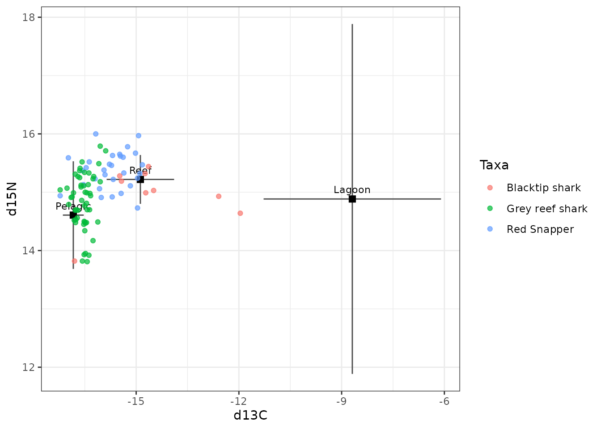
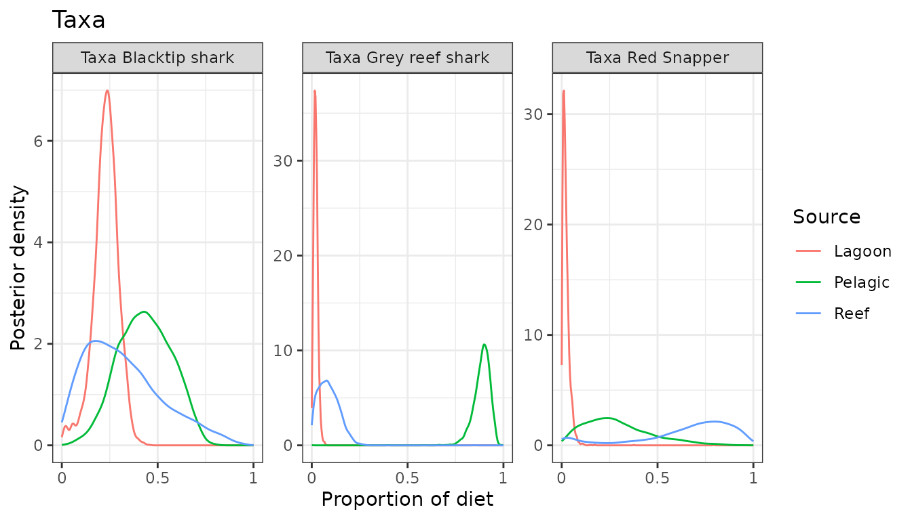
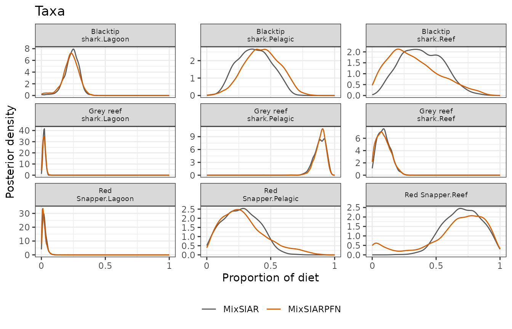
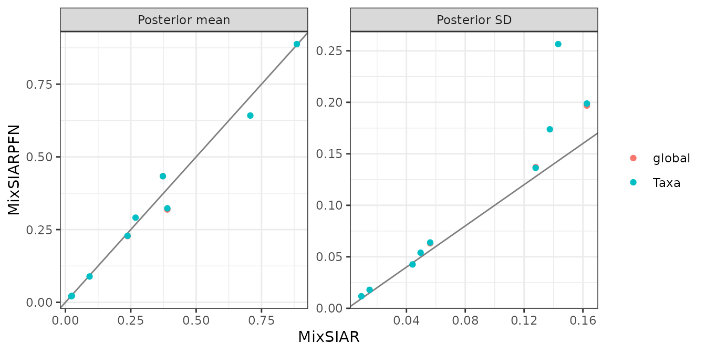

# Palmyra: a fixed effect, raw source data

This follows MixSIAR’s Palmyra example script
(`mixsiar_script_palmyra.R`): consumers of several taxa, two tracers
(δ¹³C and δ¹⁵N) and three sources (lagoon, pelagic and reef food webs),
with taxon as a fixed effect. The source data are raw samples. Only the
fitting call differs from MixSIAR’s script:
[`run_pfn()`](../reference/run_pfn.md) in place of `write_JAGS_model()`
and `run_model()`.

## The data

``` r
mix <- load_mix_data(
  filename = system.file("extdata", "palmyra_consumer.csv", package = "MixSIARPFN"),
  iso_names = c("d13C", "d15N"), factors = "Taxa", fac_random = FALSE,
  fac_nested = FALSE, cont_effects = NULL)
source <- load_source_data(
  filename = system.file("extdata", "palmyra_sources.csv", package = "MixSIARPFN"),
  source_factors = NULL, conc_dep = FALSE, data_type = "raw", mix)
#> Raw source data summarised to means, SDs and sample sizes (Lagoon: n = 24; Pelagic: n = 27; Reef: n = 20).
discr <- load_discr_data(
  filename = system.file("extdata", "palmyra_discrimination.csv", package = "MixSIARPFN"),
  mix)
```

[`load_source_data()`](../reference/load_source_data.md) summarises the
raw source samples to each source’s mean, SD and sample size, which is
what MixSIARPFN’s networks use:

``` r
source$data
#>    Source   Meand13C    SDd13C Meand15N    SDd15N  n
#> 1  Lagoon  -9.888082 1.7608748 12.78433 1.0750500 24
#> 2 Pelagic -16.835832 0.3042025 14.60792 0.9226739 27
#> 3    Reef -14.877106 0.9848190 15.21950 0.4184614 20
```

There are 92 consumers in 3 taxa (Blacktip shark, Grey reef shark, Red
Snapper).

``` r
plot_data(mix = mix, source = source, discr = discr)
```



## Fitting the model

Residual \* Process error and MixSIAR’s uninformative Dirichlet prior,
as in MixSIAR’s script.

``` r
time <- system.time(
  fit <- run_pfn(mix, source, discr, alpha.prior = 1,
                 resid_err = TRUE, process_err = TRUE)
)
fit
#> MixSIARPFN fit (Residual * Process error), 3 sources, in 0.4 s
#> Marginal posteriors (no joint draws). Global diet:
#>   source  mean    sd  2.5% 97.5%
#>   Lagoon 0.228 0.063 0.076 0.341
#>  Pelagic 0.434 0.137 0.171 0.691
#>     Reef 0.319 0.197 0.030 0.763
#> Use output_pfn() for every proportion and parameter.
```

## Results

``` r
out <- output_pfn(fit, mix, source,
                  output_options = list(summary_save = FALSE, plot_post_save_pdf = FALSE))
```

``` r
knitr::kable(round(summary_table(fit), 3))
```

|                           |  Mean |    SD |  2.5% |    5% |   25% |   50% |   75% |   95% | 97.5% |
|:--------------------------|------:|------:|------:|------:|------:|------:|------:|------:|------:|
| Epsilon.1                 | 1.232 | 0.379 | 0.624 | 0.701 | 0.967 | 1.188 | 1.451 | 1.904 | 2.081 |
| Epsilon.2                 | 0.494 | 0.183 | 0.246 | 0.273 | 0.375 | 0.468 | 0.582 | 0.798 | 0.885 |
| p.global.Lagoon           | 0.228 | 0.063 | 0.076 | 0.116 | 0.193 | 0.232 | 0.268 | 0.322 | 0.341 |
| p.global.Pelagic          | 0.434 | 0.137 | 0.171 | 0.211 | 0.336 | 0.432 | 0.534 | 0.658 | 0.691 |
| p.global.Reef             | 0.319 | 0.197 | 0.030 | 0.052 | 0.165 | 0.286 | 0.444 | 0.697 | 0.763 |
| p.Blacktip shark.Lagoon   | 0.229 | 0.064 | 0.074 | 0.115 | 0.194 | 0.233 | 0.270 | 0.324 | 0.343 |
| p.Blacktip shark.Pelagic  | 0.434 | 0.136 | 0.172 | 0.211 | 0.336 | 0.432 | 0.533 | 0.656 | 0.689 |
| p.Blacktip shark.Reef     | 0.323 | 0.199 | 0.030 | 0.052 | 0.167 | 0.291 | 0.451 | 0.702 | 0.768 |
| p.Grey reef shark.Lagoon  | 0.021 | 0.012 | 0.003 | 0.005 | 0.013 | 0.020 | 0.028 | 0.041 | 0.045 |
| p.Grey reef shark.Pelagic | 0.888 | 0.043 | 0.790 | 0.812 | 0.864 | 0.893 | 0.917 | 0.946 | 0.954 |
| p.Grey reef shark.Reef    | 0.089 | 0.054 | 0.007 | 0.012 | 0.046 | 0.084 | 0.125 | 0.184 | 0.204 |
| p.Red Snapper.Lagoon      | 0.022 | 0.018 | 0.003 | 0.004 | 0.010 | 0.018 | 0.029 | 0.056 | 0.067 |
| p.Red Snapper.Pelagic     | 0.291 | 0.174 | 0.038 | 0.057 | 0.160 | 0.263 | 0.390 | 0.632 | 0.705 |
| p.Red Snapper.Reef        | 0.642 | 0.256 | 0.015 | 0.042 | 0.546 | 0.709 | 0.828 | 0.937 | 0.958 |

``` r
for (p in out$plots[grepl("^Taxa", names(out$plots))]) print(p)
```



## Comparison with MixSIAR

``` r
ref <- mixsiar_reference("palmyra")
ref_raw <- mixsiar_reference("palmyra_raw")
blocks <- "Taxa"
```

MixSIAR 3.1.12 fitted the same model to the same data with 3 chains of
300,000 iterations (burn-in 200,000, MixSIAR’s “long” run), which took
58 minutes (largest Gelman-Rubin diagnostic 1.022). MixSIARPFN took 0.4
seconds, about 8,300 times faster.

Means, SDs, 95% intervals and the Wasserstein-1 distance between the two
posteriors (W1: how far, on average, one posterior’s mass has to move to
match the other, on the proportion scale):

``` r
knitr::kable(data.frame(
  quantity = cmp$name,
  `MixSIARPFN mean` = round(cmp$pfn_mean, 3), `MixSIAR mean` = round(cmp$mixsiar_mean, 3),
  `MixSIARPFN SD` = round(cmp$pfn_sd, 3), `MixSIAR SD` = round(cmp$mixsiar_sd, 3),
  `MixSIARPFN 95% CI` = sprintf("%.2f to %.2f", cmp$pfn_q2.5, cmp$pfn_q97.5),
  `MixSIAR 95% CI` = sprintf("%.2f to %.2f", cmp$mixsiar_q2.5, cmp$mixsiar_q97.5),
  W1 = round(cmp$w1, 3), check.names = FALSE))
```

| quantity | MixSIARPFN mean | MixSIAR mean | MixSIARPFN SD | MixSIAR SD | MixSIARPFN 95% CI | MixSIAR 95% CI | W1 |
|:---|---:|---:|---:|---:|:---|:---|---:|
| Epsilon.1 | 1.232 | 1.312 | 0.379 | 0.331 | 0.62 to 2.08 | 0.76 to 2.07 | NA |
| Epsilon.2 | 0.494 | 0.495 | 0.183 | 0.137 | 0.25 to 0.89 | 0.28 to 0.81 | NA |
| p.global.Lagoon | 0.228 | 0.238 | 0.063 | 0.056 | 0.08 to 0.34 | 0.11 to 0.33 | 0.011 |
| p.global.Pelagic | 0.434 | 0.373 | 0.137 | 0.128 | 0.17 to 0.69 | 0.15 to 0.61 | 0.061 |
| p.global.Reef | 0.319 | 0.390 | 0.197 | 0.163 | 0.03 to 0.76 | 0.11 to 0.71 | 0.078 |
| p.Blacktip shark.Lagoon | 0.229 | 0.238 | 0.064 | 0.056 | 0.07 to 0.34 | 0.11 to 0.33 | 0.011 |
| p.Blacktip shark.Pelagic | 0.434 | 0.373 | 0.136 | 0.128 | 0.17 to 0.69 | 0.15 to 0.61 | 0.061 |
| p.Blacktip shark.Reef | 0.323 | 0.390 | 0.199 | 0.163 | 0.03 to 0.77 | 0.11 to 0.71 | 0.075 |
| p.Grey reef shark.Lagoon | 0.021 | 0.023 | 0.012 | 0.009 | 0.00 to 0.05 | 0.01 to 0.04 | 0.002 |
| p.Grey reef shark.Pelagic | 0.888 | 0.885 | 0.043 | 0.044 | 0.79 to 0.95 | 0.79 to 0.95 | 0.005 |
| p.Grey reef shark.Reef | 0.089 | 0.092 | 0.054 | 0.050 | 0.01 to 0.20 | 0.01 to 0.20 | 0.005 |
| p.Red Snapper.Lagoon | 0.022 | 0.025 | 0.018 | 0.015 | 0.00 to 0.07 | 0.00 to 0.06 | 0.004 |
| p.Red Snapper.Pelagic | 0.291 | 0.268 | 0.174 | 0.138 | 0.04 to 0.71 | 0.03 to 0.53 | 0.025 |
| p.Red Snapper.Reef | 0.642 | 0.707 | 0.256 | 0.143 | 0.01 to 0.96 | 0.44 to 0.96 | 0.072 |

``` r
for (b in blocks) print(plot_compare(fit, ref$draws, block = b))
```



``` r
plot_compare(fit, ref$draws, type = "means")
```



**What this shows.** MixSIARPFN’s diet proportions differ from MixSIAR’s
by 0.031 on average (MixSIAR’s posterior SDs are about 0.09), the mean
W1 between the two posteriors is 0.034, and the median ratio of their
SDs is 1.17. The largest difference in a posterior mean is for
p.global.Reef (0.319 against 0.390).

The source data here are raw samples, which MixSIARPFN summarises to
each source’s mean, SD and sample size. MixSIAR’s own example fits the
raw samples instead, estimating each source’s mean and variance in the
model. That MixSIAR fit (115 minutes, largest Gelman-Rubin diagnostic
1.012) and MixSIAR’s fit to the summaries differ by 0.095 in posterior
means on average. The comparison above is like for like: both methods
fitted the same summaries.
