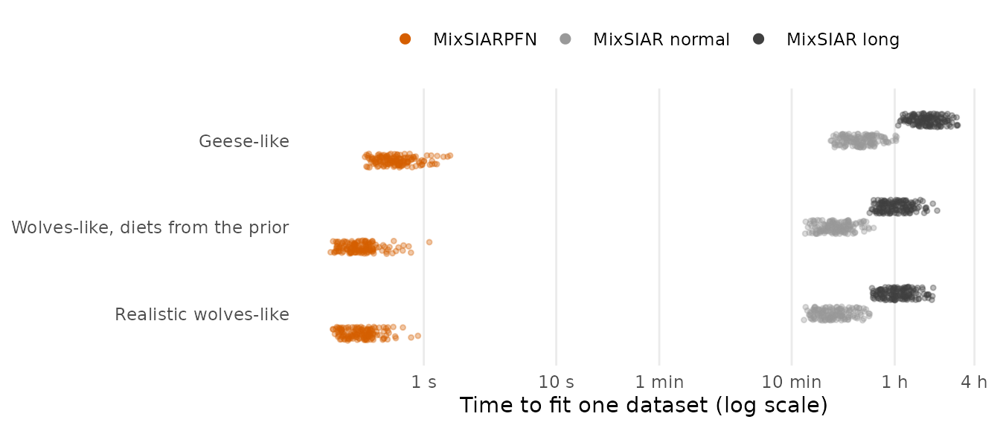
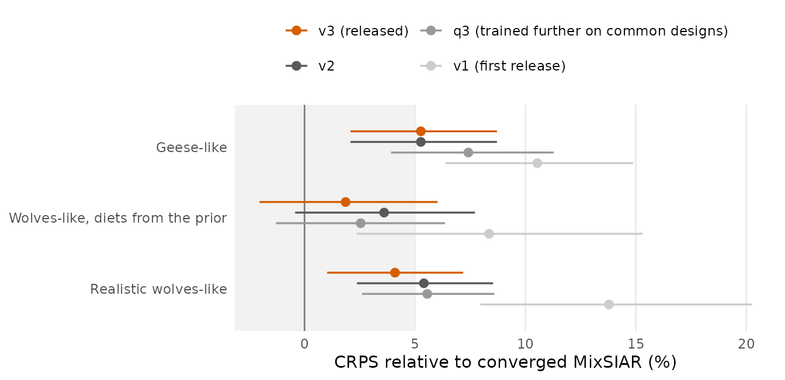
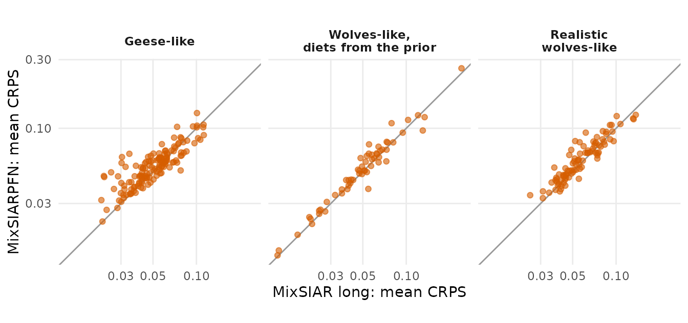
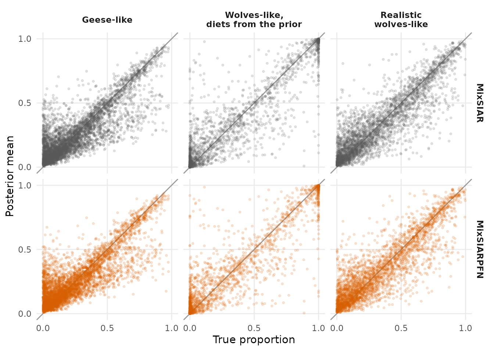
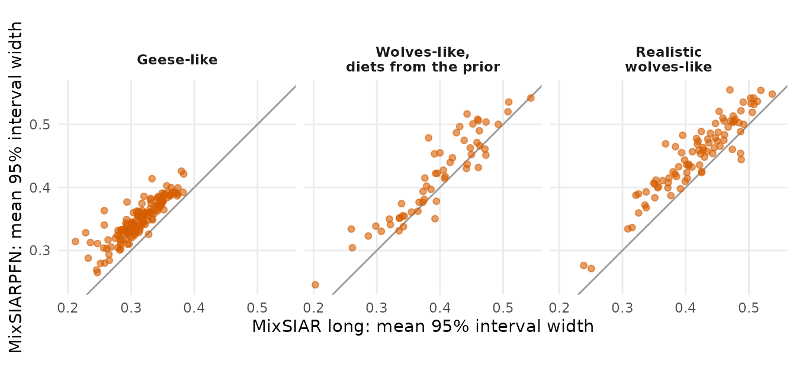
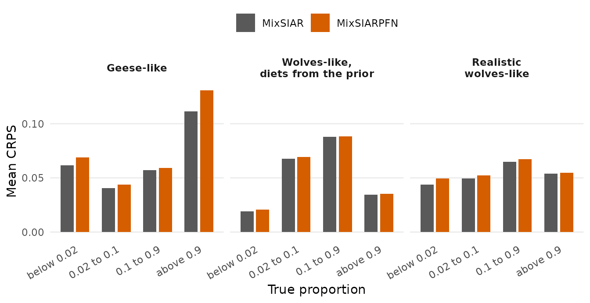

# How MixSIARPFN works and how well it does

MixSIARPFN replaces MixSIAR’s MCMC with a neural network that has
learned, from millions of simulated datasets, what MixSIAR’s posterior
looks like. This article explains what that network is and how it was
trained, and then puts it to the test: 450 simulated datasets with known
true diets, each fitted by MixSIARPFN and by MixSIAR.

**In short:**

- **Thousands of times faster.** A MixSIARPFN fit took a median of 0.3
  to 0.6 seconds; MixSIAR’s runs on the same data took a median of 20 to
  103 minutes. That is 3,200 to 12,000 times faster.
- **Nearly the same answers.** Its posterior means are nearly as close
  to the true diets as converged MixSIAR’s, and its accuracy (CRPS) is
  within about 5% of a fully converged MixSIAR run on average. On 101 of
  the 292 datasets (35%) it is *more* accurate than converged MixSIAR,
  and on 70% it is within 10%.
- **Honest intervals.** Its 95% intervals contained the true diet 95 to
  97% of the time, as they should (MixSIAR: 94 to 97%). They are a
  little more cautious than MixSIAR’s, 5 to 11% wider.
- **Always an answer.** There is nothing to converge. MixSIAR’s standard
  (“normal”) run failed its convergence check on 49% of these datasets,
  and even its long run on 35%.

## What the network is

### The idea

MixSIAR defines a full Bayesian model: priors on the diet proportions,
the random-effect SDs and the error terms, and a likelihood for the
consumers’ tracer values given the sources. Anything we can write down
as a prior and a likelihood we can also *simulate from*: draw parameters
from the prior, then draw a dataset from the likelihood. A **prior-data
fitted network** (PFN; Müller et al. 2022) is trained on millions of
such pairs. It is shown the dataset and asked for the parameters that
made it. Trained this way, with a proper scoring rule, its best possible
answer is the Bayesian posterior itself. It learns to do Bayesian
inference for MixSIAR’s model in general, rather than fitting one
dataset.

At use, the network reads your data once and returns the posterior, with
no chains to run. Two consequences:

- **Marginal posteriors only.** The network answers one question at a
  time (“what is the posterior of Pack 3’s proportion of deer?”), so
  each proportion gets its own posterior. There are no joint draws.
- **It is an approximation.** How close it gets to the true posterior
  depends on how well it was trained. That is what the rest of this
  article measures.

### Its structure

The network is a transformer in the style of TabPFN (Hollmann et
al. 2025), with about 17 million parameters. It sees each dataset as a
table:

- **Columns** are the tracers (and any continuous covariate).
- **Rows** are of three kinds:
  - **consumers:** one row per consumer, holding its tracer values;
  - **sources:** one row per source (per source-factor level), holding
    seven numbers per tracer: the mean corrected by the discrimination
    factor, the source SD, the standard error, the discrimination SD,
    the sample size, the concentration and the Dirichlet prior α;
  - **queries:** one row per quantity wanted, such as a global
    proportion, a level’s proportion, an effect’s SD or `resid.prop`.
    Each carries a tag saying which.
- **Factor levels** get an embedding drawn at random from a pool, so the
  network treats levels as exchangeable, as MixSIAR’s model does. At
  use, the answer is averaged over 8 random draws.

The body is 8 identical layers. In each, the tracer cells of every row
exchange information, then consumers and sources exchange information
with each other while queries read from them, then a small feed-forward
network updates every cell. Each cell is 384 numbers wide. Because rows
have no positions, the answer does not depend on the order of consumers
or sources.

The output is a **bar distribution** for each query: a histogram over
1,000 bars spanning \[0, 1\] for proportions (finer near 0 and 1), and
over \[0, 20\] for SDs and `resid.prop`. It can take any shape,
including the skewed and bimodal posteriors mixing models often give.

### Training

There are three networks, one for each error structure (Residual \*
Process, Residual only, Process only). Each was trained for 450,000
steps on two NVIDIA L40S GPUs (about two days), with a fresh batch of
simulated datasets at every step, so it never sees the same dataset
twice. The simulations cover everything MixSIARPFN supports:

- 2 to 8 sources and 1 to 4 tracers;
- up to two categorical effects (fixed or random, crossed or nested) and
  one continuous effect;
- sources given by a factor, and concentration dependence;
- 1 to 1,000 consumers.

In version 3, the Residual \* Process network was trained for a further
150,000 steps on a second task as well: predicting a diet one source at
a time, each source’s share of what the earlier sources leave. This
teaches the network how sources trade off against each other (where the
data fix the sum of two sources but not how it splits), and it made the
network’s ordinary marginal posteriors more accurate too, by 1 to 2% on
the wolves-like data below. The other two networks are version 2’s.

Data outside this range are refused with a message. The networks are on
Zenodo
([doi:10.5281/zenodo.24002247](https://doi.org/10.5281/zenodo.24002247))
and are downloaded on first use.

## How it was tested

The test uses datasets where the true diet is known:

1.  **The datasets.** Each set copies a MixSIAR example’s design exactly
    (its sources, discrimination factors, concentrations, groups and
    consumers per group) and simulates new consumers from MixSIAR’s
    model. Of 200,000 simulations, the ones whose spread of consumers
    looks most like the real data are kept. There are three sets of 150
    datasets each:
    - **geese-like:** a fixed effect of group, concentration dependence,
      Residual only error;
    - **wolves-like, diets from the prior:** random region and pack
      effects, pack nested in region, sources by region, Residual \*
      Process error. MixSIAR’s prior on the random-effect SDs (uniform
      on 0 to 20) makes many packs’ diets almost entirely one source;
    - **realistic wolves-like:** the same design with SDs between 0.2
      and 2, so diets vary between packs as they do in real data.
2.  **The fits.** MixSIAR fitted every dataset at its “normal” and
    “long” run lengths, three chains each. A run counts as converged
    when its largest Gelman–Rubin diagnostic is at most 1.1. MixSIARPFN
    fitted the same files.
3.  **The comparison.** On the datasets where MixSIAR’s long run
    converged, every diet proportion (global and per group) is scored
    against its true value:
    - **CRPS** (continuous ranked probability score): the main measure.
      It rewards a posterior that is both centred on the truth and tight
      around it. Lower is better, and it is in the units of the
      proportion;
    - **95% coverage:** how often the 95% interval contains the truth;
    - **width** of the 95% interval;
    - **RMSE** of the posterior mean.

A converged MixSIAR run is, up to Monte Carlo error, the exact
posterior. So it is the best any method can do with these data, and the
gap to it is the network’s approximation error.

## Results

### Speed

Each point is one fit. MixSIARPFN’s times are for the whole fit through
the package (loading the data, the network and summarising the
posterior), with the network already loaded; MixSIAR’s are for
`run_model()` with three chains. MixSIARPFN is 3,200 to 4,000 times
faster than MixSIAR’s normal run and 11,000 to 12,000 times faster than
its long run. The first fit in an R session takes a few seconds more, to
start Python and load the network.

That speed changes what is practical. Fitting all of MixSIAR’s
alternative models for a dataset, every dataset in a large study, or a
simulation study like this one takes seconds to minutes instead of days.

### Accuracy against MixSIAR

Each point is MixSIARPFN’s mean CRPS relative to MixSIAR’s on the same
datasets, with a bootstrap 95% interval over datasets. 0 means as
accurate as MixSIAR; the shaded band is within 5%. The released networks
(v3) are within +1.9% to +5.3% of fully converged MixSIAR, all within or
at the 5% band. The first release (v1) was +8% to +14% behind. Training
further on the most common designs (q3) did not help. v3 differs from v2
only in the Residual \* Process network (see Training), so for the
geese-like data, which use Residual only error, v2 and v3 are the same.

| Data | Datasets | Method | 95% coverage | Width | RMSE | CRPS |
|:---|:---|:---|---:|---:|---:|---:|
| Geese-like | 144 | MixSIARPFN | 0.955 | 0.349 | 0.127 | 0.0568 |
|  |  | MixSIAR long | 0.936 | 0.313 | 0.123 | 0.0539 |
| Wolves-like, diets from the prior | 58 | MixSIARPFN | 0.971 | 0.415 | 0.151 | 0.0580 |
|  |  | MixSIAR long | 0.969 | 0.396 | 0.149 | 0.0570 |
| Realistic wolves-like | 90 | MixSIARPFN | 0.973 | 0.445 | 0.130 | 0.0631 |
|  |  | MixSIAR long | 0.963 | 0.419 | 0.126 | 0.0606 |

Over every diet proportion, on the datasets where MixSIAR’s long run
converged.

MixSIARPFN’s intervals contain the truth at least as often as they
should, and on geese-like data more reliably than MixSIAR’s. Its
posterior means are nearly as close to the truth as MixSIAR’s (RMSE).
Most of the small CRPS difference comes from its slightly more cautious
intervals.

### Dataset by dataset

Each point is one dataset (its mean CRPS over all proportions). Points
above the line are datasets where MixSIAR did better, below it datasets
where MixSIARPFN did. The two track each other closely. MixSIARPFN is
the more accurate on 101 of 292 datasets (34 to 36% by set), within 10%
of MixSIAR on 204, and on half of them within 4%. Its largest shortfalls
are where MixSIAR’s posterior is very tight (the lower left of the
geese-like panel): there MixSIARPFN stays more cautious, and on 6
datasets its CRPS is close to twice MixSIAR’s.

### Posterior means against the truth

Every diet proportion in every dataset. The two panels are hard to tell
apart: the two methods make the same estimates and the same kind of
errors, pulling proportions the data cannot pin down towards the middle,
as the prior says they should.

### Interval widths

The points sit close to the line, a little above it: MixSIARPFN’s
intervals are typically 5–11% wider. The network allows for its own
approximation error, which keeps its intervals honest.

### Accuracy by true diet proportion

The two are close across the whole range of true proportions. The one
pattern to know about is near 0: where the data cannot rule a source
out, MixSIARPFN tends to put a little more probability close to 0 than
MixSIAR does (see the geese example).

### MixSIAR’s own convergence and run time

| Data | Converged, normal | Converged, long | Minutes, normal | Minutes, long |
|:---|---:|---:|---:|---:|
| Geese-like | 0.79 | 0.96 | 31 | 103 |
| Wolves-like, diets from the prior | 0.25 | 0.39 | 20 | 61 |
| Realistic wolves-like | 0.49 | 0.60 | 20 | 59 |

Share of MixSIAR runs that converged, and median run time (three
chains).

The comparisons above use only datasets where MixSIAR’s long run
converged, which is the fairest test for MixSIAR. In practice MixSIAR’s
“normal” run, the length most analyses use, failed its convergence check
on 49% of these datasets, most often with nested random effects, and
would have to be rerun longer. MixSIARPFN has nothing to converge and
gives its answer in under a second.

Against MixSIAR’s normal run, on the datasets where it converged:

| Data | Datasets | MixSIARPFN CRPS relative to MixSIAR normal |
|:---|---:|:---|
| Geese-like | 114 | +1.9% |
| Wolves-like, diets from the prior | 27 | +3.5% |
| Realistic wolves-like | 51 | +4.6% |

## What this means for use

- MixSIARPFN gives posteriors that are nearly the same as a fully
  converged MixSIAR run, and more accurate on about a third of datasets,
  in under a second instead of an hour or more. It never needs rerunning
  for convergence.
- Its intervals are honest: they cover the truth at least as often as
  they claim.
- The speed makes new things practical: fitting every candidate model,
  every dataset in a large study, or rerunning an analysis whenever the
  data change.
- It gives marginal posteriors, so it cannot give posteriors of sums or
  differences of proportions, or posterior predictive checks of the
  model. Where those matter, or for a final analysis where small
  differences in a proportion matter, a MixSIAR run is a good
  complement.

## References

- Hollmann, N., Müller, S., Purucker, L., et al. (2025). Accurate
  predictions on small data with a tabular foundation model. *Nature*
  637, 319–326.
- Müller, S., Hollmann, N., Pineda Arango, S., Grabocka, J. and
  Hutter, F. (2022). Transformers can do Bayesian inference. *ICLR*.
- Stock, B. C., Jackson, A. L., Ward, E. J., Parnell, A. C.,
  Phillips, D. L. and Semmens, B. X. (2018). Analyzing mixing systems
  using a new generation of Bayesian tracer mixing models. *PeerJ*
  6:e5096.

The simulation study’s results are in
`system.file("extdata", "simstudy.rds", package = "MixSIARPFN")`;
Datasets a\_*: seed 2026 (50 per set); b\_*: seed 2027 (100 per set).
MixSIARPFN v3 = the released networks; v3 changed only the Residual \*
Process network, so geese’s v3 rows equal v2’s.
