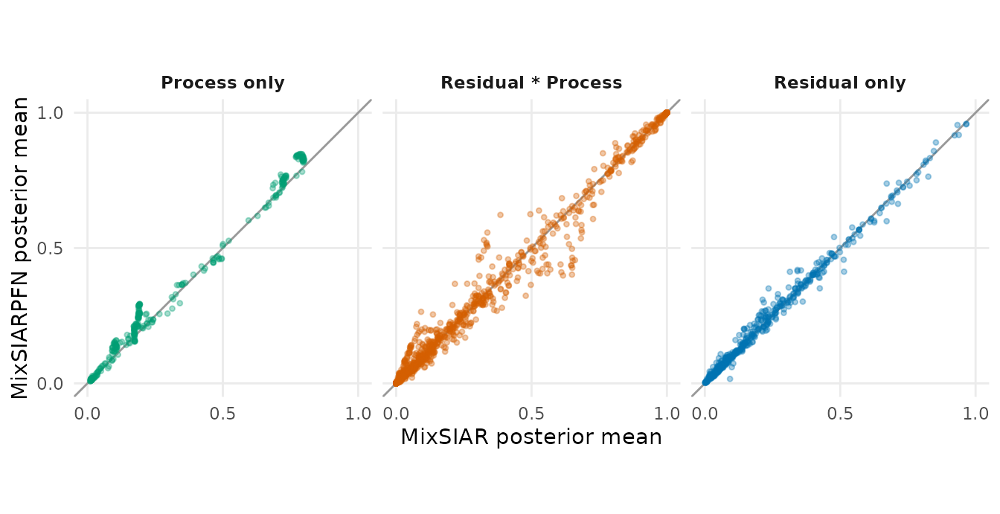
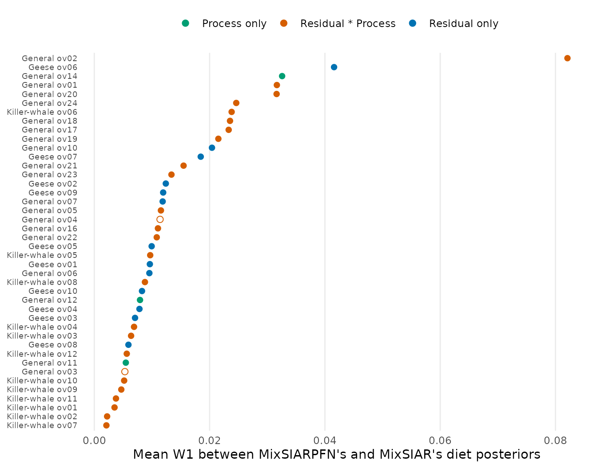

# MixSIARPFN on every simulated dataset

Every simulated dataset made while developing MixSIARPFN that MixSIAR
has also fitted is here: 492 datasets with known true diets, and more
than 1,000 MixSIAR runs. They come in two groups:

- **The simulation study** (450 datasets): three designs copied from
  MixSIAR’s geese and wolves examples, 150 datasets each. The article
  *How MixSIARPFN works and how well it does*
  ([`vignette("performance")`](https://andrewcparnell.github.io/MixSIARPFN/articles/performance.md))
  analyses these in detail; this article gives the per-batch results.
- **The benchmark** (42 datasets): designs chosen to cover what
  MixSIARPFN supports, from 2 to 8 sources, 1 to 4 tracers, 2 to 800
  consumers, every error structure, fixed, random, crossed and nested
  effects, covariates, concentration dependence, sources given by a
  factor and informative priors.

MixSIARPFN fitted every one of them, each in about a second, with the
released (version 3) networks.

## The simulation study

| Design | Batch | Datasets | MixSIAR long converged | MixSIAR normal converged | CRPS, MixSIARPFN | CRPS, MixSIAR long | MixSIARPFN more accurate | 95% coverage, MixSIARPFN | 95% coverage, MixSIAR long |
|:---|:---|---:|---:|---:|---:|---:|---:|---:|---:|
| Geese-like | 1 (seed 2026) | 50 | 47 | 35 | 0.0581 | 0.0533 | 15 | 0.952 | 0.931 |
| Geese-like | 2 (seed 2027) | 100 | 97 | 83 | 0.0561 | 0.0542 | 34 | 0.957 | 0.938 |
| Wolves-like, diets from the prior | 1 (seed 2026) | 50 | 17 | 10 | 0.0525 | 0.0486 | 5 | 0.970 | 0.975 |
| Wolves-like, diets from the prior | 2 (seed 2027) | 100 | 41 | 28 | 0.0603 | 0.0604 | 16 | 0.969 | 0.967 |
| Realistic wolves-like | 1 (seed 2026) | 50 | 32 | 22 | 0.0623 | 0.0611 | 12 | 0.969 | 0.954 |
| Realistic wolves-like | 2 (seed 2027) | 100 | 58 | 51 | 0.0635 | 0.0603 | 19 | 0.971 | 0.968 |

CRPS and ‘more accurate’ are over the datasets where MixSIAR’s long run
converged; MixSIARPFN’s coverage is over all datasets.

The two batches were simulated separately, with different random seeds,
and they tell the same story: MixSIARPFN’s accuracy is close to
converged MixSIAR’s in every batch, it is the more accurate on about a
third of datasets, and its intervals cover the truth at least as often
as they should. Against MixSIAR’s normal-length run, which most analyses
use, it is the more accurate on 177 of all 450 datasets, including the
221 where that run had not converged.

## The benchmark

| Family | Dataset | Error | Sources | Tracers | Consumers | Effects and options | MixSIAR run | Diets compared | Mean W1 | Median SD ratio | Coverage, MixSIARPFN | Coverage, MixSIAR |
|:---|:---|:---|---:|---:|---:|:---|:---|---:|---:|---:|---:|---:|
| Geese-like | ov01 | Residual only | 2 | 1 | 20 | F, conc. | long | 6 | 0.010 | 1.00 | 1.00 | 1.00 |
| Geese-like | ov02 | Residual only | 3 | 2 | 60 | F, conc. | long | 15 | 0.012 | 1.01 | 0.92 | 0.92 |
| Geese-like | ov07 | Residual only | 3 | 4 | 300 | F, conc. | long | 21 | 0.018 | 0.99 | 1.00 | 1.00 |
| Geese-like | ov03 | Residual only | 4 | 2 | 250 | F, conc., informative prior | long | 36 | 0.007 | 1.02 | 1.00 | 1.00 |
| Geese-like | ov04 | Residual only | 4 | 3 | 30 | F, conc. | long | 16 | 0.008 | 1.00 | 1.00 | 1.00 |
| Geese-like | ov05 | Residual only | 5 | 2 | 150 | F, conc. | long | 65 | 0.010 | 1.01 | 0.90 | 0.92 |
| Geese-like | ov09 | Residual only | 5 | 3 | 400 | F, conc., informative prior | long | 105 | 0.012 | 0.98 | 0.89 | 0.91 |
| Geese-like | ov06 | Residual only | 6 | 1 | 40 | F, conc., informative prior | long | 36 | 0.042 | 1.22 | 1.00 | 1.00 |
| Geese-like | ov10 | Residual only | 7 | 4 | 800 | F, conc. | long | 77 | 0.008 | 1.09 | 0.99 | 0.99 |
| Geese-like | ov08 | Residual only | 8 | 2 | 100 | F, conc. | long | 24 | 0.006 | 0.99 | 0.94 | 0.94 |
| General | ov14 | Process only | 3 | 1 | 75 | F + covariate | long | 252 | 0.033 | 1.02 | 1.00 | 1.00 |
| General | ov11 | Process only | 4 | 2 | 30 | none | long | 4 | 0.005 | 0.96 | 1.00 | 1.00 |
| General | ov12 | Process only | 4 | 3 | 18 | F, informative prior | long | 52 | 0.008 | 1.06 | 0.96 | 0.98 |
| General | ov16 | Residual \* Process | 2 | 1 | 30 | RR nested, sources by factor | long | 12 | 0.011 | 1.03 | 0.92 | 1.00 |
| General | ov21 | Residual \* Process | 2 | 2 | 120 | RR nested, sources by factor, informative prior | extreme | 36 | 0.015 | 0.99 | 0.72 | 0.72 |
| General | ov02 | Residual \* Process | 3 | 2 | 150 | RR | long | 84 | 0.082 | 1.01 | 1.00 | 0.99 |
| General | ov03 | Residual \* Process | 3 | 2 | 60 | none + covariate, informative prior | extreme (not converged) | 198 | 0.005 | 1.17 | 0.77 | 0.84 |
| General | ov17 | Residual \* Process | 3 | 2 | 66 | RR nested, sources by factor | extreme | 36 | 0.023 | 0.99 | 0.97 | 1.00 |
| General | ov19 | Residual \* Process | 3 | 3 | 60 | RR nested, sources by factor | long | 33 | 0.022 | 1.14 | 1.00 | 1.00 |
| General | ov24 | Residual \* Process | 3 | 2 | 300 | RR nested, sources by factor, informative prior | extreme | 75 | 0.025 | 0.91 | 1.00 | 1.00 |
| General | ov01 | Residual \* Process | 4 | 2 | 120 | FR | long | 96 | 0.032 | 1.21 | 1.00 | 1.00 |
| General | ov05 | Residual \* Process | 4 | 3 | 90 | R, conc., sources by factor | extreme | 28 | 0.012 | 1.23 | 1.00 | 1.00 |
| General | ov18 | Residual \* Process | 4 | 2 | 100 | RR nested, sources by factor, informative prior | long | 28 | 0.024 | 1.03 | 0.96 | 1.00 |
| General | ov23 | Residual \* Process | 4 | 4 | 150 | RR nested, sources by factor | extreme | 44 | 0.013 | 1.10 | 0.98 | 0.98 |
| General | ov04 | Residual \* Process | 5 | 2 | 100 | F + covariate, conc. | extreme (not converged) | 550 | 0.011 | 1.20 | 0.97 | 0.97 |
| General | ov20 | Residual \* Process | 5 | 2 | 200 | RR nested, sources by factor | extreme | 70 | 0.032 | 1.07 | 0.99 | 0.99 |
| General | ov22 | Residual \* Process | 6 | 1 | 40 | RR nested, sources by factor | long | 30 | 0.011 | 0.99 | 1.00 | 1.00 |
| General | ov06 | Residual only | 3 | 2 | 80 | FF, informative prior | long | 36 | 0.010 | 0.99 | 1.00 | 1.00 |
| General | ov07 | Residual only | 3 | 1 | 120 | R | long | 27 | 0.012 | 1.00 | 1.00 | 1.00 |
| General | ov10 | Residual only | 5 | 2 | 180 | RR nested, conc. | long | 65 | 0.020 | 1.08 | 0.97 | 0.95 |
| Killer-whale-like | ov01 | Residual \* Process | 2 | 1 | 5 | none | long | 2 | 0.004 | 1.02 | 1.00 | 1.00 |
| Killer-whale-like | ov02 | Residual \* Process | 2 | 2 | 40 | none | long | 2 | 0.002 | 1.40 | 1.00 | 1.00 |
| Killer-whale-like | ov03 | Residual \* Process | 3 | 1 | 2 | none, informative prior | long | 3 | 0.006 | 1.00 | 1.00 | 1.00 |
| Killer-whale-like | ov04 | Residual \* Process | 3 | 2 | 15 | none | long | 3 | 0.007 | 1.04 | 1.00 | 1.00 |
| Killer-whale-like | ov05 | Residual \* Process | 4 | 3 | 8 | none | long | 4 | 0.010 | 1.08 | 1.00 | 1.00 |
| Killer-whale-like | ov06 | Residual \* Process | 4 | 4 | 120 | none, informative prior | long | 4 | 0.024 | 1.35 | 1.00 | 1.00 |
| Killer-whale-like | ov07 | Residual \* Process | 5 | 2 | 12 | none | long | 5 | 0.002 | 1.00 | 1.00 | 1.00 |
| Killer-whale-like | ov08 | Residual \* Process | 5 | 3 | 60 | none | long | 5 | 0.009 | 1.04 | 1.00 | 1.00 |
| Killer-whale-like | ov09 | Residual \* Process | 6 | 2 | 25 | none, informative prior | long | 6 | 0.005 | 1.02 | 0.83 | 0.83 |
| Killer-whale-like | ov10 | Residual \* Process | 6 | 4 | 4 | none | long | 6 | 0.005 | 0.98 | 1.00 | 1.00 |
| Killer-whale-like | ov11 | Residual \* Process | 8 | 1 | 30 | none | long | 8 | 0.004 | 0.98 | 1.00 | 1.00 |
| Killer-whale-like | ov12 | Residual \* Process | 8 | 3 | 300 | none, informative prior | long | 8 | 0.006 | 1.04 | 1.00 | 0.88 |

For every diet proportion of every dataset (global, each level, along a
covariate and combinations of levels), MixSIARPFN’s posterior is
compared with MixSIAR’s draws:

- **W1** (Wasserstein-1): how far, on average, probability has to move
  to turn one posterior into the other, in units of the proportion. 0.02
  means the two posteriors are typically 0.02 apart.
- **SD ratio**: MixSIARPFN’s posterior SD over MixSIAR’s (above 1:
  MixSIARPFN is wider).
- **Coverage**: how often each method’s 95% interval contains the true
  value.

Across all 42 datasets the mean W1 is 0.019, the median SD ratio 1.04,
and the 95% coverage 95% for MixSIARPFN against 96% for MixSIAR.

### The two methods give the same diets

Each point is one diet proportion in one dataset (2213 in all). The two
methods’ posterior means agree closely across every design and error
structure: the correlation is 0.994, and half of them differ by less
than 0.006.

### Dataset by dataset

37 of the 42 datasets sit below 0.03: there the two posteriors are
nearly the same. The largest differences are General ov02 (RR, 3
sources; W1 0.082), Geese-like ov06 (F, 6 sources; W1 0.042), and
General ov14 (F, 3 sources; W1 0.033). Open circles are the two datasets
where MixSIAR itself had not fully converged (largest PSRF 1.29, both
with a covariate); the two methods agree closely even there.

### Calibration

| Error structure | Datasets | Diet proportions | 95% coverage, MixSIARPFN | 95% coverage, MixSIAR |
|:---|---:|---:|---:|---:|
| Process only | 3 | 308 | 0.994 | 0.997 |
| Residual \* Process | 26 | 1376 | 0.945 | 0.955 |
| Residual only | 13 | 529 | 0.954 | 0.959 |

### Model parameters

| Parameter | Estimates | Datasets | Correlation of means | Median SD ratio | Coverage, MixSIARPFN | Coverage, MixSIAR |
|:---|---:|---:|---:|---:|---:|---:|
| Covariate slopes (CLR) | 11 | 3 | 0.992 | 0.96 | 0.91 | 1.00 |
| Random-effect SDs | 25 | 14 | 0.982 | 1.03 | 0.84 | 0.80 |
| Residual multipliers (resid.prop) | 55 | 23 | 0.994 | 1.00 | 0.93 | 0.93 |

MixSIARPFN also gives the model’s other parameters, and they agree with
MixSIAR’s as closely as the diets do. Random-effect SDs are hard for
both methods: they are weakly identified with few levels, and both
methods’ intervals miss the true SD more often than 5% of the time.

## Datasets left out

| Dataset | Why it is not compared |
|:---|:---|
| general/ov08_resid_none_cont_K4_J2_N50 | MixSIAR cannot fit it (its inverse ILR overflows) |
| general/ov09_resid_FR_srcbyHabitat_K4_J2_L3x5_N150 | MixSIAR did not converge, even at extreme length (largest PSRF 1.14) |
| general/ov13_process_R_K5_J2_L6_N100 | MixSIAR did not converge, even at extreme length (largest PSRF 1.15) |
| general/ov15_process_RR_conc_K4_J2_L3x4_N120 | MixSIAR did not converge, even at extreme length (largest PSRF 1.31) |
| general/ov25_mult_RRn_srcbyLake_K8_J2_L4x9_N500 | MixSIAR’s long run did not converge (largest PSRF 1.12) and its extreme run had not finished |

These are cases where there is no reliable MixSIAR answer to compare
with.

## In short

Across 492 simulated datasets and every kind of model MixSIARPFN
supports, its posteriors are close to MixSIAR’s and its intervals are
calibrated. In the simulation study, where accuracy against the truth
can be compared directly, it is the more accurate of the two on about a
third of datasets. And it takes about a second where MixSIAR takes from
minutes to hours.
