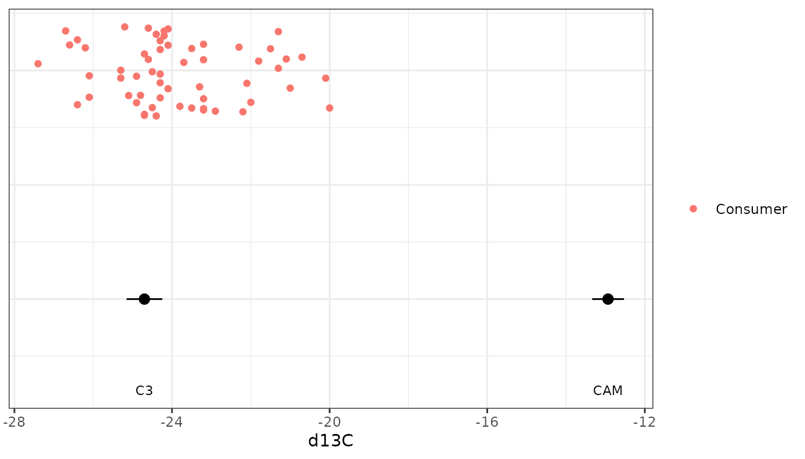
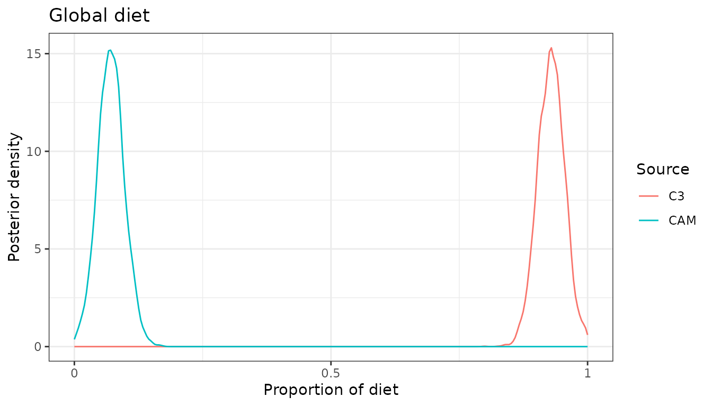
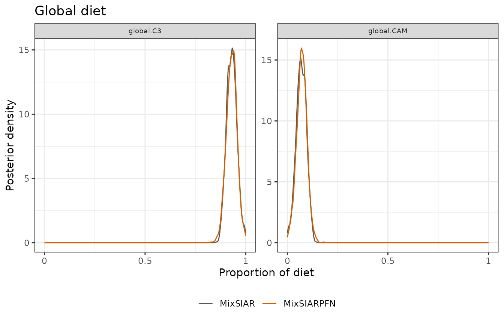
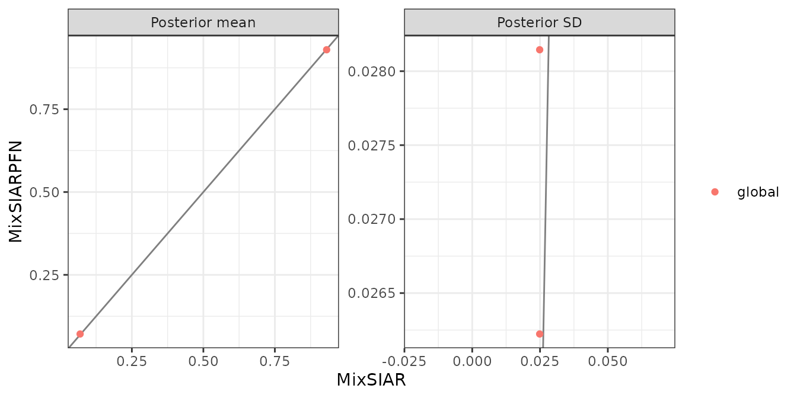

# Snail: one tracer, raw source data

This follows MixSIAR’s snail example script (`mixsiar_script_snail.R`),
with data from Yanes et al. (2013): land snails, one tracer (δ¹³C) and
two food sources, C3 and CAM plants, and no effects. Two things make it
different from the other examples: there is only one tracer, and the
source data are raw samples rather than means and SDs. Only the fitting
call differs from MixSIAR’s script:
[`run_pfn()`](https://andrewcparnell.github.io/MixSIARPFN/reference/run_pfn.md)
in place of `write_JAGS_model()` and `run_model()`.

## The data

``` r
mix <- load_mix_data(
  filename = system.file("extdata", "snail_consumer.csv", package = "MixSIARPFN"),
  iso_names = "d13C", factors = NULL, fac_random = NULL,
  fac_nested = NULL, cont_effects = NULL)
source <- load_source_data(
  filename = system.file("extdata", "snail_sources.csv", package = "MixSIARPFN"),
  source_factors = NULL, conc_dep = FALSE, data_type = "raw", mix)
#> Raw source data summarised to means, SDs and sample sizes (C3: n = 5; CAM: n = 3).
discr <- load_discr_data(
  filename = system.file("extdata", "snail_discrimination.csv", package = "MixSIARPFN"),
  mix)
```

With `data_type = "raw"`,
[`load_source_data()`](https://andrewcparnell.github.io/MixSIARPFN/reference/load_source_data.md)
summarises each source’s samples to its mean, SD and sample size, which
is what MixSIARPFN’s networks use:

``` r
source$data
#>   Source  Meand13C    SDd13C n
#> 1     C3 -25.70000 0.4527693 5
#> 2    CAM -13.93333 0.4041452 3
```

There are 58 snails.

``` r
plot_data(mix = mix, source = source, discr = discr)
```



## Fitting the model

Residual \* Process error and MixSIAR’s uninformative Dirichlet prior,
as in MixSIAR’s script.

``` r
time <- system.time(
  fit <- run_pfn(mix, source, discr, alpha.prior = 1,
                 resid_err = TRUE, process_err = TRUE)
)
fit
#> MixSIARPFN fit (Residual * Process error), 2 sources, in 0.2 s
#> Marginal posteriors (no joint draws). Global diet:
#>  source  mean    sd  2.5% 97.5%
#>      C3 0.929 0.028 0.876 0.982
#>     CAM 0.071 0.026 0.020 0.123
#> Use output_pfn() for every proportion and parameter.
#> Note: Consumer columns not used: Length.
```

## Results

``` r
out <- output_pfn(fit, mix, source,
                  output_options = list(summary_save = FALSE, plot_post_save_pdf = FALSE))
```

``` r
knitr::kable(round(summary_table(fit), 3))
```

|              |   Mean |    SD |  2.5% |    5% |    25% |    50% |    75% |    95% |  97.5% |
|:-------------|-------:|------:|------:|------:|-------:|-------:|-------:|-------:|-------:|
| Epsilon.1    | 13.695 | 4.242 | 4.673 | 5.913 | 10.675 | 14.277 | 17.254 | 19.459 | 19.730 |
| p.global.C3  |  0.929 | 0.028 | 0.876 | 0.886 |  0.912 |  0.930 |  0.947 |  0.973 |  0.982 |
| p.global.CAM |  0.071 | 0.026 | 0.020 | 0.028 |  0.054 |  0.071 |  0.089 |  0.114 |  0.123 |

``` r
out$plots$global
```



The snails’ diet is mostly C3 plants. With one tracer and two sources
the diet is well identified: the consumers’ δ¹³C sits between the two
sources, much closer to C3.

## Comparison with MixSIAR

``` r
ref <- mixsiar_reference("snail")
ref_raw <- mixsiar_reference("snail_raw")
blocks <- "global"
```

MixSIAR 3.1.12 fitted the same model to the same data with 3 chains of
300,000 iterations (burn-in 200,000, MixSIAR’s “long” run), which took 2
minutes (largest Gelman-Rubin diagnostic 1.012). MixSIARPFN took 0.2
seconds, about 480 times faster.

Means, SDs, 95% intervals and the Wasserstein-1 distance between the two
posteriors (W1: how far, on average, one posterior’s mass has to move to
match the other, on the proportion scale):

``` r
knitr::kable(data.frame(
  quantity = cmp$name,
  `MixSIARPFN mean` = round(cmp$pfn_mean, 3), `MixSIAR mean` = round(cmp$mixsiar_mean, 3),
  `MixSIARPFN SD` = round(cmp$pfn_sd, 3), `MixSIAR SD` = round(cmp$mixsiar_sd, 3),
  `MixSIARPFN 95% CI` = sprintf("%.2f to %.2f", cmp$pfn_q2.5, cmp$pfn_q97.5),
  `MixSIAR 95% CI` = sprintf("%.2f to %.2f", cmp$mixsiar_q2.5, cmp$mixsiar_q97.5),
  W1 = round(cmp$w1, 3), check.names = FALSE))
```

| quantity | MixSIARPFN mean | MixSIAR mean | MixSIARPFN SD | MixSIAR SD | MixSIARPFN 95% CI | MixSIAR 95% CI | W1 |
|:---|---:|---:|---:|---:|:---|:---|---:|
| Epsilon.1 | 13.695 | 13.590 | 4.242 | 4.216 | 4.67 to 19.73 | 4.83 to 19.74 | NA |
| p.global.C3 | 0.929 | 0.931 | 0.028 | 0.025 | 0.88 to 0.98 | 0.88 to 0.98 | 0.002 |
| p.global.CAM | 0.071 | 0.069 | 0.026 | 0.025 | 0.02 to 0.12 | 0.02 to 0.12 | 0.002 |

``` r
for (b in blocks) print(plot_compare(fit, ref$draws, block = b))
```



``` r
plot_compare(fit, ref$draws, type = "means")
```



**What this shows.** MixSIARPFN’s diet proportions differ from MixSIAR’s
by 0.002 on average (MixSIAR’s posterior SDs are about 0.02), the mean
W1 between the two posteriors is 0.002, and the median ratio of their
SDs is 1.09. The largest difference in a posterior mean is for
p.global.CAM (0.071 against 0.069).

The source data here are raw samples, which MixSIARPFN summarises to
each source’s mean, SD and sample size. MixSIAR’s own example fits the
raw samples instead, estimating each source’s mean and variance in the
model. That MixSIAR fit (6 minutes, largest Gelman-Rubin diagnostic
1.031) and MixSIAR’s fit to the summaries differ by 0.001 in posterior
means on average, so summarising the sources changes little here. The
comparison above is like for like: both methods fitted the same
summaries.
