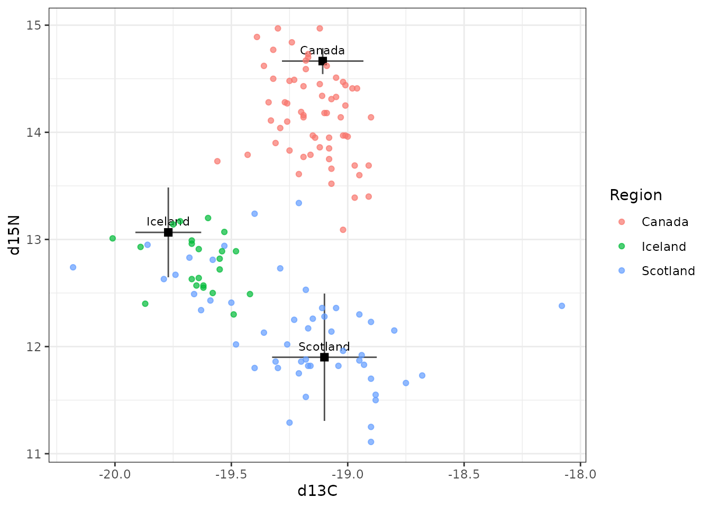
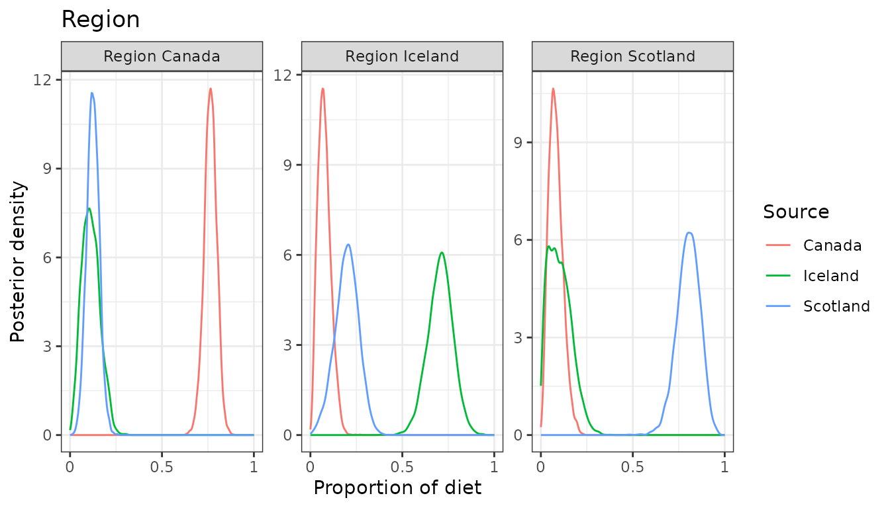
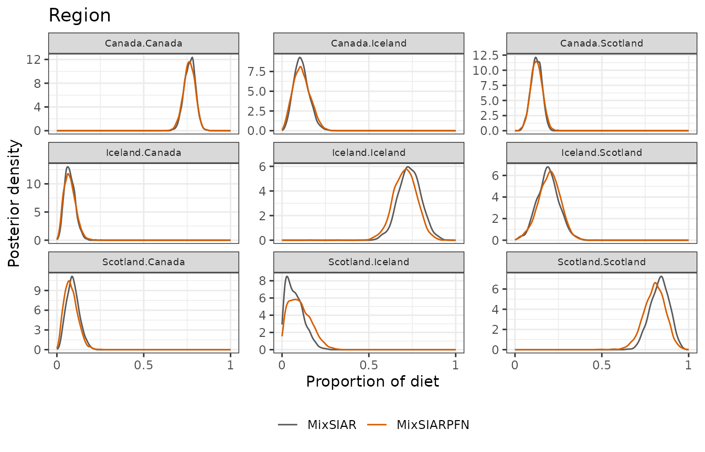
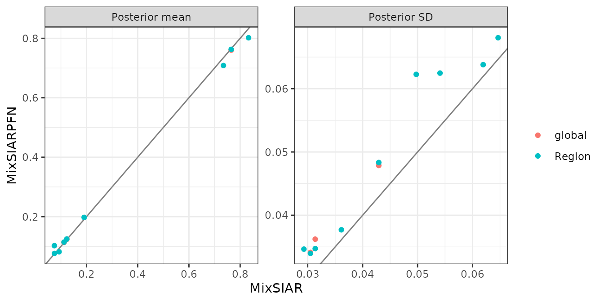

# Storm petrel: a fixed effect, raw source data

This follows MixSIAR’s storm petrel example script
(`mixsiar_script_stormpetrel.R`), based on Bicknell et al. (2014). It
uses a mixing model for movement rather than diet: the “mixture” is
juvenile (non-breeding) birds, caught in three regions (a fixed effect),
and the “sources” are adult (breeding) birds from three colonies, in
Canada, Iceland and Scotland. The model estimates what share of the
juveniles in each region are isotopically like each colony.
Discrimination is set to zero, since juveniles and adults feeding in the
same region should look the same. Two tracers (δ¹³C and δ¹⁵N), and the
source data are raw samples. Only the fitting call differs from
MixSIAR’s script:
[`run_pfn()`](https://andrewcparnell.github.io/MixSIARPFN/reference/run_pfn.md)
in place of `write_JAGS_model()` and `run_model()`.

## The data

``` r
mix <- load_mix_data(
  filename = system.file("extdata", "stormpetrel_consumer.csv", package = "MixSIARPFN"),
  iso_names = c("d13C", "d15N"), factors = "Region", fac_random = FALSE,
  fac_nested = FALSE, cont_effects = NULL)
source <- load_source_data(
  filename = system.file("extdata", "stormpetrel_sources.csv", package = "MixSIARPFN"),
  source_factors = NULL, conc_dep = FALSE, data_type = "raw", mix)
#> Raw source data summarised to means, SDs and sample sizes (Canada: n = 4; Iceland: n = 12; Scotland: n = 18).
discr <- load_discr_data(
  filename = system.file("extdata", "stormpetrel_discrimination.csv", package = "MixSIARPFN"),
  mix)
```

[`load_source_data()`](https://andrewcparnell.github.io/MixSIARPFN/reference/load_source_data.md)
summarises the raw source samples to each source’s mean, SD and sample
size, which is what MixSIARPFN’s networks use:

``` r
source$data
#>     Source  Meand13C    SDd13C Meand15N    SDd15N  n
#> 1   Canada -19.10750 0.1750000 14.66500 0.1215182  4
#> 2  Iceland -19.77083 0.1413865 13.06583 0.4191649 12
#> 3 Scotland -19.10000 0.2248660 11.90056 0.5943803 18
```

There are 135 birds in 3 regions (Canada, Iceland, Scotland).

``` r
plot_data(mix = mix, source = source, discr = discr)
```



## Fitting the model

Residual \* Process error and MixSIAR’s uninformative Dirichlet prior,
as in MixSIAR’s script.

``` r
time <- system.time(
  fit <- run_pfn(mix, source, discr, alpha.prior = 1,
                 resid_err = TRUE, process_err = TRUE)
)
fit
#> MixSIARPFN fit (Residual * Process error), 3 sources, in 0.5 s
#> Marginal posteriors (no joint draws). Global diet:
#>    source  mean    sd  2.5% 97.5%
#>    Canada 0.760 0.036 0.687 0.828
#>   Iceland 0.113 0.048 0.031 0.215
#>  Scotland 0.123 0.034 0.058 0.192
#> Use output_pfn() for every proportion and parameter.
```

## Results

``` r
out <- output_pfn(fit, mix, source,
                  output_options = list(summary_save = FALSE, plot_post_save_pdf = FALSE))
```

``` r
knitr::kable(round(summary_table(fit), 3))
```

|                     |  Mean |    SD |  2.5% |    5% |   25% |   50% |   75% |   95% | 97.5% |
|:--------------------|------:|------:|------:|------:|------:|------:|------:|------:|------:|
| Epsilon.1           | 2.603 | 0.763 | 1.403 | 1.543 | 2.058 | 2.508 | 3.042 | 3.981 | 4.343 |
| Epsilon.2           | 1.212 | 0.454 | 0.547 | 0.618 | 0.891 | 1.141 | 1.454 | 2.040 | 2.276 |
| p.global.Canada     | 0.760 | 0.036 | 0.687 | 0.700 | 0.738 | 0.761 | 0.785 | 0.817 | 0.828 |
| p.global.Iceland    | 0.113 | 0.048 | 0.031 | 0.040 | 0.078 | 0.110 | 0.145 | 0.197 | 0.215 |
| p.global.Scotland   | 0.123 | 0.034 | 0.058 | 0.068 | 0.100 | 0.123 | 0.146 | 0.180 | 0.192 |
| p.Canada.Canada     | 0.763 | 0.035 | 0.692 | 0.705 | 0.741 | 0.764 | 0.786 | 0.818 | 0.828 |
| p.Canada.Iceland    | 0.114 | 0.048 | 0.031 | 0.040 | 0.079 | 0.111 | 0.146 | 0.199 | 0.216 |
| p.Canada.Scotland   | 0.125 | 0.034 | 0.059 | 0.069 | 0.102 | 0.124 | 0.147 | 0.181 | 0.193 |
| p.Iceland.Canada    | 0.076 | 0.035 | 0.021 | 0.026 | 0.051 | 0.073 | 0.098 | 0.139 | 0.153 |
| p.Iceland.Iceland   | 0.708 | 0.068 | 0.571 | 0.596 | 0.665 | 0.710 | 0.753 | 0.818 | 0.839 |
| p.Iceland.Scotland  | 0.197 | 0.064 | 0.066 | 0.088 | 0.156 | 0.200 | 0.241 | 0.299 | 0.319 |
| p.Scotland.Canada   | 0.082 | 0.038 | 0.021 | 0.027 | 0.054 | 0.078 | 0.105 | 0.149 | 0.164 |
| p.Scotland.Iceland  | 0.102 | 0.062 | 0.011 | 0.016 | 0.052 | 0.095 | 0.144 | 0.215 | 0.238 |
| p.Scotland.Scotland | 0.802 | 0.062 | 0.671 | 0.695 | 0.762 | 0.805 | 0.846 | 0.899 | 0.914 |

``` r
for (p in out$plots[grepl("^Region", names(out$plots))]) print(p)
```



## Comparison with MixSIAR

``` r
ref <- mixsiar_reference("stormpetrel")
ref_raw <- mixsiar_reference("stormpetrel_raw")
blocks <- "Region"
```

MixSIAR 3.1.12 fitted the same model to the same data with 3 chains of
300,000 iterations (burn-in 200,000, MixSIAR’s “long” run), which took
71 minutes (largest Gelman-Rubin diagnostic 1.005). MixSIARPFN took 0.5
seconds, about 8,000 times faster.

Means, SDs, 95% intervals and the Wasserstein-1 distance between the two
posteriors (W1: how far, on average, one posterior’s mass has to move to
match the other, on the proportion scale):

``` r
knitr::kable(data.frame(
  quantity = cmp$name,
  `MixSIARPFN mean` = round(cmp$pfn_mean, 3), `MixSIAR mean` = round(cmp$mixsiar_mean, 3),
  `MixSIARPFN SD` = round(cmp$pfn_sd, 3), `MixSIAR SD` = round(cmp$mixsiar_sd, 3),
  `MixSIARPFN 95% CI` = sprintf("%.2f to %.2f", cmp$pfn_q2.5, cmp$pfn_q97.5),
  `MixSIAR 95% CI` = sprintf("%.2f to %.2f", cmp$mixsiar_q2.5, cmp$mixsiar_q97.5),
  W1 = round(cmp$w1, 3), check.names = FALSE))
```

| quantity | MixSIARPFN mean | MixSIAR mean | MixSIARPFN SD | MixSIAR SD | MixSIARPFN 95% CI | MixSIAR 95% CI | W1 |
|:---|---:|---:|---:|---:|:---|:---|---:|
| Epsilon.1 | 2.603 | 2.488 | 0.763 | 0.736 | 1.40 to 4.34 | 1.31 to 4.17 | NA |
| Epsilon.2 | 1.212 | 1.218 | 0.454 | 0.390 | 0.55 to 2.28 | 0.62 to 2.16 | NA |
| p.global.Canada | 0.760 | 0.765 | 0.036 | 0.031 | 0.69 to 0.83 | 0.70 to 0.83 | 0.005 |
| p.global.Iceland | 0.113 | 0.112 | 0.048 | 0.043 | 0.03 to 0.21 | 0.04 to 0.20 | 0.004 |
| p.global.Scotland | 0.123 | 0.123 | 0.034 | 0.031 | 0.06 to 0.19 | 0.06 to 0.18 | 0.003 |
| p.Canada.Canada | 0.763 | 0.765 | 0.035 | 0.031 | 0.69 to 0.83 | 0.70 to 0.83 | 0.003 |
| p.Canada.Iceland | 0.114 | 0.112 | 0.048 | 0.043 | 0.03 to 0.22 | 0.04 to 0.20 | 0.005 |
| p.Canada.Scotland | 0.125 | 0.123 | 0.034 | 0.031 | 0.06 to 0.19 | 0.06 to 0.18 | 0.002 |
| p.Iceland.Canada | 0.076 | 0.075 | 0.035 | 0.029 | 0.02 to 0.15 | 0.03 to 0.14 | 0.004 |
| p.Iceland.Iceland | 0.708 | 0.735 | 0.068 | 0.065 | 0.57 to 0.84 | 0.61 to 0.86 | 0.026 |
| p.Iceland.Scotland | 0.197 | 0.191 | 0.064 | 0.062 | 0.07 to 0.32 | 0.08 to 0.31 | 0.007 |
| p.Scotland.Canada | 0.082 | 0.093 | 0.038 | 0.036 | 0.02 to 0.16 | 0.03 to 0.17 | 0.011 |
| p.Scotland.Iceland | 0.102 | 0.074 | 0.062 | 0.050 | 0.01 to 0.24 | 0.01 to 0.19 | 0.028 |
| p.Scotland.Scotland | 0.802 | 0.833 | 0.062 | 0.054 | 0.67 to 0.91 | 0.72 to 0.93 | 0.031 |

``` r
for (b in blocks) print(plot_compare(fit, ref$draws, block = b))
```



``` r
plot_compare(fit, ref$draws, type = "means")
```



**What this shows.** MixSIARPFN’s diet proportions differ from MixSIAR’s
by 0.010 on average (MixSIAR’s posterior SDs are about 0.04), the mean
W1 between the two posteriors is 0.011, and the median ratio of their
SDs is 1.12. The largest difference in a posterior mean is for
p.Scotland.Scotland (0.802 against 0.833).

The source data here are raw samples, which MixSIARPFN summarises to
each source’s mean, SD and sample size. MixSIAR’s own example fits the
raw samples instead, estimating each source’s mean and variance in the
model. That MixSIAR fit (165 minutes, largest Gelman-Rubin diagnostic
1.004) and MixSIAR’s fit to the summaries differ by 0.025 in posterior
means on average. The comparison above is like for like: both methods
fitted the same summaries.
