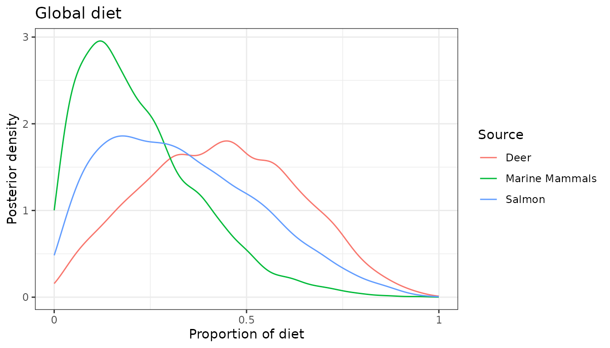
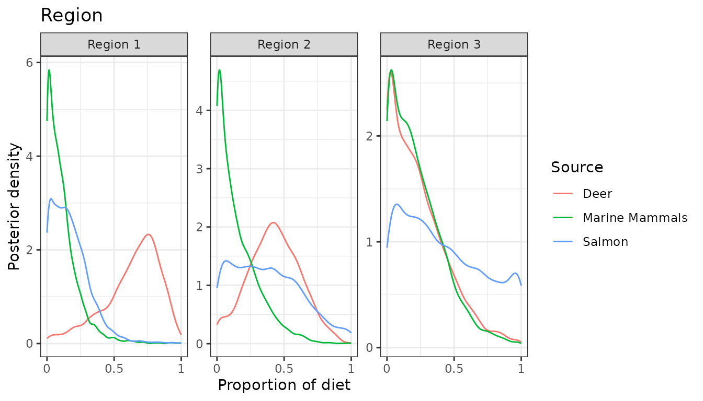
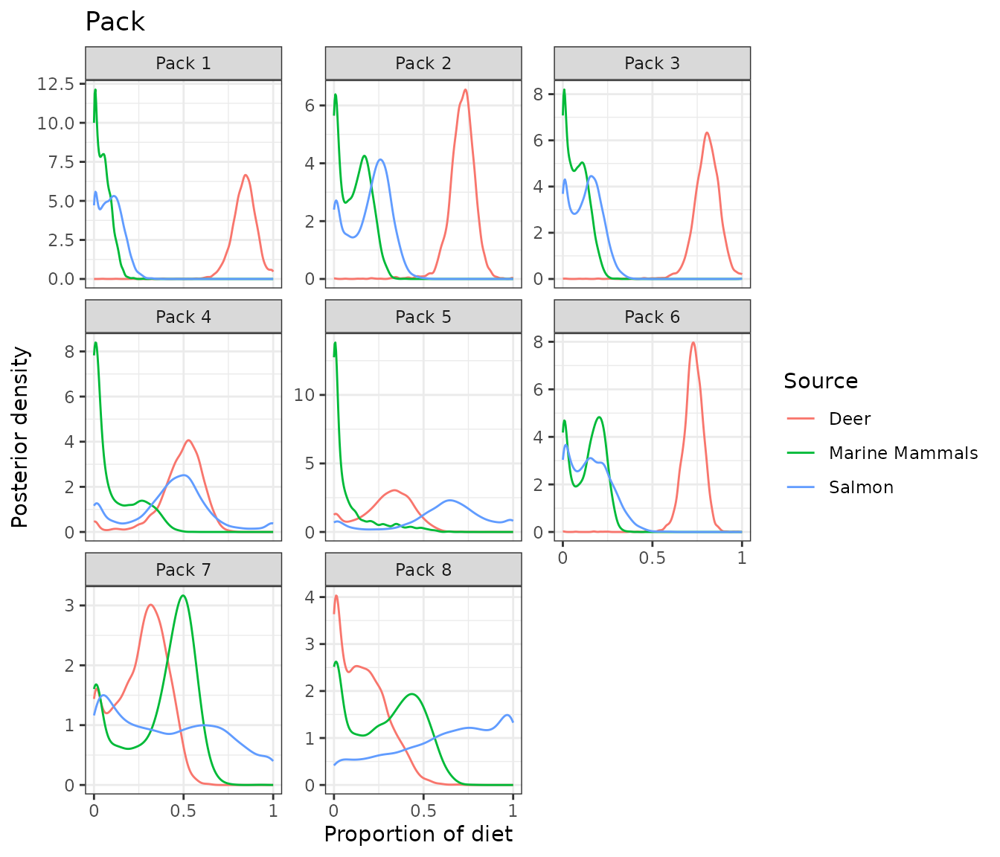
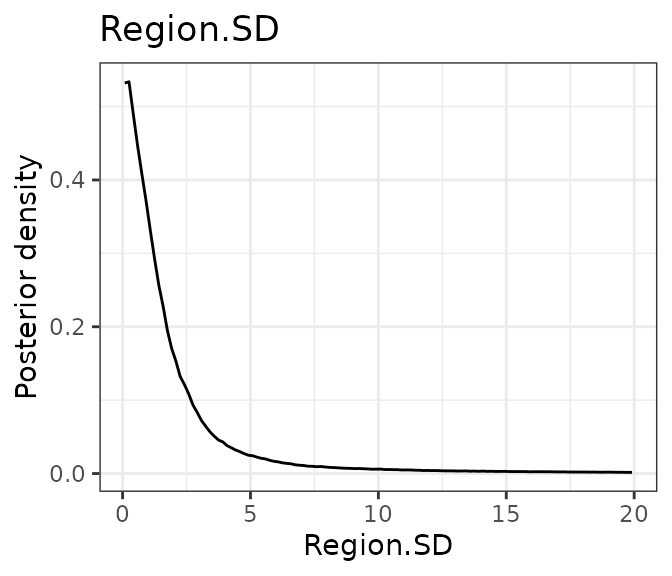
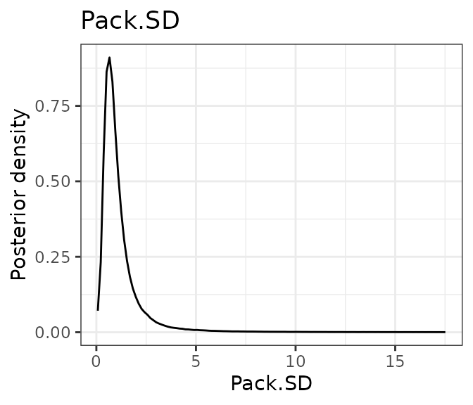
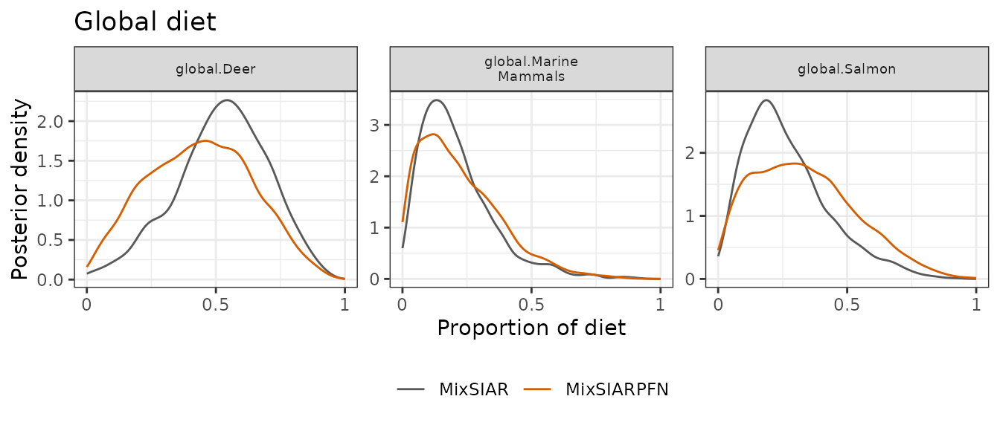
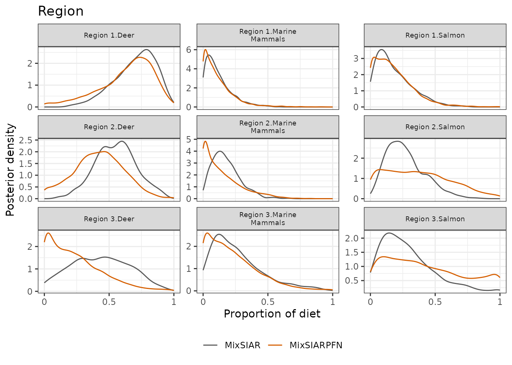
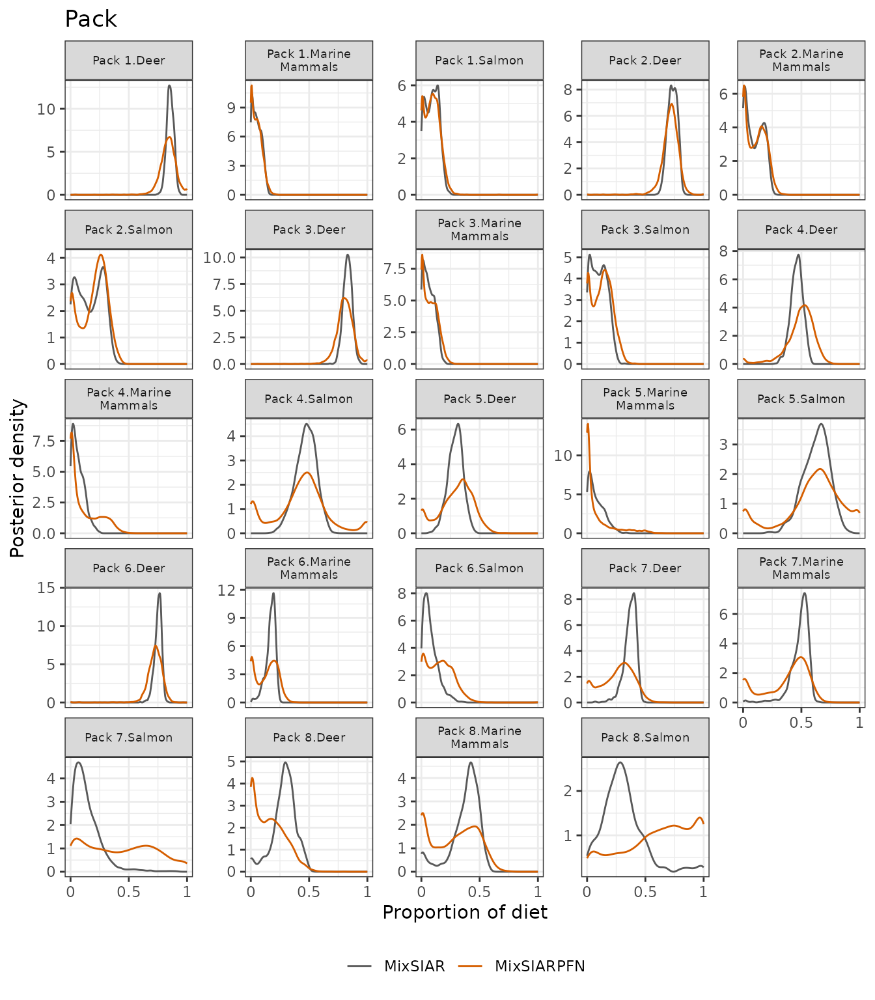
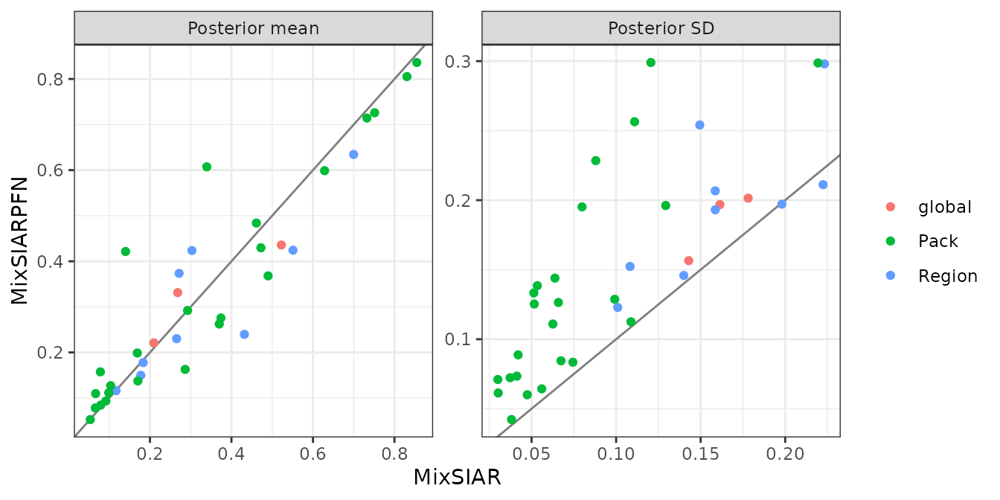

# Wolves: nested random effects, sources by region

This follows MixSIAR’s wolves example (Semmens et al. 2009 data, as
analysed in Stock et al. 2018): 66 wolves from 8 packs in 3 regions,
whose diet is a mix of deer, marine mammals and salmon, measured with
two tracers (δ¹³C and δ¹⁵N). Pack is a random effect nested within the
random effect Region, and the sources’ isotope values were measured
separately in each region. The model and data are exactly as in
MixSIAR’s vignette; only the fitting call changes,
[`run_pfn()`](../reference/run_pfn.md) in place of `write_JAGS_model()`
and `run_model()`.

## The data

``` r
mix <- load_mix_data(
  filename = system.file("extdata", "wolves_consumer.csv", package = "MixSIARPFN"),
  iso_names = c("d13C", "d15N"), factors = c("Region", "Pack"),
  fac_random = c(TRUE, TRUE), fac_nested = c(FALSE, TRUE), cont_effects = NULL)
source <- load_source_data(
  filename = system.file("extdata", "wolves_sources.csv", package = "MixSIARPFN"),
  source_factors = "Region", conc_dep = FALSE, data_type = "means", mix)
discr <- load_discr_data(
  filename = system.file("extdata", "wolves_discrimination.csv", package = "MixSIARPFN"),
  mix)
mix
#> Consumer data: 66 consumers, 2 tracer(s): d13C, d15N 
#>    Random effect Region with 3 levels
#>    Random effect Pack with 8 levels
source
#> Source data: 3 sources: Deer, Marine Mammals, Salmon 
#>   Given by Region
```

The isospace plot shows the wolves, coloured by region, and each
source’s mean in each region after adding the discrimination factor,
with ±1 SD:

``` r
plot_data(mix = mix, source = source, discr = discr)
#> `height` was translated to `width`.
```


## Fitting the model

Residual \* Process error and MixSIAR’s uninformative prior, as in
MixSIAR’s vignette. The network for this error structure is downloaded
the first time it is needed (about 36 MB) and cached.

``` r
time <- system.time(
  fit <- run_pfn(mix, source, discr, alpha.prior = 1,
                 resid_err = TRUE, process_err = TRUE)
)
fit
#> MixSIARPFN fit (Residual * Process error), 3 sources, in 0.5 s
#> Marginal posteriors (no joint draws). Global diet:
#>          source  mean    sd  2.5% 97.5%
#>            Deer 0.436 0.201 0.070 0.817
#>  Marine Mammals 0.221 0.157 0.015 0.601
#>          Salmon 0.331 0.197 0.030 0.757
#> Use output_pfn() for every proportion and parameter.
```

The fit took 0.5 seconds.

## Results

[`output_pfn()`](../reference/output_pfn.md) takes MixSIAR’s
`output_options` list. It prints the summary statistics, with MixSIAR’s
row names, and draws a posterior density plot for the global diet, each
effect and each parameter (here shown, not saved):

``` r
out <- output_pfn(fit, mix, source,
                  output_options = list(summary_save = FALSE, plot_post_save_pdf = FALSE))
```

``` r
knitr::kable(round(summary_table(fit), 3))
```

|                           |  Mean |    SD |  2.5% |    5% |   25% |   50% |   75% |   95% |  97.5% |
|:--------------------------|------:|------:|------:|------:|------:|------:|------:|------:|-------:|
| Epsilon.1                 | 0.853 | 0.643 | 0.205 | 0.254 | 0.471 | 0.714 | 1.060 | 1.870 |  2.297 |
| Epsilon.2                 | 0.621 | 0.415 | 0.191 | 0.230 | 0.384 | 0.540 | 0.758 | 1.248 |  1.490 |
| Region.SD                 | 2.005 | 2.776 | 0.049 | 0.095 | 0.480 | 1.106 | 2.277 | 7.436 | 11.071 |
| Pack.SD                   | 1.208 | 1.393 | 0.232 | 0.306 | 0.578 | 0.863 | 1.333 | 3.041 |  4.418 |
| p.global.Deer             | 0.436 | 0.201 | 0.070 | 0.108 | 0.283 | 0.433 | 0.586 | 0.769 |  0.817 |
| p.global.Marine Mammals   | 0.221 | 0.157 | 0.015 | 0.026 | 0.100 | 0.189 | 0.310 | 0.524 |  0.601 |
| p.global.Salmon           | 0.331 | 0.197 | 0.030 | 0.052 | 0.175 | 0.308 | 0.465 | 0.691 |  0.757 |
| p.Region 1.Deer           | 0.634 | 0.207 | 0.121 | 0.213 | 0.521 | 0.678 | 0.785 | 0.901 |  0.932 |
| p.Region 1.Marine Mammals | 0.116 | 0.123 | 0.000 | 0.001 | 0.030 | 0.084 | 0.162 | 0.342 |  0.440 |
| p.Region 1.Salmon         | 0.178 | 0.146 | 0.000 | 0.003 | 0.066 | 0.151 | 0.254 | 0.449 |  0.535 |
| p.Region 2.Deer           | 0.424 | 0.193 | 0.039 | 0.096 | 0.291 | 0.424 | 0.557 | 0.745 |  0.805 |
| p.Region 2.Marine Mammals | 0.150 | 0.152 | 0.000 | 0.000 | 0.027 | 0.105 | 0.228 | 0.456 |  0.539 |
| p.Region 2.Salmon         | 0.373 | 0.254 | 0.006 | 0.018 | 0.157 | 0.351 | 0.555 | 0.835 |  0.920 |
| p.Region 3.Deer           | 0.240 | 0.211 | 0.000 | 0.000 | 0.063 | 0.194 | 0.361 | 0.659 |  0.765 |
| p.Region 3.Marine Mammals | 0.230 | 0.197 | 0.000 | 0.002 | 0.072 | 0.187 | 0.339 | 0.620 |  0.723 |
| p.Region 3.Salmon         | 0.424 | 0.298 | 0.006 | 0.020 | 0.167 | 0.376 | 0.654 | 0.971 |  0.996 |
| p.Pack 1.Deer             | 0.836 | 0.071 | 0.696 | 0.726 | 0.798 | 0.840 | 0.880 | 0.939 |  0.963 |
| p.Pack 1.Marine Mammals   | 0.053 | 0.042 | 0.000 | 0.001 | 0.016 | 0.047 | 0.081 | 0.129 |  0.146 |
| p.Pack 1.Salmon           | 0.093 | 0.064 | 0.000 | 0.001 | 0.039 | 0.091 | 0.139 | 0.202 |  0.223 |
| p.Pack 2.Deer             | 0.714 | 0.073 | 0.568 | 0.602 | 0.677 | 0.720 | 0.759 | 0.815 |  0.834 |
| p.Pack 2.Marine Mammals   | 0.111 | 0.083 | 0.000 | 0.000 | 0.026 | 0.114 | 0.180 | 0.244 |  0.263 |
| p.Pack 2.Salmon           | 0.199 | 0.113 | 0.000 | 0.002 | 0.111 | 0.222 | 0.284 | 0.357 |  0.380 |
| p.Pack 3.Deer             | 0.805 | 0.072 | 0.663 | 0.693 | 0.766 | 0.808 | 0.849 | 0.911 |  0.935 |
| p.Pack 3.Marine Mammals   | 0.078 | 0.060 | 0.000 | 0.001 | 0.023 | 0.074 | 0.123 | 0.182 |  0.200 |
| p.Pack 3.Salmon           | 0.127 | 0.084 | 0.000 | 0.001 | 0.054 | 0.130 | 0.190 | 0.263 |  0.287 |
| p.Pack 4.Deer             | 0.484 | 0.133 | 0.051 | 0.223 | 0.431 | 0.507 | 0.569 | 0.648 |  0.673 |
| p.Pack 4.Marine Mammals   | 0.110 | 0.125 | 0.000 | 0.000 | 0.005 | 0.047 | 0.205 | 0.355 |  0.386 |
| p.Pack 4.Salmon           | 0.430 | 0.228 | 0.001 | 0.007 | 0.316 | 0.453 | 0.556 | 0.822 |  0.987 |
| p.Pack 5.Deer             | 0.292 | 0.144 | 0.000 | 0.005 | 0.204 | 0.312 | 0.396 | 0.500 |  0.533 |
| p.Pack 5.Marine Mammals   | 0.084 | 0.126 | 0.000 | 0.000 | 0.004 | 0.026 | 0.104 | 0.398 |  0.460 |
| p.Pack 5.Salmon           | 0.599 | 0.256 | 0.003 | 0.017 | 0.502 | 0.640 | 0.762 | 0.978 |  0.999 |
| p.Pack 6.Deer             | 0.726 | 0.061 | 0.606 | 0.632 | 0.694 | 0.730 | 0.764 | 0.812 |  0.827 |
| p.Pack 6.Marine Mammals   | 0.137 | 0.089 | 0.000 | 0.001 | 0.050 | 0.154 | 0.209 | 0.265 |  0.281 |
| p.Pack 6.Salmon           | 0.157 | 0.111 | 0.000 | 0.002 | 0.062 | 0.153 | 0.236 | 0.343 |  0.380 |
| p.Pack 7.Deer             | 0.262 | 0.138 | 0.000 | 0.006 | 0.163 | 0.283 | 0.368 | 0.462 |  0.490 |
| p.Pack 7.Marine Mammals   | 0.368 | 0.195 | 0.000 | 0.001 | 0.238 | 0.435 | 0.515 | 0.597 |  0.621 |
| p.Pack 7.Salmon           | 0.421 | 0.299 | 0.001 | 0.008 | 0.137 | 0.413 | 0.670 | 0.927 |  0.989 |
| p.Pack 8.Deer             | 0.163 | 0.129 | 0.000 | 0.000 | 0.045 | 0.150 | 0.256 | 0.392 |  0.433 |
| p.Pack 8.Marine Mammals   | 0.276 | 0.196 | 0.000 | 0.000 | 0.076 | 0.297 | 0.442 | 0.567 |  0.602 |
| p.Pack 8.Salmon           | 0.607 | 0.299 | 0.011 | 0.043 | 0.392 | 0.653 | 0.863 | 0.999 |  1.000 |

``` r
out$plots$global
```



``` r
out$plots$Region
```



``` r
out$plots$Pack
```



``` r
out$plots$Region.SD
out$plots$Pack.SD
```



Each of these is a **marginal** posterior. The network gives each
proportion’s posterior on its own, not joint draws, so the marginal
means of one diet need not sum to exactly 1, and sums, differences or
ratios of proportions cannot be computed from the output.

## Comparison with MixSIAR

``` r
ref <- mixsiar_reference("wolves")
cmp <- compare_mixsiar(fit, ref$draws, ref$summary)
```

MixSIAR 3.1.12 fitted the same model with 3 chains of 3,000,000
iterations (burn-in 1,500,000, thinned by 500), a run of about 6.3 hours
that was needed for the Region SD to converge (largest Gelman-Rubin
diagnostic 1.012). MixSIARPFN took 0.5 seconds.

The table gives both posteriors’ means, SDs and 95% intervals, and the
Wasserstein-1 distance between them (W1: how far, on average, one
posterior’s mass has to move to match the other, on the proportion
scale; MixSIAR’s draws for the SDs and residual multipliers were not
saved, so those rows have no W1):

``` r
show <- transform(cmp, `MixSIARPFN 95% CI` = sprintf("%.2f to %.2f", pfn_q2.5, pfn_q97.5),
                  `MixSIAR 95% CI` = sprintf("%.2f to %.2f", mixsiar_q2.5, mixsiar_q97.5),
                  check.names = FALSE)
knitr::kable(data.frame(
  quantity = show$name,
  `MixSIARPFN mean` = round(show$pfn_mean, 3), `MixSIAR mean` = round(show$mixsiar_mean, 3),
  `MixSIARPFN SD` = round(show$pfn_sd, 3), `MixSIAR SD` = round(show$mixsiar_sd, 3),
  show[c("MixSIARPFN 95% CI", "MixSIAR 95% CI")], W1 = round(show$w1, 3),
  check.names = FALSE))
```

| quantity | MixSIARPFN mean | MixSIAR mean | MixSIARPFN SD | MixSIAR SD | MixSIARPFN 95% CI | MixSIAR 95% CI | W1 |
|:---|---:|---:|---:|---:|:---|:---|---:|
| Region.SD | 2.005 | 1.147 | 2.776 | 1.212 | 0.05 to 11.07 | 0.05 to 4.15 | NA |
| Pack.SD | 1.208 | 1.299 | 1.393 | 0.626 | 0.23 to 4.42 | 0.56 to 2.78 | NA |
| Epsilon.1 | 0.853 | 1.042 | 0.643 | 0.380 | 0.20 to 2.30 | 0.48 to 1.95 | NA |
| Epsilon.2 | 0.621 | 0.465 | 0.415 | 0.189 | 0.19 to 1.49 | 0.21 to 0.93 | NA |
| p.global.Deer | 0.436 | 0.522 | 0.201 | 0.178 | 0.07 to 0.82 | 0.14 to 0.83 | 0.087 |
| p.global.Marine Mammals | 0.221 | 0.209 | 0.157 | 0.143 | 0.01 to 0.60 | 0.03 to 0.59 | 0.019 |
| p.global.Salmon | 0.331 | 0.268 | 0.197 | 0.161 | 0.03 to 0.76 | 0.04 to 0.67 | 0.065 |
| p.Region 1.Deer | 0.634 | 0.700 | 0.207 | 0.159 | 0.12 to 0.93 | 0.34 to 0.94 | 0.066 |
| p.Region 1.Marine Mammals | 0.116 | 0.117 | 0.123 | 0.101 | 0.00 to 0.44 | 0.00 to 0.39 | 0.011 |
| p.Region 1.Salmon | 0.178 | 0.183 | 0.146 | 0.140 | 0.00 to 0.53 | 0.00 to 0.52 | 0.010 |
| p.Region 2.Deer | 0.424 | 0.551 | 0.193 | 0.159 | 0.04 to 0.80 | 0.23 to 0.87 | 0.127 |
| p.Region 2.Marine Mammals | 0.150 | 0.178 | 0.152 | 0.108 | 0.00 to 0.54 | 0.03 to 0.42 | 0.049 |
| p.Region 2.Salmon | 0.373 | 0.271 | 0.254 | 0.149 | 0.01 to 0.92 | 0.05 to 0.61 | 0.121 |
| p.Region 3.Deer | 0.240 | 0.432 | 0.211 | 0.222 | 0.00 to 0.76 | 0.02 to 0.86 | 0.192 |
| p.Region 3.Marine Mammals | 0.230 | 0.265 | 0.197 | 0.198 | 0.00 to 0.72 | 0.01 to 0.78 | 0.036 |
| p.Region 3.Salmon | 0.424 | 0.303 | 0.298 | 0.223 | 0.01 to 1.00 | 0.01 to 0.90 | 0.124 |
| p.Pack 1.Deer | 0.836 | 0.855 | 0.071 | 0.030 | 0.70 to 0.96 | 0.80 to 0.91 | 0.030 |
| p.Pack 1.Marine Mammals | 0.053 | 0.054 | 0.042 | 0.038 | 0.00 to 0.15 | 0.00 to 0.13 | 0.004 |
| p.Pack 1.Salmon | 0.093 | 0.092 | 0.064 | 0.056 | 0.00 to 0.22 | 0.00 to 0.19 | 0.006 |
| p.Pack 2.Deer | 0.714 | 0.732 | 0.073 | 0.041 | 0.57 to 0.83 | 0.65 to 0.80 | 0.024 |
| p.Pack 2.Marine Mammals | 0.111 | 0.099 | 0.083 | 0.074 | 0.00 to 0.26 | 0.00 to 0.22 | 0.014 |
| p.Pack 2.Salmon | 0.199 | 0.169 | 0.113 | 0.109 | 0.00 to 0.38 | 0.00 to 0.34 | 0.031 |
| p.Pack 3.Deer | 0.805 | 0.831 | 0.072 | 0.037 | 0.66 to 0.94 | 0.75 to 0.90 | 0.031 |
| p.Pack 3.Marine Mammals | 0.078 | 0.066 | 0.060 | 0.047 | 0.00 to 0.20 | 0.00 to 0.16 | 0.014 |
| p.Pack 3.Salmon | 0.127 | 0.104 | 0.084 | 0.067 | 0.00 to 0.29 | 0.00 to 0.23 | 0.025 |
| p.Pack 4.Deer | 0.484 | 0.461 | 0.133 | 0.051 | 0.05 to 0.67 | 0.36 to 0.55 | 0.066 |
| p.Pack 4.Marine Mammals | 0.110 | 0.067 | 0.125 | 0.052 | 0.00 to 0.39 | 0.00 to 0.19 | 0.057 |
| p.Pack 4.Salmon | 0.430 | 0.472 | 0.228 | 0.088 | 0.00 to 0.99 | 0.29 to 0.63 | 0.105 |
| p.Pack 5.Deer | 0.292 | 0.292 | 0.144 | 0.064 | 0.00 to 0.53 | 0.16 to 0.41 | 0.065 |
| p.Pack 5.Marine Mammals | 0.084 | 0.079 | 0.126 | 0.066 | 0.00 to 0.46 | 0.00 to 0.23 | 0.043 |
| p.Pack 5.Salmon | 0.599 | 0.629 | 0.256 | 0.111 | 0.00 to 1.00 | 0.39 to 0.82 | 0.101 |
| p.Pack 6.Deer | 0.726 | 0.751 | 0.061 | 0.030 | 0.61 to 0.83 | 0.69 to 0.80 | 0.030 |
| p.Pack 6.Marine Mammals | 0.137 | 0.170 | 0.089 | 0.042 | 0.00 to 0.28 | 0.06 to 0.23 | 0.048 |
| p.Pack 6.Salmon | 0.157 | 0.078 | 0.111 | 0.063 | 0.00 to 0.38 | 0.00 to 0.24 | 0.080 |
| p.Pack 7.Deer | 0.262 | 0.370 | 0.138 | 0.053 | 0.00 to 0.49 | 0.24 to 0.45 | 0.114 |
| p.Pack 7.Marine Mammals | 0.368 | 0.490 | 0.195 | 0.080 | 0.00 to 0.62 | 0.28 to 0.59 | 0.127 |
| p.Pack 7.Salmon | 0.421 | 0.140 | 0.299 | 0.121 | 0.00 to 0.99 | 0.01 to 0.45 | 0.282 |
| p.Pack 8.Deer | 0.163 | 0.286 | 0.129 | 0.099 | 0.00 to 0.43 | 0.02 to 0.46 | 0.124 |
| p.Pack 8.Marine Mammals | 0.276 | 0.374 | 0.196 | 0.129 | 0.00 to 0.60 | 0.00 to 0.54 | 0.111 |
| p.Pack 8.Salmon | 0.607 | 0.339 | 0.299 | 0.219 | 0.01 to 1.00 | 0.02 to 0.96 | 0.268 |

The posterior densities side by side, for the global diet, the regions
and the packs:

``` r
plot_compare(fit, ref$draws, block = "global")
```



``` r
plot_compare(fit, ref$draws, block = "Region")
```



``` r
plot_compare(fit, ref$draws, block = "Pack")
```



And every proportion’s posterior mean and SD against MixSIAR’s:

``` r
plot_compare(fit, ref$draws, type = "means")
```



**What this shows.** For the global and region diets, MixSIARPFN’s
posterior means differ from MixSIAR’s by 0.05 and 0.08 on average,
against MixSIAR posterior SDs of about 0.16 and 0.16, and its posteriors
are a little wider (median SD ratio 1.13 and 1.22). The pack diets
differ more. Most pack means are close (median difference 0.03), but
MixSIARPFN’s pack posteriors are about twice as wide (median SD ratio
1.93) and a few means are far off, the largest being Pack 7.Salmon (0.42
against 0.14). The Region and Pack SDs and the residual multipliers are
also wider. For a dataset like this, with many small levels, MixSIARPFN
gives a quick first answer, and a MixSIAR run is the more precise one
when time allows.
