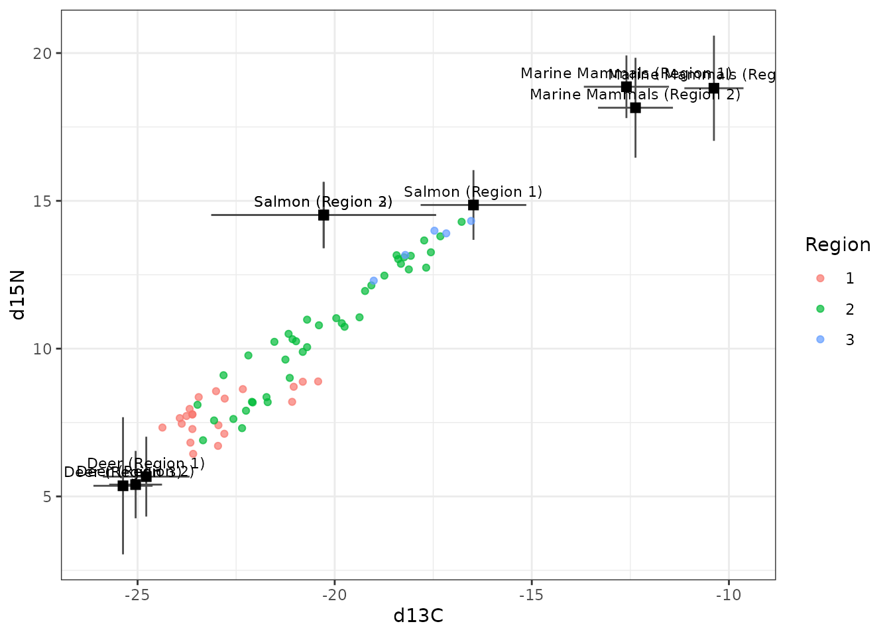
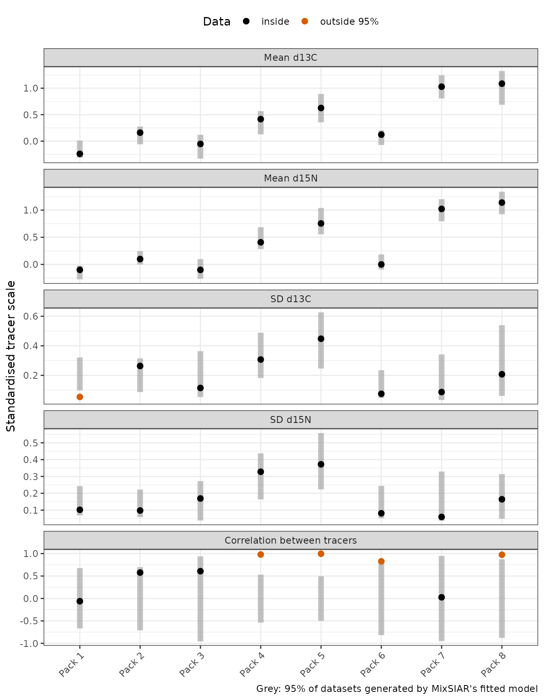

# Wolves: nested random effects, sources by region

This follows MixSIAR’s wolves example (Semmens et al. 2009 data, as
analysed in Stock et al. 2018): 66 wolves from 8 packs in 3 regions,
whose diet is a mix of deer, marine mammals and salmon, measured with
two tracers (δ¹³C and δ¹⁵N). Pack is a random effect nested within the
random effect Region, and the sources’ isotope values were measured
separately in each region. The model and data are exactly as in
MixSIAR’s vignette; only the fitting call changes,
[`run_pfn()`](https://andrewcparnell.github.io/MixSIARPFN/reference/run_pfn.md)
in place of `write_JAGS_model()` and `run_model()`.

## The data

``` r
mix <- load_mix_data(
  filename = system.file("extdata", "wolves_consumer.csv", package = "MixSIARPFN"),
  iso_names = c("d13C", "d15N"), factors = c("Region", "Pack"),
  fac_random = c(TRUE, TRUE), fac_nested = c(FALSE, TRUE), cont_effects = NULL)
source <- load_source_data(
  filename = system.file("extdata", "wolves_sources.csv", package = "MixSIARPFN"),
  source_factors = "Region", conc_dep = FALSE, data_type = "means", mix)
discr <- load_discr_data(
  filename = system.file("extdata", "wolves_discrimination.csv", package = "MixSIARPFN"),
  mix)
mix
#> Consumer data: 66 consumers, 2 tracer(s): d13C, d15N 
#>    Random effect Region with 3 levels
#>    Random effect Pack with 8 levels
source
#> Source data: 3 sources: Deer, Marine Mammals, Salmon 
#>   Given by Region
```

The isospace plot shows the wolves, coloured by region, and each
source’s mean in each region after adding the discrimination factor,
with ±1 SD:

``` r
plot_data(mix = mix, source = source, discr = discr)
```



## Fitting the model

Residual \* Process error and MixSIAR’s uninformative prior, as in
MixSIAR’s vignette. The network for this error structure is downloaded
the first time it is needed (about 70 MB) and cached.

``` r
time <- system.time(
  fit <- run_pfn(mix, source, discr, alpha.prior = 1,
                 resid_err = TRUE, process_err = TRUE)
)
fit
#> MixSIARPFN fit (Residual * Process error), 3 sources, in 0.4 s
#> Marginal posteriors (no joint draws). Global diet:
#>          source  mean    sd  2.5% 97.5%
#>            Deer 0.463 0.197 0.089 0.829
#>  Marine Mammals 0.193 0.151 0.012 0.585
#>          Salmon 0.332 0.197 0.035 0.770
#> Use output_pfn() for every proportion and parameter.
```

The fit took 0.4 seconds.

## Results

[`output_pfn()`](https://andrewcparnell.github.io/MixSIARPFN/reference/output_pfn.md)
takes MixSIAR’s `output_options` list. It prints the summary statistics,
with MixSIAR’s row names, and draws a posterior density plot for the
global diet, each effect and each parameter (here shown, not saved):

``` r
out <- output_pfn(fit, mix, source,
                  output_options = list(summary_save = FALSE, plot_post_save_pdf = FALSE))
```

``` r
knitr::kable(round(summary_table(fit), 3))
```

|                           |  Mean |    SD |  2.5% |    5% |   25% |   50% |   75% |   95% | 97.5% |
|:--------------------------|------:|------:|------:|------:|------:|------:|------:|------:|------:|
| Epsilon.1                 | 0.910 | 0.494 | 0.291 | 0.347 | 0.582 | 0.815 | 1.128 | 1.776 | 2.067 |
| Epsilon.2                 | 0.536 | 0.285 | 0.218 | 0.249 | 0.367 | 0.483 | 0.642 | 0.986 | 1.143 |
| Region.SD                 | 1.981 | 2.181 | 0.116 | 0.213 | 0.771 | 1.380 | 2.357 | 5.775 | 8.104 |
| Pack.SD                   | 0.950 | 0.738 | 0.349 | 0.397 | 0.588 | 0.788 | 1.095 | 1.939 | 2.442 |
| p.global.Deer             | 0.463 | 0.197 | 0.089 | 0.132 | 0.317 | 0.467 | 0.610 | 0.782 | 0.829 |
| p.global.Marine Mammals   | 0.193 | 0.151 | 0.012 | 0.021 | 0.080 | 0.156 | 0.267 | 0.497 | 0.585 |
| p.global.Salmon           | 0.332 | 0.197 | 0.035 | 0.057 | 0.178 | 0.305 | 0.461 | 0.700 | 0.770 |
| p.Region 1.Deer           | 0.756 | 0.154 | 0.321 | 0.447 | 0.699 | 0.789 | 0.856 | 0.934 | 0.955 |
| p.Region 1.Marine Mammals | 0.096 | 0.087 | 0.000 | 0.002 | 0.032 | 0.077 | 0.135 | 0.253 | 0.309 |
| p.Region 1.Salmon         | 0.174 | 0.119 | 0.005 | 0.016 | 0.090 | 0.157 | 0.235 | 0.389 | 0.458 |
| p.Region 2.Deer           | 0.498 | 0.153 | 0.179 | 0.237 | 0.400 | 0.502 | 0.601 | 0.741 | 0.787 |
| p.Region 2.Marine Mammals | 0.163 | 0.128 | 0.000 | 0.001 | 0.059 | 0.143 | 0.242 | 0.399 | 0.456 |
| p.Region 2.Salmon         | 0.430 | 0.207 | 0.044 | 0.090 | 0.281 | 0.425 | 0.576 | 0.781 | 0.840 |
| p.Region 3.Deer           | 0.293 | 0.209 | 0.000 | 0.005 | 0.125 | 0.268 | 0.427 | 0.679 | 0.763 |
| p.Region 3.Marine Mammals | 0.238 | 0.194 | 0.000 | 0.002 | 0.078 | 0.200 | 0.356 | 0.609 | 0.694 |
| p.Region 3.Salmon         | 0.367 | 0.279 | 0.002 | 0.011 | 0.130 | 0.310 | 0.564 | 0.911 | 0.970 |
| p.Pack 1.Deer             | 0.854 | 0.043 | 0.765 | 0.781 | 0.827 | 0.855 | 0.883 | 0.920 | 0.932 |
| p.Pack 1.Marine Mammals   | 0.053 | 0.043 | 0.000 | 0.001 | 0.014 | 0.045 | 0.085 | 0.130 | 0.143 |
| p.Pack 1.Salmon           | 0.104 | 0.059 | 0.002 | 0.006 | 0.057 | 0.106 | 0.147 | 0.199 | 0.215 |
| p.Pack 2.Deer             | 0.727 | 0.053 | 0.612 | 0.635 | 0.694 | 0.730 | 0.763 | 0.807 | 0.821 |
| p.Pack 2.Marine Mammals   | 0.097 | 0.074 | 0.000 | 0.001 | 0.025 | 0.091 | 0.159 | 0.219 | 0.235 |
| p.Pack 2.Salmon           | 0.218 | 0.103 | 0.004 | 0.014 | 0.151 | 0.242 | 0.295 | 0.353 | 0.371 |
| p.Pack 3.Deer             | 0.823 | 0.051 | 0.720 | 0.739 | 0.791 | 0.824 | 0.856 | 0.903 | 0.918 |
| p.Pack 3.Marine Mammals   | 0.073 | 0.053 | 0.000 | 0.001 | 0.024 | 0.070 | 0.113 | 0.162 | 0.177 |
| p.Pack 3.Salmon           | 0.142 | 0.071 | 0.005 | 0.015 | 0.092 | 0.147 | 0.194 | 0.253 | 0.272 |
| p.Pack 4.Deer             | 0.479 | 0.087 | 0.308 | 0.337 | 0.422 | 0.480 | 0.538 | 0.620 | 0.646 |
| p.Pack 4.Marine Mammals   | 0.085 | 0.096 | 0.000 | 0.000 | 0.010 | 0.045 | 0.130 | 0.297 | 0.334 |
| p.Pack 4.Salmon           | 0.476 | 0.157 | 0.061 | 0.179 | 0.396 | 0.487 | 0.574 | 0.707 | 0.760 |
| p.Pack 5.Deer             | 0.319 | 0.110 | 0.090 | 0.136 | 0.247 | 0.321 | 0.394 | 0.496 | 0.527 |
| p.Pack 5.Marine Mammals   | 0.104 | 0.117 | 0.000 | 0.000 | 0.013 | 0.058 | 0.157 | 0.361 | 0.410 |
| p.Pack 5.Salmon           | 0.663 | 0.169 | 0.196 | 0.368 | 0.582 | 0.682 | 0.771 | 0.896 | 0.945 |
| p.Pack 6.Deer             | 0.726 | 0.052 | 0.615 | 0.639 | 0.697 | 0.730 | 0.760 | 0.802 | 0.815 |
| p.Pack 6.Marine Mammals   | 0.126 | 0.078 | 0.001 | 0.003 | 0.054 | 0.138 | 0.191 | 0.240 | 0.255 |
| p.Pack 6.Salmon           | 0.176 | 0.109 | 0.002 | 0.008 | 0.086 | 0.176 | 0.256 | 0.354 | 0.384 |
| p.Pack 7.Deer             | 0.316 | 0.111 | 0.056 | 0.107 | 0.247 | 0.330 | 0.396 | 0.473 | 0.497 |
| p.Pack 7.Marine Mammals   | 0.384 | 0.189 | 0.001 | 0.005 | 0.263 | 0.445 | 0.530 | 0.603 | 0.623 |
| p.Pack 7.Salmon           | 0.361 | 0.296 | 0.001 | 0.005 | 0.099 | 0.289 | 0.589 | 0.921 | 0.975 |
| p.Pack 8.Deer             | 0.199 | 0.126 | 0.000 | 0.004 | 0.099 | 0.191 | 0.292 | 0.416 | 0.449 |
| p.Pack 8.Marine Mammals   | 0.283 | 0.178 | 0.000 | 0.001 | 0.127 | 0.302 | 0.438 | 0.537 | 0.561 |
| p.Pack 8.Salmon           | 0.448 | 0.307 | 0.003 | 0.012 | 0.171 | 0.424 | 0.708 | 0.965 | 0.992 |

``` r
out$plots$global
```


``` r
out$plots$Region
```


``` r
out$plots$Pack
```


``` r
out$plots$Region.SD
out$plots$Pack.SD
```


Each of these is a **marginal** posterior. The network gives each
proportion’s posterior on its own, not joint draws, so the marginal
means of one diet need not sum to exactly 1, and sums, differences or
ratios of proportions cannot be computed from the output.

## Comparison with MixSIAR

``` r
ref <- mixsiar_reference("wolves")
cmp <- compare_mixsiar(fit, ref$draws, ref$summary)
```

MixSIAR 3.1.12 fitted the same model with 3 chains of 3,000,000
iterations (burn-in 1,500,000, thinned by 500), a run of about 6.3 hours
that was needed for the Region SD to converge (largest Gelman-Rubin
diagnostic 1.012). MixSIARPFN took 0.4 seconds.

The table gives both posteriors’ means, SDs and 95% intervals, and the
Wasserstein-1 distance between them (W1: how far, on average, one
posterior’s mass has to move to match the other, on the proportion
scale; MixSIAR’s draws for the SDs and residual multipliers were not
saved, so those rows have no W1):

``` r
show <- transform(cmp, `MixSIARPFN 95% CI` = sprintf("%.2f to %.2f", pfn_q2.5, pfn_q97.5),
                  `MixSIAR 95% CI` = sprintf("%.2f to %.2f", mixsiar_q2.5, mixsiar_q97.5),
                  check.names = FALSE)
knitr::kable(data.frame(
  quantity = show$name,
  `MixSIARPFN mean` = round(show$pfn_mean, 3), `MixSIAR mean` = round(show$mixsiar_mean, 3),
  `MixSIARPFN SD` = round(show$pfn_sd, 3), `MixSIAR SD` = round(show$mixsiar_sd, 3),
  show[c("MixSIARPFN 95% CI", "MixSIAR 95% CI")], W1 = round(show$w1, 3),
  check.names = FALSE))
```

| quantity | MixSIARPFN mean | MixSIAR mean | MixSIARPFN SD | MixSIAR SD | MixSIARPFN 95% CI | MixSIAR 95% CI | W1 |
|:---|---:|---:|---:|---:|:---|:---|---:|
| Region.SD | 1.981 | 1.147 | 2.181 | 1.212 | 0.12 to 8.10 | 0.05 to 4.15 | NA |
| Pack.SD | 0.950 | 1.299 | 0.738 | 0.626 | 0.35 to 2.44 | 0.56 to 2.78 | NA |
| Epsilon.1 | 0.910 | 1.042 | 0.494 | 0.380 | 0.29 to 2.07 | 0.48 to 1.95 | NA |
| Epsilon.2 | 0.536 | 0.465 | 0.285 | 0.189 | 0.22 to 1.14 | 0.21 to 0.93 | NA |
| p.global.Deer | 0.463 | 0.522 | 0.197 | 0.178 | 0.09 to 0.83 | 0.14 to 0.83 | 0.059 |
| p.global.Marine Mammals | 0.193 | 0.209 | 0.151 | 0.143 | 0.01 to 0.58 | 0.03 to 0.59 | 0.018 |
| p.global.Salmon | 0.332 | 0.268 | 0.197 | 0.161 | 0.03 to 0.77 | 0.04 to 0.67 | 0.065 |
| p.Region 1.Deer | 0.756 | 0.700 | 0.154 | 0.159 | 0.32 to 0.96 | 0.34 to 0.94 | 0.060 |
| p.Region 1.Marine Mammals | 0.096 | 0.117 | 0.087 | 0.101 | 0.00 to 0.31 | 0.00 to 0.39 | 0.022 |
| p.Region 1.Salmon | 0.174 | 0.183 | 0.119 | 0.140 | 0.01 to 0.46 | 0.00 to 0.52 | 0.021 |
| p.Region 2.Deer | 0.498 | 0.551 | 0.153 | 0.159 | 0.18 to 0.79 | 0.23 to 0.87 | 0.053 |
| p.Region 2.Marine Mammals | 0.163 | 0.178 | 0.128 | 0.108 | 0.00 to 0.46 | 0.03 to 0.42 | 0.022 |
| p.Region 2.Salmon | 0.430 | 0.271 | 0.207 | 0.149 | 0.04 to 0.84 | 0.05 to 0.61 | 0.160 |
| p.Region 3.Deer | 0.293 | 0.432 | 0.209 | 0.222 | 0.00 to 0.76 | 0.02 to 0.86 | 0.139 |
| p.Region 3.Marine Mammals | 0.238 | 0.265 | 0.194 | 0.198 | 0.00 to 0.69 | 0.01 to 0.78 | 0.028 |
| p.Region 3.Salmon | 0.367 | 0.303 | 0.279 | 0.223 | 0.00 to 0.97 | 0.01 to 0.90 | 0.074 |
| p.Pack 1.Deer | 0.854 | 0.855 | 0.043 | 0.030 | 0.76 to 0.93 | 0.80 to 0.91 | 0.010 |
| p.Pack 1.Marine Mammals | 0.053 | 0.054 | 0.043 | 0.038 | 0.00 to 0.14 | 0.00 to 0.13 | 0.004 |
| p.Pack 1.Salmon | 0.104 | 0.092 | 0.059 | 0.056 | 0.00 to 0.22 | 0.00 to 0.19 | 0.012 |
| p.Pack 2.Deer | 0.727 | 0.732 | 0.053 | 0.041 | 0.61 to 0.82 | 0.65 to 0.80 | 0.009 |
| p.Pack 2.Marine Mammals | 0.097 | 0.099 | 0.074 | 0.074 | 0.00 to 0.24 | 0.00 to 0.22 | 0.004 |
| p.Pack 2.Salmon | 0.218 | 0.169 | 0.103 | 0.109 | 0.00 to 0.37 | 0.00 to 0.34 | 0.049 |
| p.Pack 3.Deer | 0.823 | 0.831 | 0.051 | 0.037 | 0.72 to 0.92 | 0.75 to 0.90 | 0.012 |
| p.Pack 3.Marine Mammals | 0.073 | 0.066 | 0.053 | 0.047 | 0.00 to 0.18 | 0.00 to 0.16 | 0.007 |
| p.Pack 3.Salmon | 0.142 | 0.104 | 0.071 | 0.067 | 0.00 to 0.27 | 0.00 to 0.23 | 0.039 |
| p.Pack 4.Deer | 0.479 | 0.461 | 0.087 | 0.051 | 0.31 to 0.65 | 0.36 to 0.55 | 0.032 |
| p.Pack 4.Marine Mammals | 0.085 | 0.067 | 0.096 | 0.052 | 0.00 to 0.33 | 0.00 to 0.19 | 0.031 |
| p.Pack 4.Salmon | 0.476 | 0.472 | 0.157 | 0.088 | 0.06 to 0.76 | 0.29 to 0.63 | 0.048 |
| p.Pack 5.Deer | 0.319 | 0.292 | 0.110 | 0.064 | 0.09 to 0.53 | 0.16 to 0.41 | 0.042 |
| p.Pack 5.Marine Mammals | 0.104 | 0.079 | 0.117 | 0.066 | 0.00 to 0.41 | 0.00 to 0.23 | 0.033 |
| p.Pack 5.Salmon | 0.663 | 0.629 | 0.169 | 0.111 | 0.20 to 0.95 | 0.39 to 0.82 | 0.057 |
| p.Pack 6.Deer | 0.726 | 0.751 | 0.052 | 0.030 | 0.61 to 0.82 | 0.69 to 0.80 | 0.027 |
| p.Pack 6.Marine Mammals | 0.126 | 0.170 | 0.078 | 0.042 | 0.00 to 0.25 | 0.06 to 0.23 | 0.049 |
| p.Pack 6.Salmon | 0.176 | 0.078 | 0.109 | 0.063 | 0.00 to 0.38 | 0.00 to 0.24 | 0.097 |
| p.Pack 7.Deer | 0.316 | 0.370 | 0.111 | 0.053 | 0.06 to 0.50 | 0.24 to 0.45 | 0.064 |
| p.Pack 7.Marine Mammals | 0.384 | 0.490 | 0.189 | 0.080 | 0.00 to 0.62 | 0.28 to 0.59 | 0.113 |
| p.Pack 7.Salmon | 0.361 | 0.140 | 0.296 | 0.121 | 0.00 to 0.97 | 0.01 to 0.45 | 0.222 |
| p.Pack 8.Deer | 0.199 | 0.286 | 0.126 | 0.099 | 0.00 to 0.45 | 0.02 to 0.46 | 0.088 |
| p.Pack 8.Marine Mammals | 0.283 | 0.374 | 0.178 | 0.129 | 0.00 to 0.56 | 0.00 to 0.54 | 0.095 |
| p.Pack 8.Salmon | 0.448 | 0.339 | 0.307 | 0.219 | 0.00 to 0.99 | 0.02 to 0.96 | 0.132 |

The posterior densities side by side, for the global diet, the regions
and the packs:

``` r
plot_compare(fit, ref$draws, block = "global")
```


``` r
plot_compare(fit, ref$draws, block = "Region")
```


``` r
plot_compare(fit, ref$draws, block = "Pack")
```


And every proportion’s posterior mean and SD against MixSIAR’s:

``` r
plot_compare(fit, ref$draws, type = "means")
```


**What this shows.** For the global and region diets, MixSIARPFN’s
posterior means differ from MixSIAR’s by 0.05 and 0.06 on average,
against MixSIAR posterior SDs of about 0.16 and 0.16, and its posteriors
are a little wider (median SD ratio 1.11 and 0.97). The pack diets
differ more. Most pack means are close (median difference 0.03), but
MixSIARPFN’s pack posteriors are wider (median SD ratio 1.48) and a few
means are further off, the largest being Pack 7.Salmon (0.36 against
0.14). The Region and Pack SDs and the residual multipliers are also
wider. For a dataset like this, with many small levels, MixSIARPFN gives
a quick first answer, and a MixSIAR run is the more precise one when
time allows.

## Does MixSIAR’s model fit these data?

The comparison above takes MixSIAR as the reference. That is fair only
where MixSIAR’s model describes the data, which a posterior predictive
check can test: MixSIAR’s fitted model generates new datasets, one per
posterior draw, and the real data are compared with them pack by pack.
MixSIARPFN gives marginal posteriors only, so it cannot run this check
itself; the results come from a separate MixSIAR run with the same model
and data, shipped with the package (`mixsiar_reference("wolves")$ppc`).
For each pack, the plot shows each tracer’s mean and SD and the
correlation between the tracers, on the standardised scale MixSIAR’s
model uses:



5 of the 40 pack statistics fall outside the 95% range of the model’s
datasets (4 outside 99%). For six datasets simulated from MixSIAR’s own
model with the same design the count is 0 to 2 (about 2 are expected by
chance). The clearest failure is the correlation between δ¹³C and δ¹⁵N
within packs: Pack 4 0.98, Pack 5 1.00, Pack 6 0.83, Pack 8 0.97, where
the model’s datasets give about 0. The wolves of these packs lie on a
line in isospace, which is what wolves eating different mixes of the
same prey would produce. MixSIAR’s model has no diet variation between
the wolves of a pack, so it can only treat that spread as residual
error. The checks on the whole dataset (each tracer’s mean, SD and
range, and the total log-likelihood) pass, so MixSIAR’s usual output
would not show this.

Where the model does not fit, MixSIAR’s posterior is not a correct
answer for MixSIARPFN to match, and the two can differ more. Here the
two fits differ most in the packs that fail the check, and in pack 7,
whose four wolves are too few for the check to say much (the model’s
datasets give its correlation anywhere from about -0.95 to 0.95):

| Pack   | Statistics outside 95% (of 5) | Mean W1, MixSIARPFN against MixSIAR |
|:-------|------------------------------:|------------------------------------:|
| Pack 1 |                             1 |                               0.009 |
| Pack 2 |                             0 |                               0.021 |
| Pack 3 |                             0 |                               0.019 |
| Pack 4 |                             1 |                               0.037 |
| Pack 5 |                             1 |                               0.044 |
| Pack 6 |                             1 |                               0.058 |
| Pack 7 |                             0 |                               0.133 |
| Pack 8 |                             1 |                               0.105 |

The mean W1 is 0.061 for the packs whose tracers are strongly
correlated, against 0.016 for packs 1, 2, 3. On data like these, the
differences between MixSIARPFN and MixSIAR say as much about the model
as about either method: both are fitting a model that leaves out
structure the data show.
